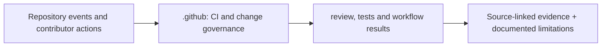

# `.github/` — CLARION folder guide

<!-- CLARION:AUTOGENERATED_FOLDER_GUIDE_BEGIN -->
## Maintainer technical guide — current source tree

> This section is **generated from tracked files** and intentionally preserves the earlier architecture/blueprint notes above. The file index describes the current repository, not a hypothetical implementation. See [source-wide coverage audit](../docs/architecture/FEATURE_IMPLEMENTATION_AUDIT.md).

### Guide contents
1. [Purpose and actual status](#purpose-and-actual-status-.github)
2. [Files directly in this folder](#files-directly-in-this-folder-.github)
3. [Child modules and navigation](#child-modules-and-navigation-.github)
4. [Technical architecture diagram](#technical-architecture-diagram-.github)
5. [Tech stack and interfaces](#tech-stack-and-interfaces-.github)
6. [Validation and work remaining](#validation-and-work-remaining-.github)

### Purpose and actual status (.github)
**Path:** `.github/`  
**Responsibility:** CI and change governance.  
**Consumes:** Repository events and contributor actions.  
**Produces:** review, tests and workflow results.  
**Current direct-file inventory:** Specification or guide: 2.

**Important:** Status is assessed per file; an architectural contract does not prove executable implementation. In particular, CLARION's core running code is primarily `src/clarion/application/engine.py`, `src/clarion/application/training_demo.py`, `src/clarion/api/main.py` and `src/clarion/v4/`, with the React screens in `frontend/src/app/App.tsx`. Other files may be placeholders.

### Files directly in this folder (.github)
| Entry | Technical responsibility | State |
|---|---|---|
| [`ARCHITECTURE.md`](ARCHITECTURE.md) | .github/ — Architecture contract (GitHub automation) | Specification or guide |
| [`pull_request_template.md`](pull_request_template.md) | pull_request_template.md — planned content | Specification or guide |

### Child modules and navigation (.github)
- [`ISSUE_TEMPLATE/`](./ISSUE_TEMPLATE/README.md) — Consistent research and implementation issue intake.
- [`workflows/`](./workflows/README.md) — Install dependencies and check code, UI, offline security and synthetic data.

### Technical architecture diagram (.github)

### Tech stack and interfaces (.github)
**Technologies:** GitHub Actions YAML, Python/Pytest/Ruff, Node/Vite verification as configured.

**Input boundary:** Repository events and contributor actions.  
**Output boundary:** review, tests and workflow results.  
**Causal/evidence invariants:** Preserve source SHA-256, UTC `event_time` and `available_at`, explicit score type and `ABSTAIN` when required. Observed relay TXIDs never establish transaction origin or wallet ownership; candidate entity links are not confirmed identity; Country is non-scoring context.

**System contracts:** [original §0–§12 specification](../docs/architecture/architecture-v4-spec.md) · [implemented versus planned matrix](../docs/architecture/FEATURE_IMPLEMENTATION_AUDIT.md) · [canonical schemas and pipeline](../docs/development/V4_PIPELINES_AND_SCHEMAS.md).

### Validation and work remaining (.github)
- **Required gate:** Passing baseline CI is not a substitute for v4 or real-data checks.
- Verify the exact entrypoint and source file before using a planned module; avoid importing comment-only blueprints.
- For executable changes run affected Python/TypeScript tests, offline checks and canonical synthetic smoke validation. Real-data ML calibration, service negative controls and SIH capture semantics still need independent evidence.
- Record new inputs/outputs, schema versions and proven tests in this README; rerun `python scripts/docs/generate_folder_readmes.py --write` to refresh its indexed section.

<!-- CLARION:AUTOGENERATED_FOLDER_GUIDE_END -->
