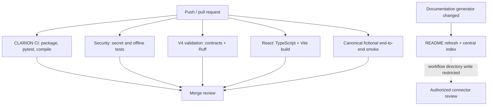

# .github/workflows/ — Architecture contract

> **Documentation-only scaffold.** No module functionality is implemented. Follow the original v4 specification and root README; file stubs are comments describing future work.

## Responsibility
Future CI/CD validation; no workflow is activated in the architecture-only scaffold.

## Phase ownership
P1/P5

## Planned files and their exact responsibilities

| File | What must be written during implementation |
|---|---|
| **ci.yml** | TODO: Python lint, typing, tests, data contract tests and frontend checks with pinned actions. |
| **security.yml** | TODO: dependency checks, secret detection, SBOM and license policy. |

## Data/interfaces
**Inputs:** See parent modules and the architecture specification.

**Outputs:** Versioned artifacts or typed interfaces; no implementation exists yet.

## Security, testing and acceptance
Require executable tests, provenance and review before marking complete.

For all modules: preserve provenance, causal availability, explicit uncertainty/abstention, offline operation, real tests and realistic false-positive controls. Record status in docs/progress before claiming completion.

## Implementation handoff
Do not add executable logic before the assigned phase PR; update this README when actual public interfaces, dependencies and tests are verified.

<!-- CLARION:AUTOGENERATED_FOLDER_GUIDE_BEGIN -->
## Maintainer technical guide — current workflows

> This current guide **supersedes the older architecture-only note above**, which predates the actual implementation and is preserved for history. This folder contains *active* GitHub Actions. For full project folder navigation see [the README index](../../docs/FOLDER_README_INDEX.md).

### Contents
1. [Workflow inventory](#workflow-inventory)
2. [CI dependency diagram](#ci-dependency-diagram)
3. [Tech stack, inputs and outputs](#tech-stack-inputs-and-outputs)
4. [Operational safety and verification](#operational-safety-and-verification)

### Workflow inventory

| Entry | Responsibility and trigger | State |
|---|---|---|
| [`ci.yml`](ci.yml) | Python 3.11 packaging, full tests and compileall on push/PR | Active baseline |
| [`security.yml`](security.yml) | Obvious secret-pattern scan and offline socket unit checks on push/PR | Active narrow security check |
| [`demo.yml`](demo.yml) | Generate/train/investigate fictional transactions, verify demo tests | Active synthetic CI |
| [`v4-manual-review.yml`](v4-manual-review.yml) | Python v4 contracts and Ruff, React TS/Vite, canonical source-to-score smoke test | Active v4 validation |
| [`folder-readme-generator.yml`](folder-readme-generator.yml) | Deterministically generate per-folder guides on the documentation branch; restricted token excludes this workflow README from automated commits | Active docs automation |

### CI dependency diagram

### Tech stack, inputs and outputs

**Inputs:** GitHub refs and checked-out tracked code (no live sensitive dataset is supplied to CI). **Outputs:** job checks and logs. **Libraries:** GitHub Actions, Python 3.11/3.12, Pytest, Ruff, Pydantic, scikit-learn, Node 22, React/TypeScript, Vite. Pin actions/dependency lockfiles during release hardening.

The v4 smoke test verifies fictional data flow; it is *not* evidence of a production accuracy threshold. Network-relay observations must never imply wallet identity. `GITHUB_TOKEN` in the generator has write scope only for documentation commits on the dedicated documentation branch, and its inability to modify workflow-directory files is respected.

### Operational safety and verification

- Only merge when required checks complete and pass; inspect exact SHA and check suites.
- Treat unapproved workflows and dependency installation as supply-chain risks; lock versions and avoid exposing API secrets.
- For future docs refresh use `python scripts/docs/generate_folder_readmes.py --write` locally, inspect the diff and open a PR.
- **Implementation audit:** [What is actually covered](../../docs/architecture/FEATURE_IMPLEMENTATION_AUDIT.md).
<!-- CLARION:AUTOGENERATED_FOLDER_GUIDE_END -->
