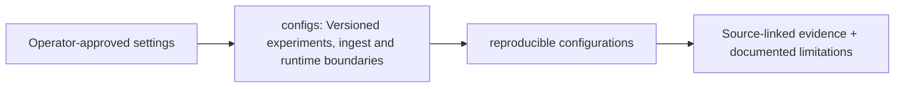

# configs/ — Architecture contract

> **Documentation-only scaffold.** No module functionality is implemented. Follow the original v4 specification and root README; file stubs are comments describing future work.

## Responsibility
Version-controlled configuration schemas and profiles. No credentials or runtime config secrets.

## Phase ownership
P1

## Planned files and their exact responsibilities

| File | What must be written during implementation |
|---|---|
| **README.md.template** | TODO: document resolution order: defaults -> file -> environment -> CLI; no silent overrides. |

## Data/interfaces
**Inputs:** See parent modules and the architecture specification.

**Outputs:** Versioned artifacts or typed interfaces; no implementation exists yet.

## Security, testing and acceptance
Require executable tests, provenance and review before marking complete.

For all modules: preserve provenance, causal availability, explicit uncertainty/abstention, offline operation, real tests and realistic false-positive controls. Record status in docs/progress before claiming completion.

## Implementation handoff
Do not add executable logic before the assigned phase PR; update this README when actual public interfaces, dependencies and tests are verified.

<!-- CLARION:AUTOGENERATED_FOLDER_GUIDE_BEGIN -->
## Maintainer technical guide — current source tree

> This section is **generated from tracked files** and intentionally preserves the earlier architecture/blueprint notes above. The file index describes the current repository, not a hypothetical implementation. See [source-wide coverage audit](../docs/architecture/FEATURE_IMPLEMENTATION_AUDIT.md).

### Guide contents
1. [Purpose and actual status](#purpose-and-actual-status-configs)
2. [Files directly in this folder](#files-directly-in-this-folder-configs)
3. [Child modules and navigation](#child-modules-and-navigation-configs)
4. [Technical architecture diagram](#technical-architecture-diagram-configs)
5. [Tech stack and interfaces](#tech-stack-and-interfaces-configs)
6. [Validation and work remaining](#validation-and-work-remaining-configs)

### Purpose and actual status (configs)
**Path:** `configs/`  
**Responsibility:** Versioned experiments, ingest and runtime boundaries.  
**Consumes:** Operator-approved settings.  
**Produces:** reproducible configurations.  
**Current direct-file inventory:** Source asset / fixture: 1.

**Important:** Status is assessed per file; an architectural contract does not prove executable implementation. In particular, CLARION's core running code is primarily `src/clarion/application/engine.py`, `src/clarion/application/training_demo.py`, `src/clarion/api/main.py` and `src/clarion/v4/`, with the React screens in `frontend/src/app/App.tsx`. Other files may be placeholders.

### Files directly in this folder (configs)
| Entry | Technical responsibility | State |
|---|---|---|
| [`README.md.template`](README.md.template) | Versioned resource | Source asset / fixture |

### Child modules and navigation (configs)
- [`ingestion/`](./ingestion/README.md) — Explicit column mapping and quality gates.
- [`models/`](./models/README.md) — Configurable ML, MCER and graph training settings.
- [`profiles/`](./profiles/README.md) — Offline, synthetic and production profiles.
- [`security/`](./security/README.md) — Local access, redaction and parsing constraints.

### Technical architecture diagram (configs)

### Tech stack and interfaces (configs)
**Technologies:** Markdown, Mermaid and versioned JSON/YAML/configuration where present; execution lives in linked code directories.

**Input boundary:** Operator-approved settings.  
**Output boundary:** reproducible configurations.  
**Causal/evidence invariants:** Preserve source SHA-256, UTC `event_time` and `available_at`, explicit score type and `ABSTAIN` when required. Observed relay TXIDs never establish transaction origin or wallet ownership; candidate entity links are not confirmed identity; Country is non-scoring context.

**System contracts:** [original §0–§12 specification](../docs/architecture/architecture-v4-spec.md) · [implemented versus planned matrix](../docs/architecture/FEATURE_IMPLEMENTATION_AUDIT.md) · [canonical schemas and pipeline](../docs/development/V4_PIPELINES_AND_SCHEMAS.md).

### Validation and work remaining (configs)
- **Required gate:** Blueprint values are not automatically wired into every runtime.
- Verify the exact entrypoint and source file before using a planned module; avoid importing comment-only blueprints.
- For executable changes run affected Python/TypeScript tests, offline checks and canonical synthetic smoke validation. Real-data ML calibration, service negative controls and SIH capture semantics still need independent evidence.
- Record new inputs/outputs, schema versions and proven tests in this README; rerun `python scripts/docs/generate_folder_readmes.py --write` to refresh its indexed section.

<!-- CLARION:AUTOGENERATED_FOLDER_GUIDE_END -->
