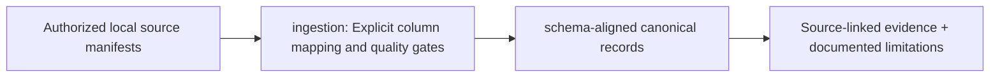

# `configs/ingestion/` — CLARION folder guide

<!-- CLARION:AUTOGENERATED_FOLDER_GUIDE_BEGIN -->
## Maintainer technical guide — current source tree

> This section is **generated from tracked files** and intentionally preserves the earlier architecture/blueprint notes above. The file index describes the current repository, not a hypothetical implementation. See [source-wide coverage audit](../../docs/architecture/FEATURE_IMPLEMENTATION_AUDIT.md).

### Guide contents
1. [Purpose and actual status](#purpose-and-actual-status-ingestion)
2. [Files directly in this folder](#files-directly-in-this-folder-ingestion)
3. [Child modules and navigation](#child-modules-and-navigation-ingestion)
4. [Technical architecture diagram](#technical-architecture-diagram-ingestion)
5. [Tech stack and interfaces](#tech-stack-and-interfaces-ingestion)
6. [Validation and work remaining](#validation-and-work-remaining-ingestion)

### Purpose and actual status (ingestion)
**Path:** `configs/ingestion/`  
**Responsibility:** Explicit column mapping and quality gates.  
**Consumes:** Authorized local source manifests.  
**Produces:** schema-aligned canonical records.  
**Current direct-file inventory:** Executable source / config (validate): 1.

**Important:** Status is assessed per file; an architectural contract does not prove executable implementation. In particular, CLARION's core running code is primarily `src/clarion/application/engine.py`, `src/clarion/application/training_demo.py`, `src/clarion/api/main.py` and `src/clarion/v4/`, with the React screens in `frontend/src/app/App.tsx`. Other files may be placeholders.

### Files directly in this folder (ingestion)
| Entry | Technical responsibility | State |
|---|---|---|
| [`canonical.example.json`](canonical.example.json) | Typed data or metadata | Executable source / config (validate) |

### Child modules and navigation (ingestion)
No tracked child folders.

### Technical architecture diagram (ingestion)

### Tech stack and interfaces (ingestion)
**Technologies:** Markdown, Mermaid and versioned JSON/YAML/configuration where present; execution lives in linked code directories.

**Input boundary:** Authorized local source manifests.  
**Output boundary:** schema-aligned canonical records.  
**Causal/evidence invariants:** Preserve source SHA-256, UTC `event_time` and `available_at`, explicit score type and `ABSTAIN` when required. Observed relay TXIDs never establish transaction origin or wallet ownership; candidate entity links are not confirmed identity; Country is non-scoring context.

**System contracts:** [original §0–§12 specification](../../docs/architecture/architecture-v4-spec.md) · [implemented versus planned matrix](../../docs/architecture/FEATURE_IMPLEMENTATION_AUDIT.md) · [canonical schemas and pipeline](../../docs/development/V4_PIPELINES_AND_SCHEMAS.md).

### Validation and work remaining (ingestion)
- **Required gate:** Never infer unobserved TXID relays, owners, permissions or dataset columns.
- Verify the exact entrypoint and source file before using a planned module; avoid importing comment-only blueprints.
- For executable changes run affected Python/TypeScript tests, offline checks and canonical synthetic smoke validation. Real-data ML calibration, service negative controls and SIH capture semantics still need independent evidence.
- Record new inputs/outputs, schema versions and proven tests in this README; rerun `python scripts/docs/generate_folder_readmes.py --write` to refresh its indexed section.

<!-- CLARION:AUTOGENERATED_FOLDER_GUIDE_END -->
