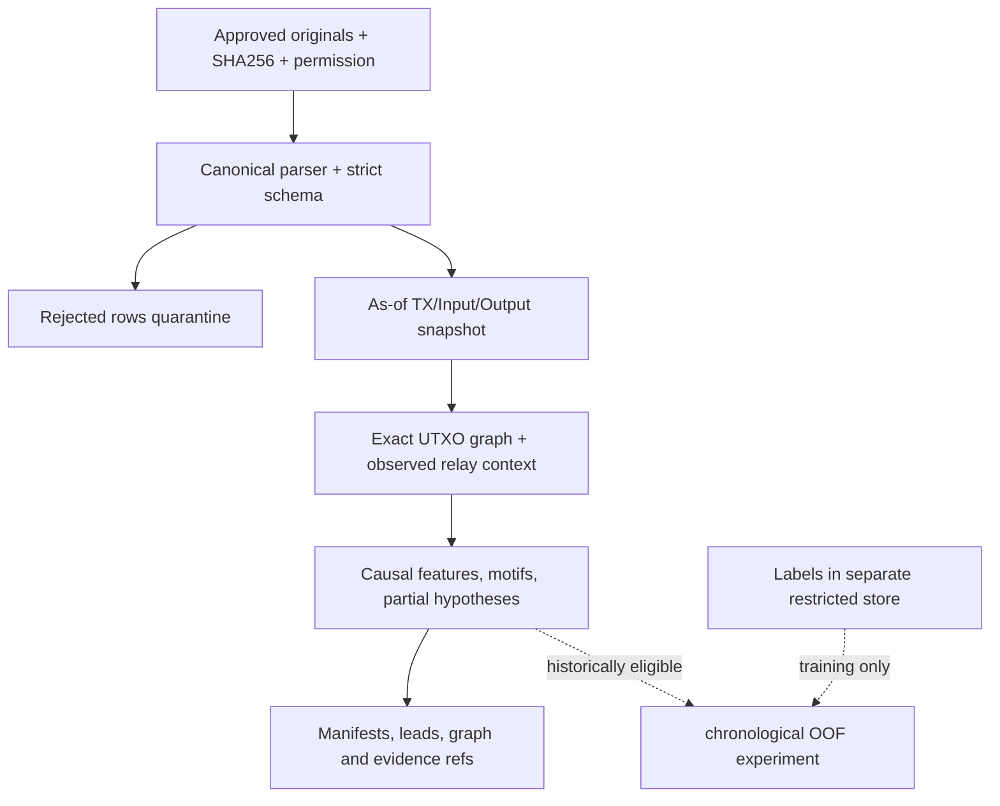
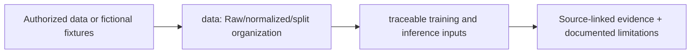

# data/ — Architecture contract

> **Documentation-only scaffold.** No module functionality is implemented. Follow the original v4 specification and root README; file stubs are comments describing future work.

## Responsibility
Dataset intake policy. Never commit private captures, external bulk files or licensed GeoIP databases.

## Phase ownership
P1/P5

## Planned files and their exact responsibilities

| File | What must be written during implementation |
|---|---|

## Data/interfaces
**Inputs:** See parent modules and the architecture specification.

**Outputs:** Versioned artifacts or typed interfaces; no implementation exists yet.

## Security, testing and acceptance
Require executable tests, provenance and review before marking complete.

For all modules: preserve provenance, causal availability, explicit uncertainty/abstention, offline operation, real tests and realistic false-positive controls. Record status in docs/progress before claiming completion.

## Implementation handoff
Do not add executable logic before the assigned phase PR; update this README when actual public interfaces, dependencies and tests are verified.

## Canonical evidence layout and reproducible data flow

The repository does **not** ship real SIH P2P captures, full Bitcoin chain state, institutional labels, or wallet/IP identities. Fictional fixtures are generated under a local output path on demand.

### Input table contract

| File | Essential fields | Role |
|---|---|---|
| `transactions.csv` | txid, event_time/time, available_at, fee_sats?, vbytes?, coinbase | UTC canonical transaction records |
| `inputs.csv` | txid, vin, prev_txid, prev_vout | Exact spending outpoint |
| `outputs.csv` | txid, vout, value_sats, address? | Script/value records, never guaranteed wallet owner |
| `observations.csv` | sensor_id, host, txid?, event_time, provenance, clock uncertainty | Observed Bitcoin relay only |
| `labels.csv` | subject_id, subject_type, label, available_at, definition | Separate supervised training; never inference |
| `truth_SYNTHETIC_ONLY.csv` | demo case and label | Synthetic generator ground truth **not** production evidence |

**Source hierarchy:** `data/external/` holds permissioned raw copies (do not commit sensitive files), `data/manifests/` documents legal origin/license/hash and `data/samples/` contains safe demonstrators. **Satoshi values are integers**; Bitcoin Core BTC decimal conversion uses Decimal. Cut every snapshot by `available_at`, not just event-time. For exact schemas see [data dictionary](../docs/data/data-dictionary.md) and [canonical v4 specification](../docs/development/V4_PIPELINES_AND_SCHEMAS.md).

<!-- CLARION:AUTOGENERATED_FOLDER_GUIDE_BEGIN -->
## Maintainer technical guide — current source tree

> This section is **generated from tracked files** and intentionally preserves the earlier architecture/blueprint notes above. The file index describes the current repository, not a hypothetical implementation. See [source-wide coverage audit](../docs/architecture/FEATURE_IMPLEMENTATION_AUDIT.md).

### Guide contents
1. [Purpose and actual status](#purpose-and-actual-status-data)
2. [Files directly in this folder](#files-directly-in-this-folder-data)
3. [Child modules and navigation](#child-modules-and-navigation-data)
4. [Technical architecture diagram](#technical-architecture-diagram-data)
5. [Tech stack and interfaces](#tech-stack-and-interfaces-data)
6. [Validation and work remaining](#validation-and-work-remaining-data)

### Purpose and actual status (data)
**Path:** `data/`  
**Responsibility:** Raw/normalized/split organization.  
**Consumes:** Authorized data or fictional fixtures.  
**Produces:** traceable training and inference inputs.  
**Current direct-file inventory:** No direct tracked non-README files; see child modules.

**Important:** Status is assessed per file; an architectural contract does not prove executable implementation. In particular, CLARION's core running code is primarily `src/clarion/application/engine.py`, `src/clarion/application/training_demo.py`, `src/clarion/api/main.py` and `src/clarion/v4/`, with the React screens in `frontend/src/app/App.tsx`. Other files may be placeholders.

### Files directly in this folder (data)
| Entry | Technical responsibility | State |
|---|---|---|
| *(none)* | Folder groups child modules / future files | — |

### Child modules and navigation (data)
- [`external/`](./external/README.md) — Keep original source immutable.
- [`manifests/`](./manifests/README.md) — Track provenance and source versions.
- [`samples/`](./samples/README.md) — Schema and pipeline teaching fixtures.

### Technical architecture diagram (data)

### Tech stack and interfaces (data)
**Technologies:** Markdown, Mermaid and versioned JSON/YAML/configuration where present; execution lives in linked code directories.

**Input boundary:** Authorized data or fictional fixtures.  
**Output boundary:** traceable training and inference inputs.  
**Causal/evidence invariants:** Preserve source SHA-256, UTC `event_time` and `available_at`, explicit score type and `ABSTAIN` when required. Observed relay TXIDs never establish transaction origin or wallet ownership; candidate entity links are not confirmed identity; Country is non-scoring context.

**System contracts:** [original §0–§12 specification](../docs/architecture/architecture-v4-spec.md) · [implemented versus planned matrix](../docs/architecture/FEATURE_IMPLEMENTATION_AUDIT.md) · [canonical schemas and pipeline](../docs/development/V4_PIPELINES_AND_SCHEMAS.md).

### Validation and work remaining (data)
- **Required gate:** Do not commit personal capture data or incorrectly reuse held-out labels.
- Verify the exact entrypoint and source file before using a planned module; avoid importing comment-only blueprints.
- For executable changes run affected Python/TypeScript tests, offline checks and canonical synthetic smoke validation. Real-data ML calibration, service negative controls and SIH capture semantics still need independent evidence.
- Record new inputs/outputs, schema versions and proven tests in this README; rerun `python scripts/docs/generate_folder_readmes.py --write` to refresh its indexed section.

<!-- CLARION:AUTOGENERATED_FOLDER_GUIDE_END -->
