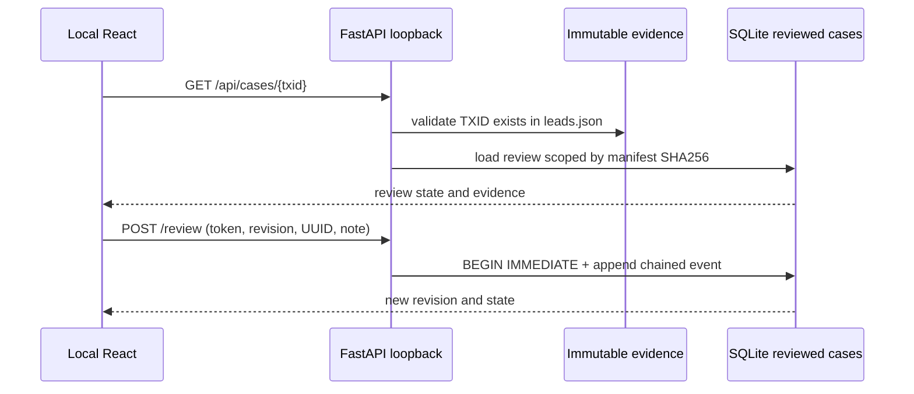

# CLARION localhost HTTP API — source contract

**Base URL:** `http://127.0.0.1:8000`. Read-only artifact routes plus optional authenticated local review writes. No public Internet deployment is supported.

## Routes

| Method | Path | Data | Auth |
|---|---|---|---|
| GET | `/` | bundled React assets / fallback local HTML | Loopback |
| GET | `/api/manifest` | current run manifest, source checksums and readiness | Loopback |
| GET | `/api/readiness` | independent chain/wire/labels evidence mode | Loopback |
| GET | `/api/provenance/verify` | compares local artifact SHA-256 against run manifest | Loopback |
| GET | `/api/leads?limit&offset` | backward compatible array | Loopback |
| GET | `/api/leads/query?q&priority&sort&limit&offset` | `{total,items}` bounded server query | Loopback |
| GET | `/api/graph` | full bounded run-graph JSON, legacy API | Loopback |
| GET | `/api/graph/neighborhood?txid&limit` | at most 500 nearby source-linked edges | Loopback |
| GET | `/api/motifs`, `/api/propagation`, `/api/entities`, `/api/features` | recorded evidence; no fabricated signal | Loopback |
| GET | `/api/cases` | persisted reviewed rows and review statuses | Loopback |
| GET | `/api/cases/{txid}` | `{lead,review}` | Loopback |
| GET | `/api/cases/{txid}/history` | append-only event history, latest first | Loopback |
| GET | `/api/cases/audit` | linked history verification state | Loopback |
| POST | `/api/cases/{txid}/review` | `{status,note,expected_revision,request_id}` | Configured local token |
| GET | `/api/health` | loopback service status | Loopback |

Write body example: `{"status":"IN_REVIEW","note":"Explain evidence and benign alternatives","expected_revision":0,"request_id":"550e8400-e29b-41d4-a716-446655440000"}`. Reusing `request_id` for a different payload is HTTP 409. Errors: 401 wrong token, 422 malformed input/TXID, 404 absent case, 409 stale revision/state, 503 writes disabled.

**Never** infer a Bitcoin address or controlling wallet from a relay host. Δ/Π absence is an abstention, not zero. Scores are prioritized review, not calibrated guilt estimates. The API does not offer general-purpose arbitrary file or SQL access.

## Request flow

