# CLARION — Current executable architecture (October 2026)

This describes **current code**, not simply the aspirational [v4 plan](architecture/architecture-v4-spec.md). For a 172-entry check, see [IMPLEMENTATION_CHECKLIST.md](IMPLEMENTATION_CHECKLIST.md).

## Contents
1. Data-plane and application flow
2. Architectural packages and contracts
3. Runtime profiles
4. Data/ML separation and scientific abstention
5. Security, database and deployment boundaries

### Connected architecture

```mermaid
flowchart LR
  A["Authorized local CSV / JSON / DTD-free XML"] --> B["ingest.py: bounded parser, source hash, quarantine"]
  B --> C["contracts.py: Tx / Input / Output / WireObservation"]
  C --> D["graph.py: UTC as-of directed UTXO graph"]
  C --> E["wire_sessions.py: observed relay only"]
  D --> F["features, motif candidates, MCER signed H1/H2 evidence"]
  E -. "contextual features; not ownership" .-> F
  F --> G["unsupervised novelty rank"]
  X["verified paired samples"] -. "Δ estimator or abstain" .-> G
  Y["verified same-goal baseline"] -. "Π ratios or abstain" .-> G
  G --> H["local priority first pass 0–75"]
  H --> I["frozen seed digest"]
  I --> J["UTXO spend-only propagation ≤6 hops, ≤25 points"]
  J --> K["case-lead priority ≤100"]
  K --> L["Immutable run JSON/CSV; source SHA-256"]
  L --> M["FastAPI 127.0.0.1 only"]
  M --> N["React terracotta/ivory investigator"]
  N --> O["Token-gated case review"]
  O --> P["SQLite: reviews, hash-linked events"]
  T["Labeled canonical evidence — separate"] --> U["chronological OOF baseline; safe JSON logistic artifact"]
  F -. "features time-frozen" .-> U
```

### Domain boundaries

| Subsystem | Active code and technology | Current limitations |
|---|---|---|
| Validation and contracts | `src/clarion/v4/contracts.py`, `ingest.py`, Pydantic, CSV/JSON, defusedxml | Provider-specific real SIH mapping requires actual source |
| Chain/wire | `graph.py`, `wire_sessions.py`; timestamped six-type graph, exact UTXO outpoints | No guaranteed transaction-origin identification; no full packet capture |
| Hypotheses and motifs | `mcer.py`, `motifs_extended.py`, `analysis.py` | Proposed identity groups need evidence calibration and legitimate negative controls |
| Graph/model | `representation.py`, `ml.py`, `model_artifact.py`; optional PyG, scikit-learn | Temporal heterogeneous GNN and calibrated real-world risk not completed |
| Δ and Π | `signals.py`: global CCA dependence gate / unit bearing same-goal ratios | Real paired networks and verified economic objectives unavailable; abstain |
| Propagation | `analysis.py`: immutable seed, causal value-only hop exposure, hard caps | Not the complete five-scoring-level MLRP research design |
| Offline persistence | JSON/Parquet/DuckDB evidence; SQLite local reviews in `case_store.py` | No external signed audit service or multi-user federation |
| API and frontend | `api/main.py`, `api/reviews.py`; React, Vite, typed client | Basic lead/neighborhood investigation; full temporal graph/heatmap still partial |
| CI and local packaging | GitHub Actions, Python pytest/Ruff, npm TypeScript/build, Linux loopback CLI | Docker/Compose, signed offline release, backup automation are incomplete |

### Separate pipelines

**Evidence inference:** imports approved canonical tables; labels are excluded. If no paired observations, run CHAIN_ONLY. If no independent ground truth, novelty ranks are unsupervised review priorities; probabilities are not asserted. Network host sightings cannot become address-owner edges.

**Model fitting:** opt-in `python scripts/train/train_json_baseline.py` and `python scripts/v4_pipeline.py train`; label availability, cutoff and heldout splits are logged. JSON-only experimental logistic artifacts carry fitted feature statistics, cutoff and SHA-256. Models are never loaded from pickle.

**Review state:** evidence stays immutable. Human decisions live in SQLite keyed by (TXID, exact run-manifest SHA256), with revisions, transition constraints, idempotency and hash-linked audit history. Missing `CLARION_REVIEW_TOKEN` disables writes; no hardcoded credential.

### Failure semantics

Invalid units/time/columns → validation error or quarantine. Missing input prevout → unresolved rather than fabricated. Missing Δ/Π premise → `ABSTAIN`. Invalid model checkpoint digest/feature order → inference error. No independent temporal holdout → supervised training refuses. Bad/oversized JSON → bounded API error. Case revision collision → HTTP 409. No review token → HTTP 503.

## Deployment envelope

Python 3.11–3.12, local Linux with optional CPU/GPU configured by operator. `clarion serve --run artifacts/v4_run --port 8000` binds to 127.0.0.1 only; Vite built assets are local, no remote CDN or telemetry. A publicly reachable server is **not supported** by this token-based local architecture. SQL backup and retention are environment-specific.

Related documentation: [API](API_SPECIFICATION.md), [database](DATABASE_DESIGN.md), [feature checklist](IMPLEMENTATION_CHECKLIST.md), [implementation decisions](IMPLEMENTATION_DECISIONS.md), [research audit](FINAL_FEATURE_AUDIT.md), [local steps](LOCAL_TESTING.md).
