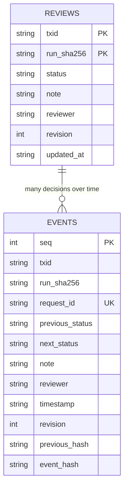

# CLARION persistent case reviews — schema 1

CLARION stores immutable run evidence separately from mutable human review state.

## Current persistence architecture

A review is scoped to the SHA-256 of `run_manifest.json` so changing source evidence creates a distinct review namespace. The case database is `<run_directory>/.clarion_reviews.sqlite3`. Core evidence `leads.json`, `graph.json`, and run hashes are never mutated by human review.

`src/clarion/v4/case_store.py` migrates schema 1 idempotently, uses `BEGIN IMMEDIATE`, optimistic `expected_revision`, strict state transitions, a unique request ID for idempotency, and a SHA-256 linked event ledger. Indexes support status and per-TXID review history. Hash linkage detects accidental or malicious modification when compared to the local chain, **not** externally witnessed or cryptographically signed proof.

Valid transitions: NEW→IN_REVIEW, IN_REVIEW→DISMISSED or ESCALATED, DISMISSED→IN_REVIEW, ESCALATED→IN_REVIEW. SQL CHECK blocks unknown states. Concurrent stale writes return HTTP 409. A transition requires an explanation. **Escalated is an analyst workflow state, not a criminal finding.**

### Security and retention

Writes require an explicit `CLARION_REVIEW_TOKEN` of at least 24 characters, in the `X-CLARION-REVIEW-TOKEN` header. If unconfigured, mutating endpoints return 503 (not an open default credential). The authenticated local reviewer identity comes from `CLARION_REVIEWER_ID`; token is not stored in review rows. The user must configure filesystem permissions, protected backups and an applicable retention plan before storing sensitive case notes. No real personal data or Bitcoin provider record is included in the repository.

### Migration and backup

Schema initialization is automatic when the loopback API is created. For safe backup, stop review writes and copy `.clarion_reviews.sqlite3` along with the immutable run-manifest and source hash manifests. SQLite user_version is checked and future schema versions refused. A production migration suite and signed external audit store still require deployment-specific engineering.
