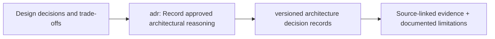

# Architecture decision records and open question resolutions

> **Design documentation only.** The original uploaded CLARION v4 PDF supplies blocks 0–12; linked implementation choices and status are proposed and not verified as code. The docs listed below replace earlier TODOs where indicated.

## Detailed contracts

- [Source-aligned evidence-first architecture proposal](ADR-001-offline-evidence-first.md)
- [Future formal ADR template](ADR-000-template.md)

## Key gates

Review the [source-to-requirement audit](../architecture/REQUIREMENTS_AUDIT.md) before asserting cross-layer, labeled or economic-cost feasibility. Honest chain-only/unsupervised/abstained outputs remain mandatory whenever sources do not support the proposed model.

<!-- CLARION:AUTOGENERATED_FOLDER_GUIDE_BEGIN -->
## Maintainer technical guide — current source tree

> This section is **generated from tracked files** and intentionally preserves the earlier architecture/blueprint notes above. The file index describes the current repository, not a hypothetical implementation. See [source-wide coverage audit](../../docs/architecture/FEATURE_IMPLEMENTATION_AUDIT.md).

### Guide contents
1. [Purpose and actual status](#purpose-and-actual-status-adr)
2. [Files directly in this folder](#files-directly-in-this-folder-adr)
3. [Child modules and navigation](#child-modules-and-navigation-adr)
4. [Technical architecture diagram](#technical-architecture-diagram-adr)
5. [Tech stack and interfaces](#tech-stack-and-interfaces-adr)
6. [Validation and work remaining](#validation-and-work-remaining-adr)

### Purpose and actual status (adr)
**Path:** `docs/adr/`  
**Responsibility:** Record approved architectural reasoning.  
**Consumes:** Design decisions and trade-offs.  
**Produces:** versioned architecture decision records.  
**Current direct-file inventory:** Specification or guide: 2.

**Important:** Status is assessed per file; an architectural contract does not prove executable implementation. In particular, CLARION's core running code is primarily `src/clarion/application/engine.py`, `src/clarion/application/training_demo.py`, `src/clarion/api/main.py` and `src/clarion/v4/`, with the React screens in `frontend/src/app/App.tsx`. Other files may be placeholders.

### Files directly in this folder (adr)
| Entry | Technical responsibility | State |
|---|---|---|
| [`ADR-000-template.md`](ADR-000-template.md) | ADR-000-template.md — planned content | Specification or guide |
| [`ADR-001-offline-evidence-first.md`](ADR-001-offline-evidence-first.md) | ADR-001 — Offline, evidence-first and uncertainty-preserving architecture | Specification or guide |

### Child modules and navigation (adr)
No tracked child folders.

### Technical architecture diagram (adr)

### Tech stack and interfaces (adr)
**Technologies:** Markdown, Mermaid and versioned JSON/YAML/configuration where present; execution lives in linked code directories.

**Input boundary:** Design decisions and trade-offs.  
**Output boundary:** versioned architecture decision records.  
**Causal/evidence invariants:** Preserve source SHA-256, UTC `event_time` and `available_at`, explicit score type and `ABSTAIN` when required. Observed relay TXIDs never establish transaction origin or wallet ownership; candidate entity links are not confirmed identity; Country is non-scoring context.

**System contracts:** [original §0–§12 specification](../../docs/architecture/architecture-v4-spec.md) · [implemented versus planned matrix](../../docs/architecture/FEATURE_IMPLEMENTATION_AUDIT.md) · [canonical schemas and pipeline](../../docs/development/V4_PIPELINES_AND_SCHEMAS.md).

### Validation and work remaining (adr)
- **Required gate:** Proposals and adopted decisions must be distinguishable.
- Verify the exact entrypoint and source file before using a planned module; avoid importing comment-only blueprints.
- For executable changes run affected Python/TypeScript tests, offline checks and canonical synthetic smoke validation. Real-data ML calibration, service negative controls and SIH capture semantics still need independent evidence.
- Record new inputs/outputs, schema versions and proven tests in this README; rerun `python scripts/docs/generate_folder_readmes.py --write` to refresh its indexed section.

<!-- CLARION:AUTOGENERATED_FOLDER_GUIDE_END -->
