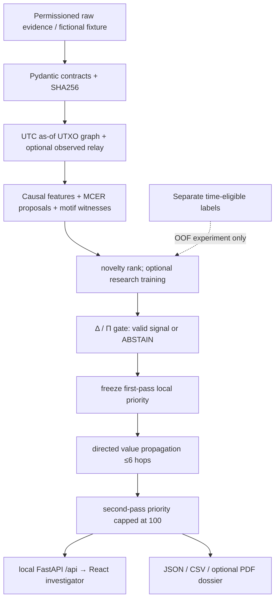

# CLARION v4 — Source-traced implementation audit

**Reviewed against main commit `f19965ee418d1bef380ba9dde6174063ef71025b`, 22 October 2026.** A source file is not proof of an experimentally validated implementation. This audit distinguishes code, tested synthetic behavior and research still blocked by independent data.

## Contents
1. [Feature matrix](#feature-matrix)
2. [Connected architecture](#connected-architecture)
3. [What tests establish](#what-tests-establish)
4. [Research gaps and completion criteria](#research-gaps-and-completion-criteria)

## Feature matrix

Statuses: **TESTED** = repository's small fictional fixtures/compilation passed; **PARTIAL** = some functional implementation exists but original block not complete; **DATA BLOCKED** = required independent evidence unavailable. Legacy package stubs do not count as implemented.

| Block | Actual code | Status and missing work |
|---|---|---|
| 0. Ingest/readiness | `src/clarion/v4/contracts.py`, `ingest.py`, `scripts/v4_pipeline.py` bounded CSV/JSON/XML, digest/quarantine and mapped adapters | **TESTED** canonical fictional pipeline; **PARTIAL** SIH source mapping, permission, clock quality |
| 1A. Bitcoin chain | `v4/graph.py` prevout joins, exact satoshis, conservation; Core JSON converter | **TESTED** fictional transactions; **PARTIAL** real reorgs, scripts, mempool/coinbase edge cases |
| 1B. Network/wire | `WireObservation` TXID/sensor/time, host→TX relay; ASN/country metadata | **PARTIAL, DATA BLOCKED** true observed P2P capture, sessions, port entropy, capture bias |
| 2. Six-type evidence graph | `graph.py`, `representation.py` typed vertices, edge provenance, cutoff, optional HeteroData | **TESTED** spend flow; **PARTIAL** large-scale graph, entity/wire versions |
| 3. Representation | `feature_rows`, PyG SAGE/GAT challenger and hetero forward | **PARTIAL** Node2Vec comparison, fully trained temporal heterogeneous GNN and link prediction |
| 4. MCER H1–H5 | `v4/mcer.py` signed pair evidence and tentative partition; `analysis.py` narrow H1 | **PARTIAL** calibrated H2–H5, multi-party/service false merges, independent identities |
| 5. Motifs | `v4/analysis.py` peel-like, equal-output and fan-in/out candidates, witness references | **PARTIAL** longer/circular/layering, learned motifs, benign-service controls |
| 6. Detection stack | `v4/ml.py` logistic/RF/IF, temporal OOF, optional PyG; `application/training_demo.py` synthetic demo | **TESTED** demo; **PARTIAL** full model zoo, real labels, independent calibration, model registry |
| 7. Cross-layer Δ | `v4/signals.py` held-out global CCA/permutation dependence gate; explicit abstention | **PARTIAL, DATA BLOCKED** independent pairing, case-level Δ1–Δ5, contrastive residuals |
| 8. Economic Π | `VerifiedEconomicGoal`, cost/baseline ratios, component-level abstention | **PARTIAL, DATA BLOCKED** verified goals, feasible controlled baselines, field observations |
| 9. Local fusion | `v4/analysis.py` heuristic 0–75 local and bounded 0–100 second-pass priority | **TESTED** bounds; **PARTIAL** score/typology calibration and uncertainty |
| 10. Six-level MLRP | frozen seeds, ≤6 verified UTXO spend hops and ≤25 exposure points | **TESTED** narrow chain exposure; **PARTIAL** full scored address/entity/host/ASN channels, service barriers |
| 11. Investigator console | `frontend/src/app/App.tsx`, typed API, FastAPI read-only loopback, case JSON/optional PDF | **TESTED** frontend build and synthetic API; **PARTIAL** per-feature React modules, large graph visualization, multi-user access, PDF acceptance |
| 12. Evaluation/deploy | `v4/evaluation.py` bootstrap/ablations/leakage; `tests/v4` and v4 CI | **TESTED** contract/demo/smoke; **PARTIAL** full L0–L3 real cohorts, ARI/NMI, privacy release and offline signed packaging |

**Verdict: NO — the complete original v4 architecture has not been fully implemented or scientifically validated.** The demonstrable vertical slice is real, but most original `src/clarion/**` feature-specific subpackage files are still explicit comment-only blueprints. Actual new implementation concentrates in `src/clarion/v4/`, demo `application/engine.py` and `training_demo.py`, `api/main.py`, CLI and `frontend/src/app/App.tsx`.

## Connected architecture

**Prohibited transformations:** relay host → wallet owner; country context → criminal score; anomaly rank → guilt probability; optional unknown Δ/Π → invented numeric evidence; propagated pass-two score → its own pass-one seed.

## What tests establish

GitHub commit `f19965ee418d1bef380ba9dde6174063ef71025b` has successful `CLARION CI` and `security checks`; `CLARION v4 validation` jobs `python-contracts`, `react-typescript` and `canonical-smoke` passed. Synthetic model/demo CI was green on the reviewed pre-merge branch. **None of these establishes real-world accuracy or comprehensive production safety.** The tests are small, fictional, and do not include data-provider/legal review, scientifically validated Δ/Π, or longitudinal adversarial benchmarks.

## Research gaps and completion criteria

1. **Legal source and exact SIH/network semantics:** verify actual provider records, precise independently captured TXIDs, sensor clocks, permissions and participant privacy; unknown fields cannot be fabricated.
2. **Reliable temporal labels and splitting:** transaction-level truth, known label availability, case/cluster separation and sealed independent future holdout; study service false positives.
3. **MCER fidelity:** calibrated H1–H5, constrained partition, false-merge rate, stable lineage and real hard negatives.
4. **Graph ML:** train graph baseline and a genuinely temporal heterogeneous model within fold boundaries; compare OOF results to simpler learners.
5. **Δ and Π:** define independently observable test premises; component-wise abstain when pairing or controlled goal cannot be verified.
6. **Six-level propagation:** audit value accounting, context separation, host/ASN aggregation, hard service boundaries and no circular score contamination.
7. **Investigator/release:** split placeholder pages into real components, bounded graph viewport, case audit trail, visual PDF QA and locked offline deployment.

**Directory navigation:** [All folder READMEs](../FOLDER_README_INDEX.md). Source: [Original detailed v4 specification](architecture-v4-spec.md) and [canonical pipeline/schema guide](../development/V4_PIPELINES_AND_SCHEMAS.md).
