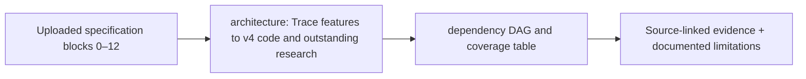

# Detailed architecture overview and source-aligned contracts

> **Design documentation only.** The original uploaded CLARION v4 PDF supplies blocks 0–12; linked implementation choices and status are proposed and not verified as code. The docs listed below replace earlier TODOs where indicated.

## Detailed contracts

- [Source PDF traceability + open decision register](REQUIREMENTS_AUDIT.md)
- [Canonical end-to-end execution modes and fallback behavior](architecture-overview.md)
- [Typed inter-module DTOs and invalid-edge rules](component-contracts.md)
- [Full original 33-section design reference (preserved)](architecture-v4-spec.md)
- [Stacking and OOF contract](stacking-architecture.md)
- [Two-pass MLRP and risk score contract](risk-propagation-architecture.md)
- [Offline dashboard/API/case dossier contract](investigator-dashboard-architecture.md)

## Key gates

Review the [source-to-requirement audit](REQUIREMENTS_AUDIT.md) before asserting cross-layer, labeled or economic-cost feasibility. Honest chain-only/unsupervised/abstained outputs remain mandatory whenever sources do not support the proposed model.

## Verified production-oriented folder architecture

[Repository structure and module dependencies](repository-structure.md) is the location map for implementation. All existing full technical, stacking, MLRP and dashboard specifications remain authoritative; this document only governs module boundaries and ownership.

<!-- CLARION:AUTOGENERATED_FOLDER_GUIDE_BEGIN -->
## Maintainer technical guide — current source tree

> This section is **generated from tracked files** and intentionally preserves the earlier architecture/blueprint notes above. The file index describes the current repository, not a hypothetical implementation. See [source-wide coverage audit](../../docs/architecture/FEATURE_IMPLEMENTATION_AUDIT.md).

### Guide contents
1. [Purpose and actual status](#purpose-and-actual-status-architecture)
2. [Files directly in this folder](#files-directly-in-this-folder-architecture)
3. [Child modules and navigation](#child-modules-and-navigation-architecture)
4. [Technical architecture diagram](#technical-architecture-diagram-architecture)
5. [Tech stack and interfaces](#tech-stack-and-interfaces-architecture)
6. [Validation and work remaining](#validation-and-work-remaining-architecture)

### Purpose and actual status (architecture)
**Path:** `docs/architecture/`  
**Responsibility:** Trace features to v4 code and outstanding research.  
**Consumes:** Uploaded specification blocks 0–12.  
**Produces:** dependency DAG and coverage table.  
**Current direct-file inventory:** Specification or guide: 9.

**Important:** Status is assessed per file; an architectural contract does not prove executable implementation. In particular, CLARION's core running code is primarily `src/clarion/application/engine.py`, `src/clarion/application/training_demo.py`, `src/clarion/api/main.py` and `src/clarion/v4/`, with the React screens in `frontend/src/app/App.tsx`. Other files may be placeholders.

### Files directly in this folder (architecture)
| Entry | Technical responsibility | State |
|---|---|---|
| [`FEATURE_IMPLEMENTATION_AUDIT.md`](FEATURE_IMPLEMENTATION_AUDIT.md) | CLARION v4 — Source-traced implementation audit | Specification or guide |
| [`REQUIREMENTS_AUDIT.md`](REQUIREMENTS_AUDIT.md) | CLARION v4 — Architecture completeness audit and unresolved decisions | Specification or guide |
| [`architecture-overview.md`](architecture-overview.md) | End-to-end CLARION v4 architecture and execution modes | Specification or guide |
| [`architecture-v4-spec.md`](architecture-v4-spec.md) | CLARION v4 | Specification or guide |
| [`component-contracts.md`](component-contracts.md) | Cross-component contracts, dependency DAG and failure semantics (design v1) | Specification or guide |
| [`investigator-dashboard-architecture.md`](investigator-dashboard-architecture.md) | Explainable Investigator Dashboard & Evidence Dossiers — Detailed Design | Specification or guide |
| [`repository-structure.md`](repository-structure.md) | CLARION v4 — Production Project Structure and Module Ownership | Specification or guide |
| [`risk-propagation-architecture.md`](risk-propagation-architecture.md) | Multi-Level Risk Propagation (MLRP) — Detailed Score Architecture | Specification or guide |
| [`stacking-architecture.md`](stacking-architecture.md) | Stacked Graph-ML Anomaly Detection — Detailed Design | Specification or guide |

### Child modules and navigation (architecture)
No tracked child folders.

### Technical architecture diagram (architecture)

### Tech stack and interfaces (architecture)
**Technologies:** Markdown, Mermaid and versioned JSON/YAML/configuration where present; execution lives in linked code directories.

**Input boundary:** Uploaded specification blocks 0–12.  
**Output boundary:** dependency DAG and coverage table.  
**Causal/evidence invariants:** Preserve source SHA-256, UTC `event_time` and `available_at`, explicit score type and `ABSTAIN` when required. Observed relay TXIDs never establish transaction origin or wallet ownership; candidate entity links are not confirmed identity; Country is non-scoring context.

**System contracts:** [original §0–§12 specification](../../docs/architecture/architecture-v4-spec.md) · [implemented versus planned matrix](../../docs/architecture/FEATURE_IMPLEMENTATION_AUDIT.md) · [canonical schemas and pipeline](../../docs/development/V4_PIPELINES_AND_SCHEMAS.md).

### Validation and work remaining (architecture)
- **Required gate:** Never label untrained or invalidated research components complete.
- Verify the exact entrypoint and source file before using a planned module; avoid importing comment-only blueprints.
- For executable changes run affected Python/TypeScript tests, offline checks and canonical synthetic smoke validation. Real-data ML calibration, service negative controls and SIH capture semantics still need independent evidence.
- Record new inputs/outputs, schema versions and proven tests in this README; rerun `python scripts/docs/generate_folder_readmes.py --write` to refresh its indexed section.

<!-- CLARION:AUTOGENERATED_FOLDER_GUIDE_END -->
