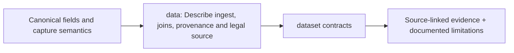

# Evidence acquisition, schema and join contracts

> **Design documentation only.** The original uploaded CLARION v4 PDF supplies blocks 0–12; linked implementation choices and status are proposed and not verified as code. The docs listed below replace earlier TODOs where indicated.

## Detailed contracts

- [Canonical Bitcoin/UTXO/wire fields and missing values](data-dictionary.md)
- [Independent sources, synthetic truth and provenance](dataset-acquisition.md)
- [J0–J3 joins, statistical dependence/coverage and source clock policies](join-policy.md)

## Key gates

Review the [source-to-requirement audit](../architecture/REQUIREMENTS_AUDIT.md) before asserting cross-layer, labeled or economic-cost feasibility. Honest chain-only/unsupervised/abstained outputs remain mandatory whenever sources do not support the proposed model.

<!-- CLARION:AUTOGENERATED_FOLDER_GUIDE_BEGIN -->
## Maintainer technical guide — current source tree

> This section is **generated from tracked files** and intentionally preserves the earlier architecture/blueprint notes above. The file index describes the current repository, not a hypothetical implementation. See [source-wide coverage audit](../../docs/architecture/FEATURE_IMPLEMENTATION_AUDIT.md).

### Guide contents
1. [Purpose and actual status](#purpose-and-actual-status-data)
2. [Files directly in this folder](#files-directly-in-this-folder-data)
3. [Child modules and navigation](#child-modules-and-navigation-data)
4. [Technical architecture diagram](#technical-architecture-diagram-data)
5. [Tech stack and interfaces](#tech-stack-and-interfaces-data)
6. [Validation and work remaining](#validation-and-work-remaining-data)

### Purpose and actual status (data)
**Path:** `docs/data/`  
**Responsibility:** Describe ingest, joins, provenance and legal source.  
**Consumes:** Canonical fields and capture semantics.  
**Produces:** dataset contracts.  
**Current direct-file inventory:** Specification or guide: 3.

**Important:** Status is assessed per file; an architectural contract does not prove executable implementation. In particular, CLARION's core running code is primarily `src/clarion/application/engine.py`, `src/clarion/application/training_demo.py`, `src/clarion/api/main.py` and `src/clarion/v4/`, with the React screens in `frontend/src/app/App.tsx`. Other files may be placeholders.

### Files directly in this folder (data)
| Entry | Technical responsibility | State |
|---|---|---|
| [`data-dictionary.md`](data-dictionary.md) | Canonical evidence data dictionary — schema design v1 | Specification or guide |
| [`dataset-acquisition.md`](dataset-acquisition.md) | Dataset strategy, acquisition and evaluation separation | Specification or guide |
| [`join-policy.md`](join-policy.md) | Cross-layer correlation contract and quantitative go/no-go procedure | Specification or guide |

### Child modules and navigation (data)
No tracked child folders.

### Technical architecture diagram (data)

### Tech stack and interfaces (data)
**Technologies:** Markdown, Mermaid and versioned JSON/YAML/configuration where present; execution lives in linked code directories.

**Input boundary:** Canonical fields and capture semantics.  
**Output boundary:** dataset contracts.  
**Causal/evidence invariants:** Preserve source SHA-256, UTC `event_time` and `available_at`, explicit score type and `ABSTAIN` when required. Observed relay TXIDs never establish transaction origin or wallet ownership; candidate entity links are not confirmed identity; Country is non-scoring context.

**System contracts:** [original §0–§12 specification](../../docs/architecture/architecture-v4-spec.md) · [implemented versus planned matrix](../../docs/architecture/FEATURE_IMPLEMENTATION_AUDIT.md) · [canonical schemas and pipeline](../../docs/development/V4_PIPELINES_AND_SCHEMAS.md).

### Validation and work remaining (data)
- **Required gate:** BitcoinHeist/Elliptic++ labels are not IP-to-wallet ground truth.
- Verify the exact entrypoint and source file before using a planned module; avoid importing comment-only blueprints.
- For executable changes run affected Python/TypeScript tests, offline checks and canonical synthetic smoke validation. Real-data ML calibration, service negative controls and SIH capture semantics still need independent evidence.
- Record new inputs/outputs, schema versions and proven tests in this README; rerun `python scripts/docs/generate_folder_readmes.py --write` to refresh its indexed section.

<!-- CLARION:AUTOGENERATED_FOLDER_GUIDE_END -->
