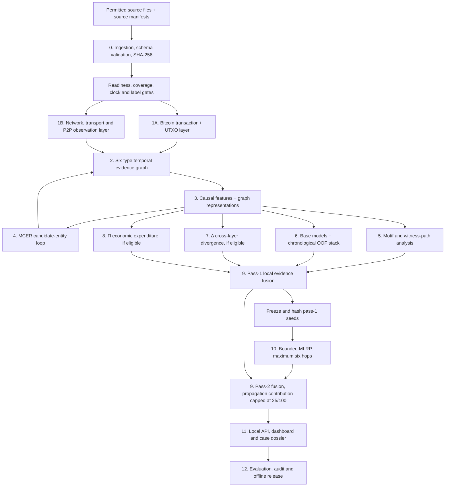

# CLARION v4 — Master Technical Implementation Plan

> **Document type:** end-to-end engineering and research implementation plan  
> **Project:** SIH'26 — CLARION v4 / SIH26146  
> **Repository:** [shanmukhdatta/CLARION](https://github.com/shanmukhdatta/CLARION)  
> **Target branch:** `main`  
> **Prepared:** 4 November 2026  
> **Repository baseline inspected:** `main` at `7b8ef4c9b7500230a86bf5820dcc9e058857fecc` (31 October 2026)  
> **Latest detailed progress audit reviewed:** `docs/progress/CURRENT_AUDIT_2026-10-31.md`, whose source audit is based on commit `34739e433a60534775f014f400166ef9343464a4` (25 October 2026).

---

## 0. How to use this plan

This is the implementation blueprint for the whole CLARION system. It specifies **what must be built, why it is needed, how the data and algorithms should work, which libraries and datasets to use, what each stage must produce, and how to verify it**.

It intentionally contains **no application implementation code**. It provides architecture, module responsibilities, algorithm logic, mathematical definitions, interfaces, data contracts, test plans and implementation tasks. Developers should implement the approved logic in the repository's existing modules rather than copy source code from this document.

### 0.1 Status vocabulary

Use these labels in every progress update:

| Status | Meaning |
|---|---|
| DESIGN | Architecture and expected behavior are documented; code may not exist. |
| IMPLEMENTED | Source code for the stated scope exists and is connected. |
| TESTED | The stated code path passed named tests on named fixtures. |
| VERIFIED | The complete acceptance criteria passed with reproducible logs and artifacts. |
| PARTIAL | Some behavior exists, but the whole requirement or its acceptance evidence is incomplete. |
| DATA-BLOCKED | The method cannot be scientifically or operationally completed without genuine external data or independent evidence. |
| NOT STARTED | No implementation work has been accepted for that task. |

A file existing, a test name existing, or a synthetic demo running does not automatically make a feature VERIFIED.

### 0.2 Repository status at the planning baseline

The 31 October audit records 172 requirements: 59 implemented and narrowly tested, 39 written but not fully accepted, 37 partial, 29 missing and 8 externally blocked. These are the audit's classifications, **not a percentage-complete estimate** and not a fresh execution of every requirement on 4 November.

The repository already has meaningful v4 code and a synthetic demonstration. Reuse and test those paths before creating replacements. The current audit identifies the main implementation areas as:

- v4 contracts and ingestion: `src/clarion/v4/contracts.py`, `ingest.py`
- Bitcoin/UTXO graph: `src/clarion/v4/graph.py`
- network observations and sessions: `src/clarion/v4/wire_sessions.py`
- graph representation and features: `src/clarion/v4/representation.py`
- MCER: `src/clarion/v4/mcer.py`
- motifs and analysis: `src/clarion/v4/analysis.py`, `motifs_extended.py`
- ML and graph training: `src/clarion/v4/ml.py`, `gnn_training.py`
- evidence gates for Δ and Π: `src/clarion/v4/signals.py`
- orchestration, evaluation and artifacts: `pipeline.py`, `evaluation.py`, `model_artifact.py`, `mlops_adapter.py`
- application/demo: `src/clarion/application/engine.py`, `training_demo.py`
- API and UI: `src/clarion/api/`, `frontend/`

Some older package paths remain comment-only blueprints. Before filling any such stub, identify the canonical v4 implementation, connect the missing behavior there, and update the interface/tests. Do not create two competing implementations of the same subsystem.

The current audit also records that a checked-in, reviewed miniature fixture is still a priority. The existing six-case demo generator produces 24 transaction records, while the training demonstration needs a larger synthetic cohort (the audit specifies at least 30 cases and 75 labeled spend transactions). Keep the tiny parser/correctness fixture separate from the larger training demonstration.

---

# 1. Project objective and final outcome

## 1.1 Mission

CLARION is a **local-first, offline-at-inference Bitcoin investigation and evidence-analysis platform**. It processes permitted Bitcoin blockchain data and, when genuinely available, locally observed Bitcoin P2P network metadata. It constructs a provenance-preserving temporal evidence graph, identifies candidate patterns and uncertain candidate entities, produces anomaly/novelty rankings, and helps an investigator inspect and export reproducible leads.

The product output is an **evidence-backed investigative lead**, not a declaration that an address, host, entity or person committed a crime.

## 1.2 End-to-end objective

Given permitted CSV, JSON, XML or Bitcoin Core-derived inputs, CLARION must:

1. Register and hash each source and record its provenance, rights and schema.
2. Parse and normalize chain and network observations into versioned canonical records.
3. Validate transaction/outpoint correctness, event-time semantics, coverage, missingness and label availability.
4. Decide whether the run can operate in CHAIN_ONLY or a genuinely supported CROSS_LAYER mode.
5. Build a typed, directed, time-aware evidence graph with a traceable source for every edge.
6. Derive causal chain, network, temporal and uncertainty features.
7. Generate candidate address/entity groupings through MCER, preserving conflicting evidence and uncertainty.
8. Find transaction motifs with witness paths and legitimate alternative explanations.
9. Run supervised models only when valid labels support them; otherwise produce unsupervised novelty rankings.
10. Train a leakage-safe stacked model from chronological out-of-fold predictions.
11. Calculate cross-layer divergence (Δ) and obfuscation expenditure (Π) only when their separate evidence prerequisites pass.
12. Fuse eligible local signals, freeze first-pass seeds, run bounded MLRP once, and produce a capped second-pass ranking.
13. Serve a local investigator interface with graph, timeline, model, evidence and case-export views.
14. Evaluate the system with separate real-benchmark, Bitcoin Core correctness, synthetic-truth and (if supplied) SIH-data tracks.
15. Package and replay the approved workflow on an offline Linux machine.

## 1.3 What CLARION is not

- It is not a live blockchain explorer or cloud analytics service.
- It does not infer wallet ownership from an IP address or a relay observation.
- It does not infer a real person's identity from an MCER cluster.
- It does not treat privacy tools, CoinJoin participation, VPNs, hosting providers or high transaction volume as proof of wrongdoing.
- It does not turn an Isolation Forest score or graph novelty score into a crime probability.
- It does not claim real-world detection accuracy from generated synthetic labels.
- It does not fabricate network captures, TXID joins, economic objectives or labels when the source data lacks them.

## 1.4 Important terminology

The formal architecture calls the iterative clustering process **MCER — Mutual-Constraint Entity Resolution**. Use MCER consistently in code, documentation and diagrams. If a different algorithm called MSCR is intended, it must be introduced through an architecture decision record rather than silently replacing MCER.

MCER returns **candidate entities** (hypotheses about address groups). A count of candidate entities is not a verified count of people. The dashboard must label this quantity “candidate entities” or “candidate clusters,” never “people identified.”

---

# 2. Complete system architecture

## 2.1 Main data flow

The graph is the shared evidence substrate. The chain model, network model, MCER, motifs, Δ, Π and MLRP must not independently invent their own inconsistent identities, timestamps or source references.

## 2.2 Three distinct evidence tracks

| Track | Contents | What it can establish |
|---|---|---|
| Chain track | Bitcoin transactions, inputs, outputs, outpoints, block metadata | UTXO value-flow facts, subject to source completeness and chain-state validation |
| Wire track | Authorized sensor observations, sessions, endpoints, observed TXIDs, timestamps | That a sensor observed a host relay or discuss a transaction under the recorded capture conditions |
| Context track | ASN, country, subnet, service category and other licensed local enrichment | Context and uncertainty; not wallet ownership or guilt |

Do not merge these tracks into a single untyped “network relationship” table.

## 2.3 Core invariants

1. **Exact value semantics:** use integer satoshis; never silently round BTC floats.
2. **Outpoint semantics:** a Bitcoin input spends a specific previous `txid:vout`; an address annotation is not an exact coin-flow edge.
3. **Time semantics:** keep block time, observation time, first-seen semantics, source precision and availability time separate.
4. **Evidence provenance:** every edge, feature, cluster decision, score and exported statement must resolve to source evidence and a processing run.
5. **Association is not attribution:** Host → observed relay → Transaction does not imply Host → Address ownership.
6. **Independent readiness gates:** network quality and label quality are separate. Valid labels can support CHAIN_ONLY supervised work; valid wire observations do not create labels.
7. **Missing is not zero:** unsupported Δ/Π components remain ABSTAIN or unavailable.
8. **No future leakage:** graph snapshots, feature generation, clustering, embeddings, preprocessing and labels must respect the prediction cutoff.
9. **Non-circular scoring:** pass-1 seeds are frozen before MLRP; MLRP is applied once in pass 2.
10. **Country is context only:** Country never receives financial-risk points or re-emits risk.
11. **Synthetic truth stays sealed:** generator labels and hidden scenario identifiers never become model features.
12. **Offline inference:** no external API, telemetry, CDN, hosted geolocation or cloud model call is required at investigation time.

---

# 3. Technology stack and engineering choices

The current repository declares Python 3.11–3.12, Pydantic and PyYAML in `pyproject.toml`. `requirements-v4.txt` already lists NumPy, SciPy, scikit-learn, PyArrow, DuckDB, defusedxml, FastAPI, Uvicorn and HTTPX. Treat the dependency lockfile as the reproducibility authority. The additional technologies below are recommendations, not a claim that all are installed or fully integrated.

## 3.1 Recommended stack by subsystem

| Subsystem | Primary technology | Optional / later choice | Purpose |
|---|---|---|---|
| Runtime and package management | Python 3.11/3.12, uv | Linux virtual environment or local container | Reproducible development and offline runtime |
| Contracts and configuration | Pydantic v2, PyYAML, JSON Schema | PyArrow schema metadata | Strict versioned input/output contracts |
| CSV/JSON/XML | Python standard library, Pydantic, defusedxml | PyArrow CSV for large batches | Bounded parsing, validation and quarantine |
| Tabular processing | PyArrow, Parquet, DuckDB | Polars or pandas where a specific API helps | Columnar storage and local SQL |
| Small graph reference implementation | NetworkX | igraph/graph-tool only if profiling justifies | Correctness tests on tiny graphs |
| Graph tensor/training | PyTorch, PyTorch Geometric | GAT and heterogeneous/temporal PyG modules | GraphSAGE/GAT research |
| Classical ML | scikit-learn | LightGBM only after measured benefit and license/build review | Baselines, anomaly detection and meta-model |
| Numerical/statistical methods | NumPy, SciPy | statsmodels where inference diagnostics need it | Statistics, dependence tests and metrics |
| Community detection | Constrained MCER logic first | Leiden/Louvain as comparison tools | Candidate grouping; community output is not ownership proof |
| API | FastAPI, Pydantic, Uvicorn | HTTPX for API integration tests | Local read-only analysis endpoints |
| Frontend | React, TypeScript, Vite | Existing project UI components | Investigator console |
| Graph visualization | One bundled graph library such as Cytoscape.js | Sigma.js after a measured comparison | Bounded subgraph rendering |
| Reports | JSON/CSV standard writers, ReportLab for PDF | WeasyPrint only if its native dependencies can be bundled | Local, hashable case export |
| Tests and quality | pytest, Ruff, mypy, GitHub Actions | Playwright for UI end-to-end tests | Regression, type and build gates |
| MLOps/artifacts | JSON manifests, SHA-256, local artifact folders, SQLite metadata | MLflow local-only if experiment volume later justifies it | Model/run lineage without mandatory cloud |
| Packaging | Linux wheelhouse, locked Python dependencies, bundled frontend assets | Docker/Podman for reproducible setup | Disconnected deployment |

### 3.2 Keep the architecture simple

Use a **single local application and batch pipeline** first. Do not introduce Kafka, Redis, Kubernetes, distributed microservices or a multi-agent orchestration framework by default. Add a separate service or queue only when a measured throughput, isolation or operational requirement proves it is necessary.

FastAPI should serve completed run artifacts and bounded queries. Model training should remain an explicit development/research job, not run implicitly inside an investigator's HTTP request.

### 3.3 Hardware and development environment

| Profile | Suitable work | Planning guidance |
|---|---|---|
| CPU development | Schema work, ingestion, UTXO checks, small graphs, classical ML, tests and dashboard | Start here; no GPU is required for P0/P1 |
| CPU research | Small/medium feature tables, baseline models, small sampled graphs | Measure RAM and wall-clock time before scaling |
| Single compatible CUDA GPU | GraphSAGE/GAT minibatches and larger experiments | Install a PyTorch/PyG-compatible pair; GPU is optional |
| Offline target | Import, chain-only analysis, approved model inference, dashboard and export | Prepare wheels, weights, GeoIP/ASN files and static assets before disconnecting |

Do not assume the complete Bitcoin graph fits into RAM or GPU memory. Use time windows, Parquet partitions, bounded neighborhood sampling and measured resource limits.

### 3.4 Dependency policy

- Add a dependency only when the phase that needs it begins.
- Check the package's license, Python compatibility, platform wheels and offline installation behavior.
- Update `pyproject.toml` and `uv.lock` together.
- Keep PyTorch/PyG optional for the CPU baseline.
- Do not upgrade the whole environment to solve one missing package.
- Record the exact Python, OS, CPU/GPU, package lock and model versions in every run manifest.

---

# 4. Datasets and evidence sources

Dataset choice must follow the research question. The sources below are separate tracks; they must not be silently merged into a fictional fully labelled chain-plus-IP dataset.

## 4.1 Dataset acquisition matrix

| Dataset/source | Official starting point | What it is suitable for | What it does not provide |
|---|---|---|---|
| Elliptic++ | [GitHub — git-disl/EllipticPlusPlus](https://github.com/git-disl/EllipticPlusPlus) | Transaction/actor graph benchmark tasks and graph-model comparison | Authenticated Bitcoin P2P host-to-wallet ownership labels |
| BitcoinHeist | [UCI ML Repository dataset 526](https://archive.ics.uci.edu/dataset/526/bitcoinheistransomwareaddressdataset) | Address-level derived-feature classification/novelty experiments | Raw UTXO transaction reconstruction or verified P2P IP joins; do not treat every “white” address as a proven benign negative |
| Bitcoin Core | [Bitcoin Core documentation](https://bitcoincore.org/en/doc/) and [Developer RPC reference](https://developer.bitcoin.org/reference/rpc/) | Transaction/outpoint parsing, fee/value correctness and chain-only evidence | Real-world illicit labels or original P2P broadcaster IP |
| CLARION synthetic fixtures | Repository generator and test fixtures | Deterministic correctness, integration, controlled hard negatives and sealed known truth | Real-world detection performance |
| SIH organizer dataset | Only files and documentation actually supplied under valid permission | Format compatibility and any genuine fields present in the organizer data | Unknown until files, schema, provenance and rights are inspected |
| Authorized P2P observations | Approved local sensor/capture provider and decoder documentation | Exact observed-TXID relay facts, session features and capture-quality research | Wallet controller identity or proof that the observed host originated a transaction |
| Local ASN/GeoIP data | Approved offline database and its license | Contextual ASN/country enrichment with version and coverage | Exact human location, wallet identity or guilt |
| Independent labels | Documented public benchmark or authorized adjudicated source | Supervised training and evaluation at the declared subject level | Labels at other subject levels unless explicitly supplied and justified |

## 4.2 Which data is used for which layer

- **Transaction/UTXO layer:** Bitcoin Core verbose transaction exports or a verified equivalent; Elliptic++ only for its documented benchmark task.
- **Address-level model:** BitcoinHeist as its own address-level experiment; do not pretend its records are raw transaction inputs/outputs.
- **Graph transaction model:** Elliptic++ with the dataset's exact graph and label semantics; create a separate split and model card.
- **Network/transport layer:** only actual authorized observations with sensor ID, source hash, protocol/decoder provenance, endpoints, timestamp precision and exact observed TXID where available.
- **Cross-layer model:** only exact J1 observed-TXID joins with adequate independent coverage and a passing dependence/null audit.
- **MCER evaluation:** controlled synthetic address groups and independent benchmark truth where available; no inferred human identity.
- **Δ:** independent, timestamped, correctly paired chain/wire observations; otherwise ABSTAIN.
- **Π:** a documented economic objective, controlled set/payee assumptions and defensible same-goal baseline; otherwise item-level ABSTAIN.
- **UI and export:** synthetic fixtures first; approved data only after permission and redaction review.

## 4.3 Dataset registration requirements

Every dataset must have a manifest containing:

- publisher/provider and source URL or internal source reference;
- dataset name, revision, acquisition date and license/permission;
- SHA-256 for each immutable source file;
- source time range and time-zone/precision semantics;
- record counts and schema version;
- subject level (transaction, address, entity, session or observation);
- label definition, provenance and `available_at`, if labels exist;
- fields that are missing, sampled, derived or uncertain;
- intended experiment and prohibited claims;
- local retention, access and export rules.

Do not commit confidential SIH data, private IP captures, restricted labels, large downloaded datasets or model weights to Git. Commit small synthetic fixtures only.

## 4.4 Synthetic data design

Build synthetic data before attempting a large real-data experiment.

1. Generate deterministic Bitcoin-shaped transaction IDs, valid `txid:vout` outpoints, inputs and outputs.
2. Keep all values as nonnegative integer satoshis and check known-input value = outputs + fee.
3. Include normal behavior first: ordinary payments, change, consolidation, merchant batching, custody/exchange activity and CoinJoin-like hard negatives.
4. Add candidate patterns as controlled scenario variables, not as model-visible labels.
5. Store true synthetic actor groups, objective/payee information and pattern labels in a sealed evaluator-only sidecar.
6. Generate a separate wire-observation table with sensor, observation time, event class, endpoints, optional observed TXID and capture uncertainty.
7. Include duplicate events, multiple peers relaying one TXID, missing TXIDs, sensor dropout, NAT-like shared egress, clock skew and service-heavy negative controls.
8. Export equivalent CSV, JSON and XML examples; parse them back to identical canonical records.
9. Define L0–L3 difficulty tiers with independent nuisance variables and a different generator seed/distribution for the final holdout.
10. Prove that hidden scenario labels, truth IDs and generator seed do not enter model features.

Use synthetic data to prove mechanics and catch implementation errors. Report synthetic results separately from real benchmark results.

---

# 5. Canonical data model and storage

## 5.1 Core tables

| Table | Key fields and semantics |
|---|---|
| `source_manifest` | source ID, origin, rights, SHA-256, revision, parser and schema version |
| `transactions` | TXID, block height, block time, transaction time if actually supplied, fee, vsize/weight if supplied |
| `transaction_inputs` | TXID, vin index, previous TXID, previous vout, amount if known, script data |
| `transaction_outputs` | TXID, vout index, amount in satoshis, script type, optional address annotation |
| `network_observations` | observation ID, sensor, observed time, precision, endpoints, ports, protocol/event class, exact observed TXID if decoded |
| `network_sessions` | session ID, endpoint pair, start/end, event count, source sensor and capture reference |
| `ip_enrichment` | IP key, ASN/country result, local database version, lookup status and coverage |
| `labels` | subject ID/type, value, definition, provenance, confidence and `available_at` |
| `feature_rows` | subject ID/type, cutoff, feature schema, values, missingness and source lineage |
| `graph_nodes` / `graph_edges` | typed IDs, direction, event/availability time, evidence ID, edge semantics and uncertainty |
| `entity_candidates` | candidate ID, member hypotheses, positive/negative evidence, MCER iteration and lineage |
| `motif_instances` | motif type, witness path, time range, values where known and benign alternatives |
| `model_predictions` | model/run/fold, subject, score type, prediction, calibration state and feature version |
| `signal_results` | Δ/Π components, eligibility, units, uncertainty and abstention reason |
| `lead_results` | pass-1 score, frozen seed reference, propagation contribution, pass-2 score and explanation |
| `case_exports` | case ID, export hash, redaction policy, source manifest and reviewer annotations |

## 5.2 Required record fields

All normalized records need a run ID, immutable source reference, source hash, parser/schema version, ingestion time, event time (when known), availability time, missingness/quality flags and row-level validation outcome.

Use:

- integer satoshis for money;
- UTC timestamps plus source precision and time meaning;
- stable TXID and outpoint identifiers;
- nullable fields for unknown values;
- explicit units for every feature;
- typed score semantics: probability, novelty rank, heuristic priority, association confidence or uncertainty.

## 5.3 Storage layout

- Raw sources: immutable, access-controlled local input area; never mutate originals.
- Normalized tables: partitioned Parquet.
- Analytical queries: DuckDB.
- Run/case metadata: SQLite or versioned JSON manifests.
- Model weights: separate local artifact store with SHA-256 and a model manifest.
- Graph snapshots: deterministic node/edge Parquet tables plus a snapshot manifest and hash.
- UI cache: rebuildable; never the source of truth.

The application must be able to rebuild derived artifacts from a registered source and a matching configuration. It must refuse to combine incompatible schema, feature, graph or model versions.

---

# 6. Layer-by-layer technical implementation

## 6.1 Block 0 — Ingestion, provenance and readiness

**Purpose:** accept permitted input files safely and decide which downstream analyses are actually supported.

**Inputs:** CSV, JSON, XML, approved Bitcoin Core exports, optional network observations, local enrichment files and independent labels.

**Recommended libraries:** Pydantic, Python standard library, defusedxml, PyArrow, DuckDB, SHA-256 from the standard library.

**Implementation logic:**

1. Register the source, provider, rights, source hash, time range and declared schema.
2. Select an explicit source adapter; never guess column meanings from a filename.
3. Parse with bounded file/record sizes and strict type validation. Reject unsafe XML features and malformed structures.
4. Convert valid rows to canonical records. Send invalid rows to a quarantine artifact with row number, field and reason.
5. Normalize TXIDs, outpoints, ports, IPs, timestamps, amounts and missing-value semantics.
6. Detect duplicates, contradictory records, impossible amounts, invalid ports, inconsistent timestamps and schema drift.
7. Compute per-source coverage, field availability, duplicate rate, missingness, time overlap and label availability.
8. Produce independent network and label readiness decisions.
9. Write a run manifest that records the route and every reason for a degraded or abstained feature.

**Routing outcomes:**

- `CHAIN_ONLY`: chain data is usable but wire evidence is missing or invalid.
- `CROSS_LAYER_ELIGIBLE`: actual exact-TXID observations, adequate independent coverage and pre-registered dependence tests support cross-layer research.
- `INSUFFICIENT_DATA`: the requested analysis cannot be performed reliably.
- `SUPERVISED_ALLOWED`: label definition, provenance, subject level, time availability and split support pass.
- `UNSUPERVISED_ONLY`: labels are absent, unsuitable or insufficient.

**Outputs:** canonical Parquet tables, quarantine report, source manifest, readiness report and immutable input hashes.

**Acceptance tests:** malformed rows are quarantined; missing values are not coerced to zero; identical source bytes give the same hash; invalid XML is rejected; no unobserved TXID is fabricated; label and wire gates remain independent.

## 6.2 Block 1A — Bitcoin transaction and UTXO layer

**Purpose:** reconstruct supported on-chain value flow with exact outpoint semantics.

**Libraries:** Python, Pydantic, PyArrow, DuckDB; optional Bitcoin Core RPC/export adapter.

**Implementation logic:**

1. Parse each transaction and retain TXID, block context, inputs, outputs and source provenance.
2. Represent every spendable output as an outpoint: previous TXID plus vout index.
3. Resolve each input to its exact previous output when source data supports it.
4. Keep unresolved prevouts explicit; do not infer missing parent values or fees.
5. Validate unique vin/vout indices, valid references and chain-state constraints.
6. Handle coinbase transactions separately; they do not have ordinary previous transaction inputs.
7. Calculate known input/output sums and fee only when all required values are known.
8. Preserve script type and address annotation as separate fields; do not assume an address is a human or wallet owner.
9. Record reorg, orphan, mempool and missing-history status where the input source can support it.
10. Derive transaction and address-level summaries only after exact UTXO checks.

**Core outputs:** transactions, inputs, outputs, resolved outpoint edges, unresolved ancestry flags, fee/value summaries and chain-quality report.

**Required invariants:** integer satoshis; no negative values; no duplicate spend of the same outpoint in the same accepted chain state; known value conservation; unresolved data stays unresolved.

**Acceptance tests:** ordinary spend, multi-input/multi-output, change candidate, coinbase, unresolved prevout, duplicate input, fee mismatch, script variants and reorg/orphan cases.

## 6.3 Block 1B — Network, transport/session and Bitcoin P2P observation layer

This layer has three logical subparts. Keep them separate in the schema.

### A. Network endpoint layer

**Purpose:** normalize host and endpoint observations.

**Inputs:** authorized sensor metadata, source/destination IP, source/destination port, protocol, capture ID, event time and available packet/flow fields.

**Logic:** validate IP family and port range; preserve source/destination direction and sensor vantage; retain original timestamp precision; attach local ASN/country context only from a licensed, versioned database; preserve unknown enrichment as null.

**Outputs:** endpoint facts and host-context records.

### B. Transport/session layer

**Purpose:** convert timestamped transport observations into reproducible sessions and behavioral summaries.

**Logic:**

1. Group observations using an explicit sensor and endpoint/session key.
2. Apply a documented inactivity gap and event-time ordering policy.
3. Keep retransmissions, duplicate capture and sensor replay distinguishable from independent observations.
4. Derive session start/end, duration, event count, inter-arrival statistics, direction changes and port statistics where source fields exist.
5. Calculate port entropy only when enough valid port observations exist.
6. Track clock precision, drift correction source, missing intervals and sensor coverage.
7. Preserve multiple sensors as separate sources; do not multiply independent sample counts with repeated packets from one sensor.

**Outputs:** versioned session records, host/session features, capture-quality metrics and session provenance.

### C. Bitcoin P2P observation/decoder layer

**Purpose:** identify what a sensor actually observed about Bitcoin transaction propagation.

**Logic:**

1. Use an authorized capture and a documented decoder/protocol version.
2. Store message/event class and whether a TXID was genuinely decoded from the observation.
3. Normalize the exact observed TXID under a declared byte-order convention.
4. Retain sensor ID, endpoint direction, timestamp and precision.
5. Deduplicate exact repeated events within the same sensor without erasing separate sensor observations.
6. Join to chain records by exact TXID equality only.
7. Record that a host was observed relaying/discussing a TXID; never claim it originated the transaction or controls the transaction's addresses.

**Outputs:** `WireObservation` facts, exact observed-relay edges, session features and a wire-readiness report.

**Join tiers:**

| Tier | Meaning | Permitted use |
|---|---|---|
| J0 | Exact on-chain outpoint/value-flow evidence | Chain graph |
| J1 | Exact observed TXID in a source-verified network observation | Host → observed-relay → Transaction edge |
| J2 | Co-session, subnet, ASN, country or timing context | Contextual features only |
| J3 | Embedding/link-prediction association hypothesis | Separate research candidate; never J0/J1 ground truth |

**Acceptance tests:** one TXID seen by many peers creates many observation records but no ownership edges; missing TXID creates no J1 edge; duplicate capture does not inflate independent sensor count; clock skew remains explicit; NAT/VPN/hosting/country context cannot create an ownership assertion.

**Data blocker:** if actual authorized decoded P2P observations are unavailable, the platform still operates in CHAIN_ONLY mode. Do not substitute synthetic relay records into a real-data report.

## 6.4 Block 2 — Heterogeneous temporal evidence graph

**Canonical node types:** Transaction, Address, Entity, Host/IP, ASN and Country. Session identity stays in the session/observation tables unless an architecture decision explicitly adds another persistent node type.

**Allowed edge families:**

- Address/UTXO → Transaction spend relation.
- Transaction → Address output/funding relation.
- Host → Transaction observed-relay relation, backed by J1 evidence.
- Host ↔ Host co-session/context relation, with source and time.
- Host → ASN and Host → Country enrichment relation.
- Address → candidate Entity membership relation, with MCER version and confidence.

Every edge must include a stable edge ID, type, direction, event/effective time, availability time, source evidence ID, method/version, uncertainty and optional value share.

**Implementation logic:**

1. Build chain-only and wire-only views independently.
2. Merge them only through allowed typed joins.
3. Materialize an as-of graph snapshot for a requested cutoff.
4. Preserve raw event records and source IDs behind graph edges.
5. Create deterministic node ordering and graph hashes for model reproducibility.
6. Export bounded neighborhoods rather than loading the entire graph into the UI.
7. Keep financial flow and observational context as separate edge semantics.

**Libraries:** NetworkX for small correctness fixtures; PyArrow/DuckDB for graph persistence; PyTorch Geometric for model-specific tensor conversion.

**Outputs:** graph node/edge tables, chain-only view, wire-only view, cross-layer view when eligible, graph manifest and bounded query interface.

## 6.5 Block 3 — Feature engineering and graph representations

### Feature registry

Every feature definition must record:

- name, version and subject type;
- mathematical definition and unit;
- required source fields and edge types;
- event-time window and `available_at`;
- missingness and uncertainty behavior;
- training-fold fitting requirements;
- provenance and leakage risks.

### Feature families

| Family | Example features | Important restriction |
|---|---|---|
| Chain | input/output counts, value totals, fee rate where known, degree, reuse, fan-in/out, outpoint age | Do not invent values for unresolved prevouts |
| Wire | session count/duration, inter-arrival statistics, port entropy, host/sensor coverage, ASN stability | Only from actual captured fields |
| Temporal | rolling activity, burst/dormancy, time-window velocity and change | Only events available at cutoff |
| Graph | degree/centrality, neighborhood summaries, motif counts and path depth | Compute from the fold's as-of graph |
| Uncertainty | joined fraction, missingness, clock error, unresolved outpoint share, sensor coverage | Must remain visible to downstream models |
| Context | service indicators, ASN/country metadata, source quality | Context is not financial ownership or guilt |

### Representation-learning ladder

Implement in this order:

1. Hand-built graph statistics and chain-only tabular baseline.
2. Node2Vec/random-walk baseline on bounded graph snapshots.
3. GraphSAGE with inductive neighborhood sampling.
4. GAT as a challenger, not an automatic upgrade.
5. Heterogeneous/temporal message passing only when source quality and measured results justify it.
6. Optional self-supervised reconstruction or contrastive alignment for a clearly defined task.

**Libraries:** NumPy, SciPy, scikit-learn, PyTorch and PyTorch Geometric. Use CPU-capable baselines first; use matching CPU/CUDA wheels for PyG only when required.

**Outputs:** versioned feature tables, feature manifest, embedding artifacts, fold-local graph snapshot references and resource measurements.

**Acceptance:** future edges do not alter earlier features; same snapshot and model seed reproduce the same node mapping; chain-only and cross-layer models are compared on identical cohorts.

## 6.6 Block 4 — MCER iterative candidate-entity resolution

**Purpose:** create cautious candidate address groups while preserving evidence conflicts and uncertainty.

**Hypotheses:**

- **H1 — Co-spend proposal:** common-input behavior can propose a relationship, but CoinJoin/multi-party/service patterns require exclusion or contested status.
- **H2 — Change candidates:** address/script/amount/context features propose possible change relationships while retaining alternatives.
- **H3 — Embedding similarity:** graph embeddings and behavioral features propose similar addresses; similarity alone is not ownership proof.
- **H4 — Wire conflict review:** conflicting observations can lower confidence or trigger review; multi-country relay sightings, NAT, VPN and routing do not automatically prove different controllers.
- **H5 — Fingerprint re-link:** stable, independently supported behavior can propose a re-link, with source-independence and confounder checks.

**MCER loop logic:**

1. Generate candidate address pairs from eligible H1/H2/H3 evidence.
2. Store each evidence item with direction, provenance, confidence type, timestamp and positive/negative sign.
3. Apply must-not-merge and must-review constraints for multi-party transactions, services and known confounders.
4. Add H4 conflicts and H5 re-link proposals without converting contextual clues into hard identity facts.
5. Score candidate pairs using independently defined evidence weights.
6. Propose merge, split, retain-separate or unresolved states.
7. Recompute candidate partitions and compare against the previous iteration.
8. Preserve partition lineage and every decision that changed.
9. Stop on stable assignments, a maximum iteration count or unresolved conflict.
10. Re-run the process inside each temporal training fold; never use a future cluster in an earlier prediction.

Start with deterministic constrained pair proposals. Introduce a correlation-clustering optimizer only after its objective, constraints and stopping criteria are specified and tested.

**Outputs:** candidate entity IDs, membership hypotheses, evidence ledger, confidence/uncertainty, competing alternatives, iteration history and merge/split lineage.

**Evaluation:** pairwise precision/recall, false-merge rate, ARI, NMI, stability and abstention by service/scenario. False merges are a high-priority failure mode.

## 6.7 Block 5 — Transaction motif and pattern engine

**Purpose:** detect explainable candidate transaction patterns, not declare intent.

**Initial pattern families:**

- peel-chain candidates;
- high fan-in and high fan-out;
- fragmentation and repeated funding patterns;
- mixing-like or CoinJoin-like structures;
- multi-hop layering candidates;
- circular flow candidates where the UTXO/time evidence supports the path;
- bursts, dormancy and repeated temporal motifs.

**Implementation logic:**

1. Define each motif with a typed graph pattern and allowed time/value constraints.
2. Enumerate candidate instances on bounded temporal subgraphs.
3. Attach the exact supporting edge/node path and source evidence IDs.
4. Calculate interpretable motif features and uncertainty.
5. Add legitimate alternative explanations: exchange batching, consolidation, custody, payment processors and CoinJoin participation.
6. Keep candidate motif score separate from a calibrated model probability.
7. Store the motif algorithm version and graph cutoff.

**Outputs:** motif ID/type, subjects, time interval, witness path, values where known, evidence confidence, benign alternatives and reason.

**Acceptance:** every reported motif has a reproducible witness path; benign controls are not automatically treated as suspicious; motif output can be traced to source records.

## 6.8 Block 6 — Anomaly detection and stacked model

### Model families

| Family | First implementation | Role |
|---|---|---|
| Interpretable baseline | Explicit chain/motif rules | Transparent comparator; not described as trained ML |
| Supervised classical ML | Logistic regression, Random Forest | Only with eligible labels |
| Unsupervised novelty | Isolation Forest; optional One-Class SVM/Gaussian Mixture | Novelty ranking when labels are missing |
| Graph ML | GraphSAGE/GAT classifier or embedding novelty | Tests incremental graph value |
| Meta-learner | Regularized logistic regression | Combines eligible out-of-fold base predictions |

LightGBM is optional and should be added only if it improves a fixed, fair benchmark and can be installed in the offline target environment.

### Training logic

1. Define the prediction subject: transaction, address or candidate entity. Never mix subject levels without an explicit task definition.
2. Sort by meaningful event/availability time and establish expanding chronological train/validation/test windows.
3. Purge overlapping label windows and group related synthetic scenarios/entities for leakage sensitivity tests.
4. Fit imputation, scaling, feature selection, graph embeddings, MCER and feature transforms inside each training fold.
5. Generate out-of-fold predictions for each base model using only past data.
6. Train the meta-learner using only those OOF predictions and eligible meta-features.
7. Evaluate once on a locked future holdout.
8. Calibrate probabilities only with adequate independent labels and a separate calibration procedure.
9. If labels are not eligible, return novelty rank and uncertainty; do not return a crime probability.
10. Register model weights, feature schema, split, seed, environment, metrics, calibration and limitations.

### Required comparisons

- rule-only chain baseline;
- tabular chain-only logistic regression and Random Forest;
- Isolation Forest novelty baseline;
- graph-statistics/Node2Vec baseline;
- GraphSAGE/GAT challenger;
- stack versus the strongest single baseline;
- chain-only versus cross-layer only when exact paired evidence is eligible.

**Metrics:** PR-AUC, ROC-AUC where class balance and labels make it meaningful, precision@K, recall, F1, calibration/Brier/ECE where valid, uncertainty coverage, per-cohort false-positive rates and runtime/memory. For unsupervised-only work, report rank-based metrics only when an independent evaluation label exists.

## 6.9 Block 7 — Cross-layer divergence (Δ)

**Question:** when genuine chain/wire pairs exist, how inconsistent are their behavioral representations beyond capture bias and chance?

**Baseline logic:**

1. Build chain and wire feature views on a matched, as-of time window.
2. Count independent paired observations, not raw duplicate relay events.
3. Fit normalization and correlation/canonical correlation analysis (CCA) on training data only.
4. Construct a constrained permutation/null model that preserves relevant sensor, host and temporal structure.
5. Compare held-out residual/divergence with the null and report uncertainty.
6. Add contrastive or graph-alignment methods only after the baseline is valid.
7. Calculate component-level diagnostics only where the relevant source fields exist.

**Five proposed component families:**

- Δ1 Sybil-collapse candidate: multiple chain identities share infrastructure, with service and hosting controls.
- Δ2 Identity-spray candidate: a candidate entity appears across dispersed hosts, with relay/VPN/NAT confounders.
- Δ3 Machine-rhythm difference: chain and wire activity rhythms differ beyond sampling artifacts.
- Δ4 Route inconsistency: timing/geographic constraints conflict only when clock and location uncertainty support the comparison.
- Δ5 Infrastructure reuse: unrelated candidate groups share infrastructure, with custody/hosting/relay alternatives.

**Output:** eligibility, residual, component explanations, paired and independent sample counts, uncertainty, null method, counterevidence and abstention reason.

**Hard rule:** missing real observed-TXID pairs, weak coverage, non-independent observations or unstable dependence means Δ = ABSTAIN. A valid dependence result is not proof of common ownership.

## 6.10 Block 8 — Obfuscation expenditure (Π)

**Question:** compared with a defensible alternative achieving the **same verified economic objective**, what observable cost premium exists?

| Component | Meaning | Required units/evidence |
|---|---|---|
| Π_fee | Fee premium over a justified fee/weight baseline | satoshis; local fee environment and known vsize/weight |
| Π_hop | Additional hops relative to a feasible same-goal route | hop count; verified controlled set and constraints |
| Π_time | Settlement delay premium | time; source-compatible timestamps and agreed baseline |
| Π_frag | Additional outputs/addresses beyond verified payee requirements | counts; known payees/controlled set |
| Π_infra | Supported infrastructure expenditure proxy | independently sourced units; often unavailable |

**Implementation logic:**

1. Establish the controlled transaction set, intended payee/objective and comparison period from independent evidence.
2. Construct a feasible baseline for the same objective.
3. Calculate each component separately with its physical unit.
4. Preserve signed differences where meaningful; batching can reduce cost.
5. Record which assumptions are supported and which are not.
6. Abstain on unsupported components or the full bill if the objective/baseline is not identifiable.
7. Never add raw satoshis, hops and seconds into one number.
8. Never interpret privacy expenditure alone as illicit intent.

**Output:** itemized bill or component-level ABSTAIN, with baseline method, units, assumptions and evidence.

## 6.11 Block 9 — Two-pass fusion and typology

### Pass 1: local evidence

Eligible inputs may include base/meta model outputs, motif witnesses, Δ and Π. Preserve each signal's score type, calibration state, missingness, dependence and provenance.

- Do not add raw Δ to raw Π.
- Do not multiply or average correlated p-values without a justified method.
- Do not replace an unavailable component with zero.
- Produce a local priority/rank appropriate to the available evidence.
- Show the Δ–Π typology only when both axes are valid and separately normalized.

### Freeze

Serialize the pass-1 seed vector with the run ID, graph cutoff, model versions, evidence references and SHA-256. MLRP consumes this immutable snapshot.

### Pass 2

After MLRP, add the validated propagation contribution once. The architecture's maximum is 25 of 100 final points. A consistent implementation budget is local score up to 75 plus propagation up to 25, subject to a documented calibration/normalization policy.

P1–P4 thresholds must be calibrated against a legitimate-user control cohort and investigator review budget. Until that evidence exists, display an honest review ranking, not a calibrated crime probability.

## 6.12 Block 10 — Multi-Level Risk Propagation (MLRP)

**Purpose:** show bounded evidence-connected exposure and provenance paths. It is not inherited guilt.

The six displayed levels are Address, Transaction, Entity, Host/IP, ASN and Country. Only the first five can have separately defined exposure scales; Country is contextual only and never scored.

A proposed damped update is:

[
r_i^{(k+1)}=(1-alpha)s_i+
alphasum_{j
ightarrow i}
w(e_{ji}),phi(v_{ji}),	au(Delta t_{ji}),r_j^{(k)}
]

where:

- (s_i) is the frozen pass-1 seed;
- (alpha) is a configured damping factor;
- (w(e)) is typed edge conductance and evidence confidence;
- (phi(v)) is a verified value-share fraction where chain value flow exists;
- (	au(Delta t)) is temporal decay;
- future or causally invalid edges are rejected.

**Implementation sequence:**

1. Load the frozen seed snapshot and matching as-of graph.
2. Select allowed typed edges and reject invalid direction/time.
3. Calculate value-share allocation without duplicating source influence.
4. Run forward value exposure and backward provenance as separate channels.
5. Keep network/co-session association in a separate contextual channel.
6. Enforce a hard maximum of six scored hops.
7. Prevent high fan-out from replicating all seed mass.
8. Apply evidence-backed exchange/custody/CoinJoin/service boundaries.
9. Prevent Host/ASN context from re-emitting risk to unrelated customers.
10. Keep Country unscored.
11. Record convergence/iteration stop reason and every contributing path.
12. Apply a single pass-2 contribution capped at 25/100.

**Required safeguards:** value conservation, time causality, service barriers, no circular pass-2-to-pass-1 feedback, no host/ASN/customer contamination, no country risk and exact evidence paths.

The deterministic evidence path is authoritative in a dossier. Learned attention/edge weights are secondary until independently validated.

## 6.13 Block 11 — API, dashboard and case dossier

**Backend:** FastAPI, Pydantic, DuckDB/Parquet read paths and a local run manager. Default network binding is loopback only.

**Frontend:** existing React/TypeScript/Vite application. Bundle all required JS/CSS/fonts locally. Do not rely on external CDNs, telemetry, remote map tiles or cloud APIs.

### Required screens

1. **Overview/readiness:** source status, chain-only/cross-layer mode, label gate, counts, data coverage and reasons for unavailable signals.
2. **Lead queue:** ranked candidate transactions/entities, score type, uncertainty, signal availability and review status.
3. **Graph explorer:** six node types, typed edges, time filter, evidence source and bounded neighborhood.
4. **Transaction timeline:** outpoint flow, amounts, fees and event-time distinctions.
5. **Candidate entities:** MCER membership, conflicting hypotheses, merge/split history and uncertainty.
6. **Patterns:** motif witness path and benign alternatives.
7. **Δ/Π:** component values, units, eligibility and ABSTAIN reasons.
8. **ML/model audit:** model version, feature schema, training split, calibration and evaluation limits.
9. **MLRP:** frozen seed, forward/backward value paths, contextual observations, hop count and service boundaries.
10. **Case dossier:** reviewer notes, source hashes, evidence references, redaction status and export history.

### API contract families

- readiness and run management;
- source registration and ingestion;
- graph and timeline queries;
- feature/model metadata;
- MCER candidates and lineage;
- motif, Δ and Π evidence;
- lead ranking and MLRP paths;
- case notes and JSON/CSV/PDF export.

Freeze endpoint DTOs, pagination, maximum graph response size, local access policy and export schema before building all UI screens. The API must read completed artifacts; it must not retrain models inside a request.

### Export requirements

Every dossier includes run ID, source hashes, graph cutoff, model and feature versions, evidence references, score type, uncertainty, ABSTAIN reasons, analyst notes and a non-attribution statement. Sanitize CSV formulas and redact private network data according to the approved policy.

---

# 7. MLOps, orchestration and reproducibility

## 7.1 Run orchestration

Use one coordinator to manage ordered stages, configuration, retries and artifact compatibility. Keep the algorithms in their own modules.

A run should be restartable only when source hashes, schema versions, configuration, graph cutoff and model versions match. If they do not match, rebuild the dependent artifacts rather than silently reusing stale outputs.

## 7.2 Configuration profiles

Maintain explicit profiles such as:

- CPU / chain-only / unsupervised;
- CPU / chain-only / supervised;
- CPU / cross-layer research (only when eligible);
- optional GPU graph-training profile;
- offline inference profile.

Configuration must state input locations, source permissions, time cutoff, schema versions, feature flags, model artifacts, graph bounds, resource limits and logging policy. Unknown configuration keys should fail explicitly.

## 7.3 Model and dataset lineage

Every model artifact must include:

- model ID and version;
- training source hashes and dataset license references;
- subject type and label definition;
- feature schema and preprocessing versions;
- temporal split and OOF fold metadata;
- model family and hyperparameters;
- training seed and environment;
- evaluation metrics and confidence intervals where valid;
- calibration method/state;
- known limitations and permitted inference mode;
- artifact SHA-256 and safe loading metadata.

Use the repository's model artifact and MLOps adapter modules as the starting integration point. Local JSON/SQLite lineage is sufficient for the initial system. Add a local MLflow server only if the experiment volume makes it necessary; cloud tracking is not required.

## 7.4 Monitoring

Monitor local runs for:

- input schema changes and rejected-row rates;
- missingness and source coverage drift;
- feature distribution and score distribution drift;
- model load failures and incompatible artifacts;
- abstention rates for Δ/Π;
- latency, throughput, peak RAM/VRAM and graph size;
- API/export failures and audit-log completeness.

Monitoring is local and privacy-preserving. Do not upload source evidence or IP captures to a remote telemetry system.

## 7.5 CI/CD

Development-time CI should run:

- Python unit/contract tests;
- Ruff and mypy;
- canonical synthetic smoke tests;
- frontend typecheck and production build;
- API integration tests;
- security and dependency checks;
- offline/no-egress and artifact-integrity tests where feasible.

A green CI workflow proves only the checks it actually ran. It does not prove scientific validity or performance on real SIH data.

---

# 8. Detailed implementation roadmap

This roadmap expands the repository's P0–P5 progression into smaller implementation milestones. It is designed so a developer can proceed without asking for a new architecture decision at every ordinary coding step. Only genuinely unresolved external evidence or architecture-changing assumptions should block progress.

## Phase P0 — Repository audit and scope freeze

**Goal:** establish exactly what exists and which evidence sources are available.

**Tasks:**

1. Check out the latest `main` and record the commit SHA.
2. Read the architecture specification, requirement checklist, data dictionary, join policy, feature audit, current progress audit and definition of done.
3. Map each requirement to the actual v4 source file, existing test and current status.
4. Identify duplicate legacy stubs and choose one canonical implementation path.
5. Run the existing test/CI commands in a controlled environment and record actual output.
6. Inventory all available SIH files, public datasets, synthetic data, labels and permitted sensor sources.
7. Create a data-readiness matrix for schema, time, TXID, outpoint completeness, labels and rights.
8. Record unresolved external decisions D01–D12; do not guess missing fields.
9. Freeze the first vertical slice: a small chain-only synthetic import, exact outpoint graph and source-linked rule lead.

**Deliverables:** current source map, requirement ledger, data manifest inventory, issue list and first-slice acceptance specification.

**Exit gate:** developer can explain the current code and demonstrate which parts are implemented, partial, untested or data-blocked.

## Phase P1 — Canonical contracts and reproducible fixture

**Goal:** establish a small, deterministic dataset and canonical schemas before advanced algorithms.

**Tasks:**

1. Finalize canonical transaction, input, output, wire observation, session, label and source-manifest contracts.
2. Implement schema-version and migration policy.
3. Generate a small fixture with normal payments, multi-input/output, change, services, CoinJoin-like controls and missing fields.
4. Keep the truth sidecar separate from inference.
5. Export equivalent CSV, JSON and XML inputs.
6. Verify parser equivalence, deterministic hashes, quarantine behavior and expected row counts.
7. Add a reviewed, small fixture to Git; keep bulk outputs ignored.
8. Produce a reproducible source/readiness manifest.

**Deliverables:** canonical schema docs, tiny fixture, sealed truth, parser tests and source manifest.

**Exit gate:** all three formats normalize to the same expected records; invalid rows are explained; no truth leakage; no confidential data committed.

## Phase P2 — Network, transport and Bitcoin transaction layers

**Goal:** make the chain and wire sources independently correct before joining them.

**Tasks — network/transport:**

1. Validate endpoint, IP family, port, protocol and sensor fields.
2. Implement sessionization with explicit grouping and inactivity policy.
3. Add duplicate/retransmission handling and independent-sensor accounting.
4. Calculate only supported session/port/time features.
5. Record clock precision and sensor provenance.

**Tasks — P2P observation:**

6. Verify decoder provenance and actual observed-TXID semantics.
7. Normalize observed TXID and event type.
8. Create J1 relay facts only from exact decoded TXIDs.
9. Add multiple-peer, replay, missing-TXID and clock-skew tests.

**Tasks — Bitcoin transaction:**

10. Parse verbose transaction exports.
11. Resolve exact previous outpoints and preserve unresolved history.
12. Validate coinbase, duplicate spends, known fees and satoshi conservation.
13. Add script, reorg and block/observation time distinction tests.

**Deliverables:** independent chain and wire tables, session summaries, chain-quality and wire-quality reports.

**Exit gate:** chain correctness passes; wire observations are factual; absent sensor evidence leaves CHAIN_ONLY mode; no ownership edge is created from relay data.

## Phase P3 — Temporal graph and feature registry

**Goal:** integrate validated source facts into one reproducible graph.

**Tasks:**

1. Implement the six canonical node types and edge allowlist.
2. Add evidence IDs, time, availability, source and uncertainty to every edge.
3. Build chain-only and wire-only graph views.
4. Build cross-layer view only from eligible J1 facts.
5. Implement as-of graph snapshots and deterministic hashes.
6. Add graph persistence in Parquet and bounded DuckDB queries.
7. Implement causal feature registry and fold-local feature generation.
8. Add graph statistics and Node2Vec baseline.
9. Add bounded neighborhood export for the UI.

**Deliverables:** graph manifests, typed node/edge tables, feature registry and graph snapshot tests.

**Exit gate:** future-edge removal changes no earlier snapshot; all graph edges trace to evidence; financial and observational edges remain distinct.

## Phase P4 — MCER and motif analysis

**Goal:** generate candidate entities and explainable pattern instances.

**Tasks:**

1. Complete H1 co-spend proposal and multi-party/CoinJoin controls.
2. Implement H2 change candidates with competing alternatives.
3. Add H3 embedding similarity as a proposal only.
4. Add H4 wire-conflict review with NAT/VPN/relay controls.
5. Add H5 fingerprint re-link only with independent source checks.
6. Implement constrained iterative merge/split/review and lineage.
7. Add convergence, maximum iteration and unresolved-conflict states.
8. Implement initial peel, fan-in/out, fragmentation and layering motif witnesses.
9. Add benign service, consolidation, custody and CoinJoin negative controls.
10. Evaluate false merges, ARI/NMI and motif witness correctness.

**Deliverables:** candidate-entity table, MCER evidence ledger, cluster lineage and motif witness reports.

**Exit gate:** every merge has traceable evidence; weak contextual evidence cannot force a merge; candidate count is not labelled as person count; every motif has a source-backed witness path.

## Phase P5 — Classical ML and graph-learning baselines

**Goal:** compare models on one clearly defined subject-level task.

**Tasks:**

1. Select transaction-level or address-level target and a dataset with valid labels.
2. Establish chronological train/validation/test boundaries.
3. Add a rule-only baseline, logistic regression and Random Forest.
4. Add Isolation Forest for unsupervised novelty.
5. Add Node2Vec and then GraphSAGE.
6. Add GAT only as a challenger.
7. Fit all preprocessing, embeddings and MCER inside training folds.
8. Generate chronological OOF base predictions.
9. Fit the meta-learner on OOF outputs only.
10. Evaluate the frozen future holdout and publish model cards.
11. Profile CPU/GPU time, RAM/VRAM and inference latency.

**Deliverables:** split manifests, model artifacts, OOF tables, metrics, calibration report and error analysis.

**Exit gate:** no future leakage; stack compared fairly with the strongest base model; no supervised probability in label-ineligible mode; GNN retained only if it provides measured value.

## Phase P6 — Δ, Π and pass-1 fusion

**Goal:** introduce the research-specific signals without fabricating unavailable evidence.

**Tasks:**

1. Freeze the chain/wire pairing and dependence-test protocol.
2. Implement training-only CCA/statistical baseline and constrained permutation null.
3. Add Δ component availability and abstention contracts.
4. Implement verified economic objective and same-goal baseline contract.
5. Calculate Π components separately in physical units.
6. Add component-level ABSTAIN and counterevidence.
7. Define score-type-aware local fusion.
8. Add Π–Δ typology only when both axes are valid.
9. Freeze and hash pass-1 seeds.
10. Calibrate thresholds only if an independent representative holdout exists.

**Deliverables:** Δ report, Π bill/abstention report, pass-1 lead table and seed manifest.

**Exit gate:** unsupported Δ/Π abstain; raw units are not combined; pass-1 is reproducible and immutable.

## Phase P7 — Bounded MLRP and pass-2 ranking

**Goal:** add bounded, causal exposure without circular feedback or mass amplification.

**Tasks:**

1. Implement edge allowlist and direction/time checks.
2. Implement value-share allocation on verified UTXO flows.
3. Separate forward exposure, backward provenance and contextual association.
4. Implement damping, time decay and maximum six scored hops.
5. Add service and CoinJoin boundary behavior.
6. Prevent Host/ASN/Country from re-emitting financial exposure.
7. Add high-fan-out and innocent-neighbor contamination tests.
8. Apply a single propagation contribution capped at 25/100.
9. Store every contributing seed, path and boundary decision.
10. Compare propagation-on and propagation-off cohorts.

**Deliverables:** propagation result, path ledger, boundary audit and pass-2 lead table.

**Exit gate:** frozen seeds unchanged; mass is not replicated; hop/cap limits hold; Country has no score; no unrelated customer receives host-based financial taint.

## Phase P8 — API, investigator UI and case export

**Goal:** let an investigator inspect the complete evidence trail locally.

**Tasks:**

1. Freeze API DTOs and pagination/size limits.
2. Implement local run/readiness endpoints.
3. Implement graph, timeline, entity, motif, model, signal and lead endpoints.
4. Implement review notes and case snapshot behavior.
5. Connect the React UI to real artifacts rather than hard-coded demo data.
6. Add bounded graph visualization and source-path drill-down.
7. Add JSON/CSV export and optional PDF.
8. Add redaction, CSV formula protection, export hashes and audit records.
9. Verify loopback-only default and documented access policy.

**Deliverables:** runnable local UI, API contract, E2E test and reproducible case dossier.

**Exit gate:** every displayed score/path can be traced to a run artifact and source record; unsupported features are visibly unavailable; no external service is needed.

## Phase P9 — Scientific validation, security and offline release

**Goal:** establish what the system can genuinely claim and produce a reproducible offline package.

**Tasks:**

1. Run benchmark tasks separately for Elliptic++, BitcoinHeist and Bitcoin Core correctness.
2. Run synthetic L0–L3 end-to-end truth tests with a sealed future holdout.
3. Use SIH data only if received with valid permission and schema documentation.
4. Run full ablation grid and service/benign hard-negative tests.
5. Report metrics by subject, time, source and scenario; include uncertainty and sample counts.
6. Test data drift, missing sensors, time skew, invalid labels and generator shift.
7. Test parsing security, malicious files, oversized graphs, unsafe model artifacts and CSV exports.
8. Build a local wheelhouse and bundle approved models, fonts and frontend assets.
9. Run on a clean Linux installation with network access disabled.
10. Publish a limitations report and update all requirement statuses from actual evidence.

**Deliverables:** experiment report, ablation tables, reproducibility package, offline install/run guide, security report and final acceptance checklist.

**Exit gate:** a reviewer can reproduce one case from source hashes to dossier on a clean offline machine; every performance claim names its dataset, split, subject, baseline and limitation.

---

# 9. Experiment and validation plan

## 9.1 Keep evaluation tracks separate

| Track | Dataset | Primary question | Do not claim |
|---|---|---|---|
| A1 | Elliptic++ | Transaction/graph task performance | Real IP-to-wallet mapping |
| A2 | BitcoinHeist | Address-level derived-feature task | Exact UTXO flow or verified clean negatives |
| A3 | Bitcoin Core | Parser, prevout, fee and graph correctness | Illicit detection accuracy |
| B | CLARION synthetic | End-to-end correctness under controlled truth | Real-world detection performance |
| C | SIH source, if available | Actual input compatibility and eligible evidence | Any result unsupported by its labels/capture quality |

## 9.2 Required ablation sequence

- A0: interpretable chain-only rule baseline.
- A1: causal chain features + classical ML.
- A2: graph statistics/Node2Vec.
- A3: GraphSAGE/GAT.
- A4: MCER and motif features.
- A5: supervised/unsupervised stack.
- A6: cross-layer wire features, only if eligible.
- A7: Δ, only if eligible.
- A8: Π, only if eligible.
- A9: pass-1 fusion.
- A10: MLRP and pass-2, compared with propagation disabled.

All paired comparisons must use the same eligible cohort, cutoff, labels, split and tuning budget. If a signal is unavailable, mark the comparison unavailable rather than filling the value with zero.

## 9.3 Negative controls

At minimum:

- exchange batching and custodial aggregation;
- coin consolidation and change;
- CoinJoin-like multi-party transactions;
- high-degree services;
- multiple peers relaying one TXID;
- shared ASN/hosting/NAT/VPN observations;
- duplicated sensor captures and timestamp skew;
- missing prevouts and incomplete transaction history;
- shuffled chain/wire pairs;
- missing economic objectives;
- 1-to-many value fan-out and innocent one-hop neighbors;
- future graph edges and labels;
- source/feature distribution shift.

## 9.4 Metrics

| Subsystem | Metrics |
|---|---|
| Ingestion | accepted/rejected rows, schema error rate, hash reproducibility, coverage |
| UTXO | exact prevout resolution, conservation failures, unresolved ancestry |
| Wire | observed-TXID coverage, sensor diversity, duplicate rate, timing uncertainty |
| Graph | edge provenance coverage, cutoff correctness, graph size and query latency |
| MCER | pair precision/recall, false-merge rate, ARI/NMI, abstention |
| Motifs | witness correctness and precision/recall by motif, benign-control false positives |
| Supervised ML | PR-AUC, precision@K, recall, F1 and calibration where valid |
| Unsupervised ML | ranking metrics on independent labels, stability and novelty coverage |
| Δ | null comparison, held-out residual, independent paired N and abstention rate |
| Π | component error against known synthetic objectives, baseline sensitivity and abstention |
| MLRP | value conservation, path validity, contamination, hop/cap compliance |
| UI/export | source-trace correctness, hash validation, redaction and end-to-end completion |
| Operations | runtime, RAM/VRAM, model size, offline install and no-egress behavior |

Report confidence intervals and sample counts where the cohort supports them. Do not publish a single aggregate accuracy that hides subject-level, service-level or source-level failures.

---

# 10. Repository mapping and implementation ownership

Use the existing repository as the implementation home. The table below is a **working ownership map**; verify each file's current code and tests before changing it.

| Concern | Existing implementation area | Work to add/verify |
|---|---|---|
| Contracts and schemas | `src/clarion/v4/contracts.py` | Version migrations, provider adapters and complete quality gates |
| Ingestion | `src/clarion/v4/ingest.py` | SIH/provider mapping only from verified source docs; more malformed-input tests |
| Bitcoin UTXO graph | `src/clarion/v4/graph.py` | Real Core edge cases, reorg/mempool and larger graph persistence |
| Wire sessions | `src/clarion/v4/wire_sessions.py` | Real sensor/decoder evidence, independent capture quality and enrichment |
| Representation/features | `src/clarion/v4/representation.py` | Feature registry, fold-local generation and larger graph benchmarks |
| MCER | `src/clarion/v4/mcer.py` | H2–H5 evidence calibration, false-merge audit and lineage |
| Motifs/analysis | `src/clarion/v4/analysis.py`, `motifs_extended.py` | Wider motif coverage and benign-control validation |
| Classical ML/stack | `src/clarion/v4/ml.py` | Full fold-local OOF protocol, label gates and calibration |
| GNN | `src/clarion/v4/gnn_training.py` | Reproducible graph training and fair classical comparison |
| Δ/Π | `src/clarion/v4/signals.py` | Independent paired evidence, case-level components and economic objective |
| Orchestration | `src/clarion/v4/pipeline.py`, `src/clarion/application/` | Stage contracts, safe retries and artifact compatibility |
| Evaluation | `src/clarion/v4/evaluation.py` | Full holdout, negative-control and ablation reports |
| Model artifacts/MLOps | `model_artifact.py`, `mlops_adapter.py`, `monitoring.py` | Registry policy, model integrity and drift records |
| Case/reporting | `case_store.py`, `reporting.py` | Reviewer workflow, export integrity and visual PDF QA |
| API | `src/clarion/api/` | Complete read-only routes and authorization boundaries |
| Frontend | `frontend/src/` | Connect all screens to versioned run artifacts |
| Tests | `tests/v4/` and API/frontend tests | Negative controls, property tests and end-to-end acceptance |
| Progress | `docs/progress/`, `docs/IMPLEMENTATION_CHECKLIST.md` | Update each requirement with real evidence and current status |

Do not implement a new network/transport package if `wire_sessions.py` already owns that behavior. Extend the canonical contract, add tests and update the module guide.

---

# 11. Run artifacts and reproducibility contract

Each run should produce a directory with the following logical contents:

| Artifact | Contents |
|---|---|
| Run manifest | run ID, code commit, source hashes, configuration, schema versions, environment and cutoff |
| Readiness report | CHAIN_ONLY/CROSS_LAYER/INSUFFICIENT_DATA, label route, coverage and reasons |
| Normalized data | Parquet tables and quarantine report |
| Graph | node/edge snapshots, cutoff, edge provenance and graph hash |
| Features | feature schema, units, availability masks and transform versions |
| MCER/motifs | candidate memberships, decision history and witness paths |
| Training | fold splits, OOF predictions, model manifests and metrics |
| Signals | Δ/Π components, eligibility and abstention reasons |
| Pass 1 | immutable local scores and seed hash |
| Propagation | forward/backward/context paths, boundaries, hop count and cap audit |
| Pass 2 | final review rank, score decomposition and uncertainty |
| Case exports | JSON/CSV/PDF, source hashes, redaction and export hash |
| Audit | test outcomes, warnings, runtime, resource usage and known limitations |

Every stage must be restartable from compatible artifacts. A mismatch in source, schema, graph cutoff, feature or model version must trigger a rebuild or explicit refusal.

---

# 12. Architecture decisions that remain evidence-dependent

These are not ordinary coding questions. They require source data, a documented scientific decision or an authorized external premise.

| ID | Unresolved decision | Required evidence before claiming completion |
|---|---|---|
| D01 | SIH input schema and actual network capture meaning | Original sample files, provider data dictionary, protocol and sensor documentation |
| D02 | Availability and permission of SIH/real data | Dataset access, license and permitted use |
| D03 | Label subject level and semantics | Transaction/address/entity definition, provenance and label-available time |
| D04 | GNN compute/model capacity | Measured CPU/GPU memory, runtime and fair baseline comparison |
| D05 | MCER thresholds and constraints | Independent candidate-entity truth and false-merge analysis |
| D06 | Δ paired sample size, clock tolerance and null | Genuine independent paired observations and pre-registered test |
| D07 | Π controlled economic objective | Verified payee/controlled-set assumptions and same-goal feasible baseline |
| D08 | Fusion weights and P1–P4 thresholds | Independent representative holdout and investigator-budget calibration |
| D09 | Service boundaries | Versioned, provenance-backed service evidence and expiry policy |
| D10 | Offline deployment and local access security | Target Linux environment, user model, threat review and asset inventory |
| D11 | Synthetic generator realism | Independent generator configurations and hard-negative validation |
| D12 | Case export and redaction | Approved case workflow, access rules and retention policy |

If an item remains unknown, implement its safe fallback and mark the dependent research claim DATA-BLOCKED. Do not invent a default value merely to make the pipeline continue.

---

# 13. Immediate execution order

After this plan is reviewed, the implementation should proceed in the following order without redesigning the entire project at each step:

1. Re-check the latest `main` SHA and refresh the requirement-to-source map.
2. Run the current Python tests, lint/type checks and existing CI; record actual results.
3. Confirm the canonical v4 implementation for ingestion, UTXO graph, wire sessions, MCER, models and API.
4. Promote a deterministic tiny synthetic fixture into a documented, reviewed test sample.
5. Complete the network/transport observation contract and exact observed-TXID validation.
6. Complete Bitcoin Core/outpoint edge-case coverage and chain-quality reporting.
7. Freeze the six-type graph and feature contracts with as-of tests.
8. Finish MCER false-merge and motif witness/benign-control tests.
9. Establish one eligible benchmark task and finish the chronological classical ML/OOF stack.
10. Add GraphSAGE/GAT only after the classical baseline and fold-local graph pipeline are correct.
11. Implement Δ/Π only where the required independent evidence exists; otherwise verify ABSTAIN.
12. Freeze pass-1, implement bounded MLRP and validate the 25-point cap.
13. Connect the API/UI and evidence dossier to real run artifacts.
14. Run full ablations, security checks and offline Linux acceptance.
15. Update the checklist, phase ledger, README and limitations report with actual test logs and hashes.

The first coding milestone is **not** a complex GNN or a complete dashboard. It is a small, fully reproducible chain-only vertical slice: permitted source → canonical transaction → exact outpoint graph → transparent candidate lead → evidence path → local report.

---

# 14. Definition of completion

CLARION is ready for a final engineering demonstration only when a reviewer can:

- install the locked dependencies on the target Linux system;
- run a documented import with source hash and permission manifest;
- inspect data quality and the selected readiness route;
- reproduce the exact outpoint-based transaction graph;
- inspect candidate entities and motif witnesses with uncertainty;
- distinguish supervised probabilities from unsupervised novelty ranks;
- see Δ/Π values or explicit ABSTAIN reasons;
- reproduce the frozen pass-1 seed and bounded MLRP paths;
- verify the six-hop and 25-point limits;
- inspect a ranked lead and trace every displayed assertion to evidence;
- export a hash-bound, redacted dossier;
- run the same workflow with external network access disabled;
- reproduce the test and experiment logs from a clean environment.

Research-grade claims require additional evidence: independent temporal holdouts, valid labels, benchmark-specific metrics, hard-negative analysis, confidence intervals, ablations and a transparent limitations report.

## 14.1 Final acceptance checklist

- [ ] Source rights, schema, hashes, units and timestamp semantics are recorded.
- [ ] CSV/JSON/XML normalize consistently and malformed inputs are quarantined.
- [ ] Bitcoin outpoint and satoshi invariants pass.
- [ ] Network and transport observations preserve sensor provenance and time uncertainty.
- [ ] J0/J1/J2/J3 tiers are implemented and not conflated.
- [ ] Six node types and typed edges have evidence references.
- [ ] As-of graph and feature generation pass future-leakage tests.
- [ ] MCER records conflicts, lineage and false-merge metrics.
- [ ] Motifs include witness paths and legitimate alternatives.
- [ ] Classical baselines precede and fairly benchmark graph models.
- [ ] Stacking uses chronological OOF predictions.
- [ ] Unsupervised novelty is not labelled a calibrated crime probability.
- [ ] Δ and Π abstain when their premises are missing.
- [ ] Pass-1 seeds are frozen before MLRP.
- [ ] MLRP is causal, value-share bounded, six-hop limited and capped at 25/100.
- [ ] Host/ASN/Country cannot propagate financial ownership or guilt.
- [ ] API/UI/export use real run artifacts and preserve evidence lineage.
- [ ] Tests, metrics and resource use are reproducible.
- [ ] Offline installation and no-egress inference are demonstrated.
- [ ] Every requirement status is backed by a named test, log or explicit external blocker.

---

# 15. Reference documents and official sources

## Repository specifications

- [Root architecture and project overview](../../README.md)
- [Architecture v4 specification](../architecture/architecture-v4-spec.md)
- [Requirements audit](../architecture/REQUIREMENTS_AUDIT.md)
- [Requirements-to-code checklist](../IMPLEMENTATION_CHECKLIST.md)
- [Canonical data dictionary](../data/data-dictionary.md)
- [Cross-layer join policy](../data/join-policy.md)
- [Scientific experiment plan](../ml/experiment-plan.md)
- [MLRP architecture](../architecture/risk-propagation-architecture.md)
- [Feature implementation audit](../architecture/FEATURE_IMPLEMENTATION_AUDIT.md)
- [Current repository progress audit](../progress/CURRENT_AUDIT_2026-10-31.md)
- [Definition of done](definition-of-done.md)
- [Beginner implementation playbook](implementation-playbook.md)

## Official external references

- [Bitcoin Core documentation](https://bitcoincore.org/en/doc/)
- [Bitcoin Developer Reference](https://developer.bitcoin.org/reference/rpc/)
- [Elliptic++ dataset repository](https://github.com/git-disl/EllipticPlusPlus)
- [BitcoinHeist — UCI dataset 526](https://archive.ics.uci.edu/dataset/526/bitcoinheistransomwareaddressdataset)
- [PyTorch Geometric installation guide](https://pytorch-geometric.readthedocs.io/en/latest/install/installation.html)
- [FastAPI documentation](https://fastapi.tiangolo.com/)
- [DuckDB documentation](https://duckdb.org/docs/)
- [PyArrow documentation](https://arrow.apache.org/docs/)
- [scikit-learn documentation](https://scikit-learn.org/stable/)

---

**Final engineering rule:** build in dependency order, reuse the current v4 implementation, measure each stage, and let unsupported signals abstain. A complete CLARION implementation is a connected, tested and reproducible evidence workflow—not a collection of modules, model names, dashboards or synthetic accuracy numbers.
