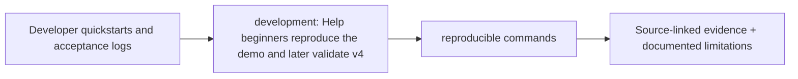

# Engineering gates and evidence-driven phase delivery

> **Design documentation only.** The original uploaded CLARION v4 PDF supplies blocks 0–12; linked implementation choices and status are proposed and not verified as code. The docs listed below replace earlier TODOs where indicated.

## Detailed contracts

- [Architecture, implementation and verification definition of done](definition-of-done.md)
- [Developer workflow planning (additional details pending implementation)](developer-guide.md)
- [Branch/PR workflow planning (additional details pending implementation)](git-workflow.md)

## Key gates

Review the [source-to-requirement audit](../architecture/REQUIREMENTS_AUDIT.md) before asserting cross-layer, labeled or economic-cost feasibility. Honest chain-only/unsupervised/abstained outputs remain mandatory whenever sources do not support the proposed model.

<!-- CLARION:AUTOGENERATED_FOLDER_GUIDE_BEGIN -->
## Maintainer technical guide — current source tree

> This section is **generated from tracked files** and intentionally preserves the earlier architecture/blueprint notes above. The file index describes the current repository, not a hypothetical implementation. See [source-wide coverage audit](../../docs/architecture/FEATURE_IMPLEMENTATION_AUDIT.md).

### Guide contents
1. [Purpose and actual status](#purpose-and-actual-status-development)
2. [Files directly in this folder](#files-directly-in-this-folder-development)
3. [Child modules and navigation](#child-modules-and-navigation-development)
4. [Technical architecture diagram](#technical-architecture-diagram-development)
5. [Tech stack and interfaces](#tech-stack-and-interfaces-development)
6. [Validation and work remaining](#validation-and-work-remaining-development)

### Purpose and actual status (development)
**Path:** `docs/development/`  
**Responsibility:** Help beginners reproduce the demo and later validate v4.  
**Consumes:** Developer quickstarts and acceptance logs.  
**Produces:** reproducible commands.  
**Current direct-file inventory:** Specification or guide: 9.

**Important:** Status is assessed per file; an architectural contract does not prove executable implementation. In particular, CLARION's core running code is primarily `src/clarion/application/engine.py`, `src/clarion/application/training_demo.py`, `src/clarion/api/main.py` and `src/clarion/v4/`, with the React screens in `frontend/src/app/App.tsx`. Other files may be placeholders.

### Files directly in this folder (development)
| Entry | Technical responsibility | State |
|---|---|---|
| [`DEMO_TEST_EVIDENCE.md`](DEMO_TEST_EVIDENCE.md) | Local execution evidence — October 22, 2026 | Specification or guide |
| [`RUNNABLE_DEMO.md`](RUNNABLE_DEMO.md) | CLARION v4 — runnable offline synthetic demonstration | Specification or guide |
| [`V4_BEGINNER_START_HERE.md`](V4_BEGINNER_START_HERE.md) | CLARION v4: from scratch to research validation (no invented results) | Specification or guide |
| [`V4_PIPELINES_AND_SCHEMAS.md`](V4_PIPELINES_AND_SCHEMAS.md) | CLARION v4: exact static data pipeline, schemas and dependencies | Specification or guide |
| [`V4_STATIC_IMPLEMENTATION_STATUS.md`](V4_STATIC_IMPLEMENTATION_STATUS.md) | CLARION v4 static implementation audit — 22 October 2026 | Specification or guide |
| [`definition-of-done.md`](definition-of-done.md) | Definition of done — architecture, code and scientific acceptance gates | Specification or guide |
| [`developer-guide.md`](developer-guide.md) | Development sequence and architecture controls (planned workflow) | Specification or guide |
| [`git-workflow.md`](git-workflow.md) | git-workflow.md — planned content | Specification or guide |
| [`implementation-playbook.md`](implementation-playbook.md) | CLARION v4 — Beginner-to-implementation playbook | Specification or guide |

### Child modules and navigation (development)
No tracked child folders.

### Technical architecture diagram (development)

### Tech stack and interfaces (development)
**Technologies:** Markdown, Mermaid and versioned JSON/YAML/configuration where present; execution lives in linked code directories.

**Input boundary:** Developer quickstarts and acceptance logs.  
**Output boundary:** reproducible commands.  
**Causal/evidence invariants:** Preserve source SHA-256, UTC `event_time` and `available_at`, explicit score type and `ABSTAIN` when required. Observed relay TXIDs never establish transaction origin or wallet ownership; candidate entity links are not confirmed identity; Country is non-scoring context.

**System contracts:** [original §0–§12 specification](../../docs/architecture/architecture-v4-spec.md) · [implemented versus planned matrix](../../docs/architecture/FEATURE_IMPLEMENTATION_AUDIT.md) · [canonical schemas and pipeline](../../docs/development/V4_PIPELINES_AND_SCHEMAS.md).

### Validation and work remaining (development)
- **Required gate:** Run results must be dated and reproducible.
- Verify the exact entrypoint and source file before using a planned module; avoid importing comment-only blueprints.
- For executable changes run affected Python/TypeScript tests, offline checks and canonical synthetic smoke validation. Real-data ML calibration, service negative controls and SIH capture semantics still need independent evidence.
- Record new inputs/outputs, schema versions and proven tests in this README; rerun `python scripts/docs/generate_folder_readmes.py --write` to refresh its indexed section.

<!-- CLARION:AUTOGENERATED_FOLDER_GUIDE_END -->
