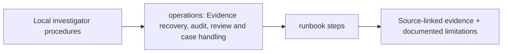

# docs/operations — implementation blueprint

> Architecture-only: no functionality or test success is claimed.

**Phase:** P4/P5
**Scope:** Offline workstation operations and case evidence handling guidance.

## Inputs and outputs
**Consumes:** Packaged artifacts, license/source manifests, authorized deployment  
**Provides:** Runbooks for installation, recovery and forensic audit

## Planned file responsibilities
| File | Required work |
|---|---|
| `offline-runbook.md` | Air-gapped wheels/assets and model checkpoint provisioning plan |
| `evidence-recovery.md` | Restore/checksum/source immutability and recovery plan |
| `case-operations.md` | Case review permissions, retention, export and redaction |

## Dependencies and security
No live capture or unreviewed external asset dependency.

## Test and completion gate
Fresh-machine disconnected install and backup restore checks.

Review [complete project structure](../../docs/architecture/repository-structure.md) before implementing. Commit real code and its tests in the relevant phase PR; replace comment-only placeholders deliberately.

<!-- CLARION:AUTOGENERATED_FOLDER_GUIDE_BEGIN -->
## Maintainer technical guide — current source tree

> This section is **generated from tracked files** and intentionally preserves the earlier architecture/blueprint notes above. The file index describes the current repository, not a hypothetical implementation. See [source-wide coverage audit](../../docs/architecture/FEATURE_IMPLEMENTATION_AUDIT.md).

### Guide contents
1. [Purpose and actual status](#purpose-and-actual-status-operations)
2. [Files directly in this folder](#files-directly-in-this-folder-operations)
3. [Child modules and navigation](#child-modules-and-navigation-operations)
4. [Technical architecture diagram](#technical-architecture-diagram-operations)
5. [Tech stack and interfaces](#tech-stack-and-interfaces-operations)
6. [Validation and work remaining](#validation-and-work-remaining-operations)

### Purpose and actual status (operations)
**Path:** `docs/operations/`  
**Responsibility:** Evidence recovery, audit, review and case handling.  
**Consumes:** Local investigator procedures.  
**Produces:** runbook steps.  
**Current direct-file inventory:** Specification or guide: 4.

**Important:** Status is assessed per file; an architectural contract does not prove executable implementation. In particular, CLARION's core running code is primarily `src/clarion/application/engine.py`, `src/clarion/application/training_demo.py`, `src/clarion/api/main.py` and `src/clarion/v4/`, with the React screens in `frontend/src/app/App.tsx`. Other files may be placeholders.

### Files directly in this folder (operations)
| Entry | Technical responsibility | State |
|---|---|---|
| [`SUBMISSION_DEPLOYMENT.md`](SUBMISSION_DEPLOYMENT.md) | CLARION synthetic demo — DevOps runbook | Specification or guide |
| [`case-operations.md`](case-operations.md) | ARCHITECTURE PLACEHOLDER ONLY — no runnable implementation | Specification or guide |
| [`evidence-recovery.md`](evidence-recovery.md) | ARCHITECTURE PLACEHOLDER ONLY — no runnable implementation | Specification or guide |
| [`offline-runbook.md`](offline-runbook.md) | ARCHITECTURE PLACEHOLDER ONLY — no runnable implementation | Specification or guide |

### Child modules and navigation (operations)
No tracked child folders.

### Technical architecture diagram (operations)

### Tech stack and interfaces (operations)
**Technologies:** Markdown, Mermaid and versioned JSON/YAML/configuration where present; execution lives in linked code directories.

**Input boundary:** Local investigator procedures.  
**Output boundary:** runbook steps.  
**Causal/evidence invariants:** Preserve source SHA-256, UTC `event_time` and `available_at`, explicit score type and `ABSTAIN` when required. Observed relay TXIDs never establish transaction origin or wallet ownership; candidate entity links are not confirmed identity; Country is non-scoring context.

**System contracts:** [original §0–§12 specification](../../docs/architecture/architecture-v4-spec.md) · [implemented versus planned matrix](../../docs/architecture/FEATURE_IMPLEMENTATION_AUDIT.md) · [canonical schemas and pipeline](../../docs/development/V4_PIPELINES_AND_SCHEMAS.md).

### Validation and work remaining (operations)
- **Required gate:** Protect legal process and privacy.
- Verify the exact entrypoint and source file before using a planned module; avoid importing comment-only blueprints.
- For executable changes run affected Python/TypeScript tests, offline checks and canonical synthetic smoke validation. Real-data ML calibration, service negative controls and SIH capture semantics still need independent evidence.
- Record new inputs/outputs, schema versions and proven tests in this README; rerun `python scripts/docs/generate_folder_readmes.py --write` to refresh its indexed section.

<!-- CLARION:AUTOGENERATED_FOLDER_GUIDE_END -->
