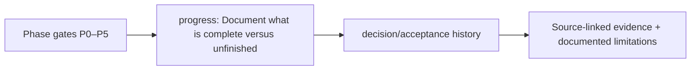

# docs/progress/ — Architecture contract

> **Documentation-only scaffold.** No module functionality is implemented. Follow the original v4 specification and root README; file stubs are comments describing future work.

## Responsibility
Phase status ledger: no phase may be reported complete without evidence.

## Phase ownership
P0–P5

## Planned files and their exact responsibilities

| File | What must be written during implementation |
|---|---|
| **phase-00-architecture.md** | Architecture review only; no code implemented. |
| **phase-01-foundation.md** | TODO: step status, commands, tests, risks and P2 handoff. |
| **phase-02-graph-entity-patterns.md** | TODO: model/MCER/motif verification and acceptance. |
| **phase-03-ml-cross-layer.md** | TODO: OOF stack, Δ/Π validity and performance. |
| **phase-04-console-propagation.md** | TODO: MLRP, UI and case dossier acceptance. |
| **phase-05-release.md** | TODO: Linux offline and scientific validation. |

## Data/interfaces
**Inputs:** See parent modules and the architecture specification.

**Outputs:** Versioned artifacts or typed interfaces; no implementation exists yet.

## Security, testing and acceptance
Require executable tests, provenance and review before marking complete.

For all modules: preserve provenance, causal availability, explicit uncertainty/abstention, offline operation, real tests and realistic false-positive controls. Record status in docs/progress before claiming completion.

## Implementation handoff
Do not add executable logic before the assigned phase PR; update this README when actual public interfaces, dependencies and tests are verified.

<!-- CLARION:AUTOGENERATED_FOLDER_GUIDE_BEGIN -->
## Maintainer technical guide — current source tree

> This section is **generated from tracked files** and intentionally preserves the earlier architecture/blueprint notes above. The file index describes the current repository, not a hypothetical implementation. See [source-wide coverage audit](../../docs/architecture/FEATURE_IMPLEMENTATION_AUDIT.md).

### Guide contents
1. [Purpose and actual status](#purpose-and-actual-status-progress)
2. [Files directly in this folder](#files-directly-in-this-folder-progress)
3. [Child modules and navigation](#child-modules-and-navigation-progress)
4. [Technical architecture diagram](#technical-architecture-diagram-progress)
5. [Tech stack and interfaces](#tech-stack-and-interfaces-progress)
6. [Validation and work remaining](#validation-and-work-remaining-progress)

### Purpose and actual status (progress)
**Path:** `docs/progress/`  
**Responsibility:** Document what is complete versus unfinished.  
**Consumes:** Phase gates P0–P5.  
**Produces:** decision/acceptance history.  
**Current direct-file inventory:** Specification or guide: 6.

**Important:** Status is assessed per file; an architectural contract does not prove executable implementation. In particular, CLARION's core running code is primarily `src/clarion/application/engine.py`, `src/clarion/application/training_demo.py`, `src/clarion/api/main.py` and `src/clarion/v4/`, with the React screens in `frontend/src/app/App.tsx`. Other files may be placeholders.

### Files directly in this folder (progress)
| Entry | Technical responsibility | State |
|---|---|---|
| [`phase-00-architecture.md`](phase-00-architecture.md) | Phase 0 — Architecture review and implementation gates | Specification or guide |
| [`phase-01-foundation.md`](phase-01-foundation.md) | phase-01-foundation.md — planned content | Specification or guide |
| [`phase-02-graph-entity-patterns.md`](phase-02-graph-entity-patterns.md) | phase-02-graph-entity-patterns.md — planned content | Specification or guide |
| [`phase-03-ml-cross-layer.md`](phase-03-ml-cross-layer.md) | phase-03-ml-cross-layer.md — planned content | Specification or guide |
| [`phase-04-console-propagation.md`](phase-04-console-propagation.md) | phase-04-console-propagation.md — planned content | Specification or guide |
| [`phase-05-release.md`](phase-05-release.md) | phase-05-release.md — planned content | Specification or guide |

### Child modules and navigation (progress)
No tracked child folders.

### Technical architecture diagram (progress)

### Tech stack and interfaces (progress)
**Technologies:** Markdown, Mermaid and versioned JSON/YAML/configuration where present; execution lives in linked code directories.

**Input boundary:** Phase gates P0–P5.  
**Output boundary:** decision/acceptance history.  
**Causal/evidence invariants:** Preserve source SHA-256, UTC `event_time` and `available_at`, explicit score type and `ABSTAIN` when required. Observed relay TXIDs never establish transaction origin or wallet ownership; candidate entity links are not confirmed identity; Country is non-scoring context.

**System contracts:** [original §0–§12 specification](../../docs/architecture/architecture-v4-spec.md) · [implemented versus planned matrix](../../docs/architecture/FEATURE_IMPLEMENTATION_AUDIT.md) · [canonical schemas and pipeline](../../docs/development/V4_PIPELINES_AND_SCHEMAS.md).

### Validation and work remaining (progress)
- **Required gate:** A phase description is not a passing test.
- Verify the exact entrypoint and source file before using a planned module; avoid importing comment-only blueprints.
- For executable changes run affected Python/TypeScript tests, offline checks and canonical synthetic smoke validation. Real-data ML calibration, service negative controls and SIH capture semantics still need independent evidence.
- Record new inputs/outputs, schema versions and proven tests in this README; rerun `python scripts/docs/generate_folder_readmes.py --write` to refresh its indexed section.

<!-- CLARION:AUTOGENERATED_FOLDER_GUIDE_END -->
