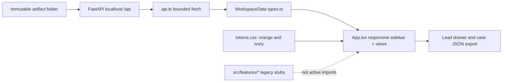
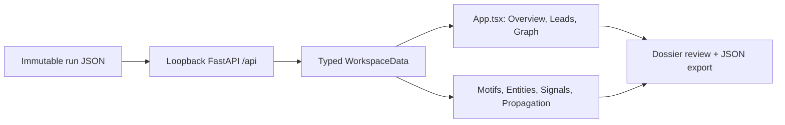

# CLARION Investigator Console — orange/white offline UI

An **actual React 18 + Vite + TypeScript frontend** replacing the previous
placeholder scaffold. Restrained terracotta (#C96743) / ivory (#FAF9F6) theme
inspired by the requested minimalist orange-and-white palette; original CLARION
layout, copy and controls.

## Development

```bash
cd frontend
npm install
npm run typecheck
npm run dev
```

Run `clarion serve --run artifacts/demo_run --port 8000` separately. Vite
proxies `/api` to this loopback service. Production bundle: `npm run build`
then serve `frontend/dist` from the loopback API service (no CDN dependencies).

## Live read-only routes
- `GET /api/manifest`
- `GET /api/leads?limit=1000`
- `GET /api/graph`
- `GET /api/motifs`
- `GET /api/propagation`

The UI derives overview, search, filters, inspector dossiers, graph neighborhoods,
motif lists, Δ/Π abstention panels, and propagation summaries from real run files.
It **never** fabricates missing entities, cross-layer eligibility, model metrics,
or labels. Case JSON export includes source hash references and is explicitly a
reviewable lead, not a claim of guilt.

No analytics, telemetry, font CDN or outbound API; assets are locally bundled.
This source has deliberately NOT been run or built in this authoring pass per request.

## Current React implementation — not merely the earlier scaffold

The initial documentation-only warning above describes the **old scaffold**. As of the reviewed v4 branch, the active UI is implemented in [`src/app/App.tsx`](src/app/App.tsx), with [`src/lib/api.ts`](src/lib/api.ts) and [`src/lib/types.ts`](src/lib/types.ts). Most files under `src/features/*` are **still blueprint stubs** and are *not* routed through the current app.

### UI components and API wiring
| Screen | Actual source / data |
|---|---|
| Overview KPIs and distribution | `App.tsx` → `GET /api/manifest`, `GET /api/leads` |
| Searchable P1–P4 lead queue, dossier drawer | `App.tsx` → `GET /api/leads`; reviewable JSON export |
| Bounded transaction chain-edge preview | `App.tsx` → `GET /api/graph`; not a full Cytoscape investigator yet |
| Structural pattern candidates | `App.tsx` → `GET /api/motifs` |
| Tentative entities | `App.tsx` → `GET /api/entities`; unknowns remain missing |
| Δ/Π scientific gate status | `App.tsx` → per-lead explicit `ABSTAIN` |
| Propagation exposure | `App.tsx` → `GET /api/propagation` |
| Audit, models and settings | `App.tsx` → local manifest fields, with unavailable results labeled honestly |

### Request-to-screen architecture


**Run:** `cd frontend && npm install && npm run typecheck && npm run build`. In development, start backend `clarion serve --run artifacts/v4_run --port 8000`, then `npm run dev` and browse port 5173. In release, the built bundle is served by the loopback backend. React compilation passed CI, but accessible graph scalability, reviewer authentication and printing require additional tests.

<!-- CLARION:AUTOGENERATED_FOLDER_GUIDE_BEGIN -->
## Maintainer technical guide — current source tree

> This section is **generated from tracked files** and intentionally preserves the earlier architecture/blueprint notes above. The file index describes the current repository, not a hypothetical implementation. See [source-wide coverage audit](../docs/architecture/FEATURE_IMPLEMENTATION_AUDIT.md).

### Guide contents
1. [Purpose and actual status](#purpose-and-actual-status-frontend)
2. [Files directly in this folder](#files-directly-in-this-folder-frontend)
3. [Child modules and navigation](#child-modules-and-navigation-frontend)
4. [Technical architecture diagram](#technical-architecture-diagram-frontend)
5. [Tech stack and interfaces](#tech-stack-and-interfaces-frontend)
6. [Validation and work remaining](#validation-and-work-remaining-frontend)

### Purpose and actual status (frontend)
**Path:** `frontend/`  
**Responsibility:** Build responsive terracotta/ivory read-only workspace.  
**Consumes:** Local /api JSON from approved run directory.  
**Produces:** offline bundled browser assets.  
**Current direct-file inventory:** Executable source / config (validate): 3, Source asset / fixture: 1.

**Important:** Status is assessed per file; an architectural contract does not prove executable implementation. In particular, CLARION's core running code is primarily `src/clarion/application/engine.py`, `src/clarion/application/training_demo.py`, `src/clarion/api/main.py` and `src/clarion/v4/`, with the React screens in `frontend/src/app/App.tsx`. Other files may be placeholders.

### Files directly in this folder (frontend)
| Entry | Technical responsibility | State |
|---|---|---|
| [`index.html`](index.html) | Versioned resource | Source asset / fixture |
| [`package.json`](package.json) | Typed data or metadata | Executable source / config (validate) |
| [`tsconfig.json`](tsconfig.json) | Typed data or metadata | Executable source / config (validate) |
| [`vite.config.ts`](vite.config.ts) | TypeScript contract | Executable source / config (validate) |

### Child modules and navigation (frontend)
- [`public/`](./public/README.md) — Plan packaged icons/assets.
- [`src/`](./src/README.md) — UI root, components, tokens and feature boundaries.

### Technical architecture diagram (frontend)


### Tech stack and interfaces (frontend)
**Technologies:** React 18, TypeScript, Vite, Lucide icons, CSS; localhost FastAPI JSON.

**Input boundary:** Local /api JSON from approved run directory.  
**Output boundary:** offline bundled browser assets.  
**Causal/evidence invariants:** Preserve source SHA-256, UTC `event_time` and `available_at`, explicit score type and `ABSTAIN` when required. Observed relay TXIDs never establish transaction origin or wallet ownership; candidate entity links are not confirmed identity; Country is non-scoring context.

**System contracts:** [original §0–§12 specification](../docs/architecture/architecture-v4-spec.md) · [implemented versus planned matrix](../docs/architecture/FEATURE_IMPLEMENTATION_AUDIT.md) · [canonical schemas and pipeline](../docs/development/V4_PIPELINES_AND_SCHEMAS.md).

### Validation and work remaining (frontend)
- **Required gate:** Component files in subfolders are often placeholders; active UI in src/app/App.tsx.
- Verify the exact entrypoint and source file before using a planned module; avoid importing comment-only blueprints.
- For executable changes run affected Python/TypeScript tests, offline checks and canonical synthetic smoke validation. Real-data ML calibration, service negative controls and SIH capture semantics still need independent evidence.
- Record new inputs/outputs, schema versions and proven tests in this README; rerun `python scripts/docs/generate_folder_readmes.py --write` to refresh its indexed section.

<!-- CLARION:AUTOGENERATED_FOLDER_GUIDE_END -->
