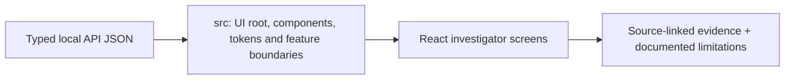

# Offline TypeScript investigator UI

> DESIGN ONLY — planned files are comments, not functioning application code.

**Scope:** React frontend composed from independent screen modules, shared view models and local assets.

## File and folder responsibilities

- app: routes, selected run/time and auth context.
- components: observed/inferred/abstained indicators, score legends.
- features: vertical folders for readiness, leads, graph, entities, patterns, signals, propagation, timeline, cases, models, audit.
- lib: local API client and versioned data types.
- styles: local CSS, accessible print and no CDN.
- main.tsx: future browser bootstrap (currently comment-only).

## Contracts, dependencies and safeguards

UI never reads source captures or fits ML; always preserve time cutoff, source evidence and score type.

## Exit criteria

Accessible offline browser, bounded graph, correct redactions and role-aware exports.

For system-level dependency direction and migration rationale, consult the [production structure blueprint](../../docs/architecture/repository-structure.md).

<!-- CLARION:AUTOGENERATED_FOLDER_GUIDE_BEGIN -->
## Maintainer technical guide — current source tree

> This section is **generated from tracked files** and intentionally preserves the earlier architecture/blueprint notes above. The file index describes the current repository, not a hypothetical implementation. See [source-wide coverage audit](../../docs/architecture/FEATURE_IMPLEMENTATION_AUDIT.md).

### Guide contents
1. [Purpose and actual status](#purpose-and-actual-status-src)
2. [Files directly in this folder](#files-directly-in-this-folder-src)
3. [Child modules and navigation](#child-modules-and-navigation-src)
4. [Technical architecture diagram](#technical-architecture-diagram-src)
5. [Tech stack and interfaces](#tech-stack-and-interfaces-src)
6. [Validation and work remaining](#validation-and-work-remaining-src)

### Purpose and actual status (src)
**Path:** `frontend/src/`  
**Responsibility:** UI root, components, tokens and feature boundaries.  
**Consumes:** Typed local API JSON.  
**Produces:** React investigator screens.  
**Current direct-file inventory:** Executable source / config (validate): 1.

**Important:** Status is assessed per file; an architectural contract does not prove executable implementation. In particular, CLARION's core running code is primarily `src/clarion/application/engine.py`, `src/clarion/application/training_demo.py`, `src/clarion/api/main.py` and `src/clarion/v4/`, with the React screens in `frontend/src/app/App.tsx`. Other files may be placeholders.

### Files directly in this folder (src)
| Entry | Technical responsibility | State |
|---|---|---|
| [`main.tsx`](main.tsx) | React component | Executable source / config (validate) |

### Child modules and navigation (src)
- [`app/`](./app/README.md) — React navigation, tables, dossier and graph preview.
- [`components/`](./components/README.md) — Reusable evidence indicators and risk scales (planned).
- [`features/`](./features/README.md) — Page-level feature subdivision (planned).
- [`lib/`](./lib/README.md) — Typed fetch helpers and score types.
- [`styles/`](./styles/README.md) — Responsive terracotta/ivory and print styles.

### Technical architecture diagram (src)

### Tech stack and interfaces (src)
**Technologies:** React 18, TypeScript, Vite, Lucide icons, CSS; localhost FastAPI JSON.

**Input boundary:** Typed local API JSON.  
**Output boundary:** React investigator screens.  
**Causal/evidence invariants:** Preserve source SHA-256, UTC `event_time` and `available_at`, explicit score type and `ABSTAIN` when required. Observed relay TXIDs never establish transaction origin or wallet ownership; candidate entity links are not confirmed identity; Country is non-scoring context.

**System contracts:** [original §0–§12 specification](../../docs/architecture/architecture-v4-spec.md) · [implemented versus planned matrix](../../docs/architecture/FEATURE_IMPLEMENTATION_AUDIT.md) · [canonical schemas and pipeline](../../docs/development/V4_PIPELINES_AND_SCHEMAS.md).

### Validation and work remaining (src)
- **Required gate:** Never invent unavailable scores or identities.
- Verify the exact entrypoint and source file before using a planned module; avoid importing comment-only blueprints.
- For executable changes run affected Python/TypeScript tests, offline checks and canonical synthetic smoke validation. Real-data ML calibration, service negative controls and SIH capture semantics still need independent evidence.
- Record new inputs/outputs, schema versions and proven tests in this README; rerun `python scripts/docs/generate_folder_readmes.py --write` to refresh its indexed section.

<!-- CLARION:AUTOGENERATED_FOLDER_GUIDE_END -->
