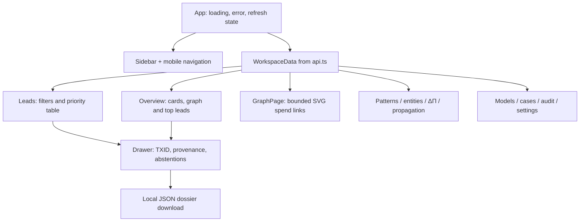
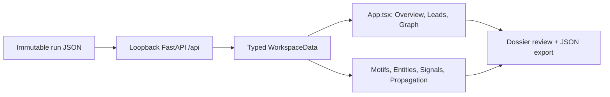

# frontend/src/app/ — Architecture contract

> **Documentation-only scaffold.** No module functionality is implemented. Follow the original v4 specification and root README; file stubs are comments describing future work.

## Responsibility
Top-level routes, session/auth state, accessibility layout and error boundaries.

## Phase ownership
P4

## Planned files and their exact responsibilities

| File | What must be written during implementation |
|---|---|
| **App.tsx** | TODO: compose cases/leads/graph/settings views and accessible navigation. |
| **routes.tsx** | TODO: route definitions and permission checks. |

## Data/interfaces
**Inputs:** See parent modules and the architecture specification.

**Outputs:** Versioned artifacts or typed interfaces; no implementation exists yet.

## Security, testing and acceptance
Require executable tests, provenance and review before marking complete.

For all modules: preserve provenance, causal availability, explicit uncertainty/abstention, offline operation, real tests and realistic false-positive controls. Record status in docs/progress before claiming completion.

## Implementation handoff
Do not add executable logic before the assigned phase PR; update this README when actual public interfaces, dependencies and tests are verified.

## Active application composition (v4)

The architecture-only warning above refers to the original scaffold. **The actual navigable application is implemented in [App.tsx](App.tsx).** [routes.tsx](routes.tsx) is not yet active; navigation is currently local page state rather than React Router.

### Screen composition

### Main functions and interfaces

- `App()`: fetch and error handling, navigation, selected lead state and refresh.
- `Overview()`: manifest-derived KPIs, top leads, distribution and small UTXO preview.
- `Leads()` / `LeadsTable()`: filter and sort client-side records returned from bounded API; keyboard selection.
- `MiniGraph()`: small SVG verified-spend-edge preview; **not** a full-scale force-directed six-type temporal graph. No IP ownership implication.
- `Drawer()`: source-linked lead breakdown with Δ/Π status and export.
- `Patterns()`, `Signals()`, `PropagationPage()`: show only actual recorded evidence, including ABSTAIN.
- `StatusPage()`: entity proposal, audit, model and settings summaries.

### Boundaries and refactor plan

All network requests go through `src/lib/api.ts` on same-origin `/api`. The real UI uses the orange/ivory tokens in `src/styles/tokens.css`, with print styles separate. The original `src/features/<domain>/` files are mostly blueprint components. Split their views out **only after adding real typed props, routing and E2E assertions**, without breaking this working vertical slice.

<!-- CLARION:AUTOGENERATED_FOLDER_GUIDE_BEGIN -->
## Maintainer technical guide — current source tree

> This section is **generated from tracked files** and intentionally preserves the earlier architecture/blueprint notes above. The file index describes the current repository, not a hypothetical implementation. See [source-wide coverage audit](../../../docs/architecture/FEATURE_IMPLEMENTATION_AUDIT.md).

### Guide contents
1. [Purpose and actual status](#purpose-and-actual-status-app)
2. [Files directly in this folder](#files-directly-in-this-folder-app)
3. [Child modules and navigation](#child-modules-and-navigation-app)
4. [Technical architecture diagram](#technical-architecture-diagram-app)
5. [Tech stack and interfaces](#tech-stack-and-interfaces-app)
6. [Validation and work remaining](#validation-and-work-remaining-app)

### Purpose and actual status (app)
**Path:** `frontend/src/app/`  
**Responsibility:** React navigation, tables, dossier and graph preview.  
**Consumes:** run manifest and lead/graph JSON.  
**Produces:** 11 responsive investigator views.  
**Current direct-file inventory:** Blueprint stub: 1, Executable source / config (validate): 1.

**Important:** Status is assessed per file; an architectural contract does not prove executable implementation. In particular, CLARION's core running code is primarily `src/clarion/application/engine.py`, `src/clarion/application/training_demo.py`, `src/clarion/api/main.py` and `src/clarion/v4/`, with the React screens in `frontend/src/app/App.tsx`. Other files may be placeholders.

### Files directly in this folder (app)
| Entry | Technical responsibility | State |
|---|---|---|
| [`App.tsx`](App.tsx) | React component | Executable source / config (validate) |
| [`routes.tsx`](routes.tsx) | React component | Blueprint stub |

### Child modules and navigation (app)
No tracked child folders.

### Technical architecture diagram (app)

### Tech stack and interfaces (app)
**Technologies:** React 18, TypeScript, Vite, Lucide icons, CSS; localhost FastAPI JSON.

**Input boundary:** run manifest and lead/graph JSON.  
**Output boundary:** 11 responsive investigator views.  
**Causal/evidence invariants:** Preserve source SHA-256, UTC `event_time` and `available_at`, explicit score type and `ABSTAIN` when required. Observed relay TXIDs never establish transaction origin or wallet ownership; candidate entity links are not confirmed identity; Country is non-scoring context.

**System contracts:** [original §0–§12 specification](../../../docs/architecture/architecture-v4-spec.md) · [implemented versus planned matrix](../../../docs/architecture/FEATURE_IMPLEMENTATION_AUDIT.md) · [canonical schemas and pipeline](../../../docs/development/V4_PIPELINES_AND_SCHEMAS.md).

### Validation and work remaining (app)
- **Required gate:** App.tsx is active; routes.tsx is a blueprint.
- Verify the exact entrypoint and source file before using a planned module; avoid importing comment-only blueprints.
- For executable changes run affected Python/TypeScript tests, offline checks and canonical synthetic smoke validation. Real-data ML calibration, service negative controls and SIH capture semantics still need independent evidence.
- Record new inputs/outputs, schema versions and proven tests in this README; rerun `python scripts/docs/generate_folder_readmes.py --write` to refresh its indexed section.

<!-- CLARION:AUTOGENERATED_FOLDER_GUIDE_END -->
