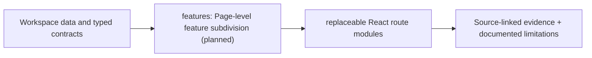

# Investigator screen modules

> DESIGN ONLY — planned files are comments, not functioning application code.

**Scope:** One folder per end-user workflow, each with its own README and comment-only TSX files.

## File and folder responsibilities

| Folder | Screen |
|---|---|
| readiness | schema, capture/label gates |
| leads | ranked priorities, filters and uncertainty |
| graph | six-type temporal graph and path tracing |
| entities | MCER versions, H1–H5 constraints |
| patterns | peel/mixing-like/layering witness paths |
| signals | OOF model, Δ and Π evidence |
| propagation | frozen seed, value/context risk channels and 25-point cap |
| timeline | separate block vs P2P observed time |
| cases | authorized local case PDF/CSV/JSON export |
| models | model cards, temporal holdout, ablations |
| audit | source/run hashes and review history |

## Contracts, dependencies and safeguards

One shared typed localhost client, bounded/time-scoped endpoints; no duplicate risk arithmetic in UI.

## Exit criteria

Functional UI/e2e and accessibility tests after Phase 4 implementation.

For system-level dependency direction and migration rationale, consult the [production structure blueprint](../../../docs/architecture/repository-structure.md).

<!-- CLARION:AUTOGENERATED_FOLDER_GUIDE_BEGIN -->
## Maintainer technical guide — current source tree

> This section is **generated from tracked files** and intentionally preserves the earlier architecture/blueprint notes above. The file index describes the current repository, not a hypothetical implementation. See [source-wide coverage audit](../../../docs/architecture/FEATURE_IMPLEMENTATION_AUDIT.md).

### Guide contents
1. [Purpose and actual status](#purpose-and-actual-status-features)
2. [Files directly in this folder](#files-directly-in-this-folder-features)
3. [Child modules and navigation](#child-modules-and-navigation-features)
4. [Technical architecture diagram](#technical-architecture-diagram-features)
5. [Tech stack and interfaces](#tech-stack-and-interfaces-features)
6. [Validation and work remaining](#validation-and-work-remaining-features)

### Purpose and actual status (features)
**Path:** `frontend/src/features/`  
**Responsibility:** Page-level feature subdivision (planned).  
**Consumes:** Workspace data and typed contracts.  
**Produces:** replaceable React route modules.  
**Current direct-file inventory:** No direct tracked non-README files; see child modules.

**Important:** Status is assessed per file; an architectural contract does not prove executable implementation. In particular, CLARION's core running code is primarily `src/clarion/application/engine.py`, `src/clarion/application/training_demo.py`, `src/clarion/api/main.py` and `src/clarion/v4/`, with the React screens in `frontend/src/app/App.tsx`. Other files may be placeholders.

### Files directly in this folder (features)
| Entry | Technical responsibility | State |
|---|---|---|
| *(none)* | Folder groups child modules / future files | — |

### Child modules and navigation (features)
- [`audit/`](./audit/README.md) — Plan the evidence audits component layer.
- [`cases/`](./cases/README.md) — Plan the case dossiers component layer.
- [`entities/`](./entities/README.md) — Plan the candidate entity hypotheses component layer.
- [`graph/`](./graph/README.md) — Plan the evidence graph component layer.
- [`leads/`](./leads/README.md) — Plan the lead queue component layer.
- [`models/`](./models/README.md) — Plan the model diagnostics component layer.
- [`patterns/`](./patterns/README.md) — Plan the motif investigation component layer.
- [`propagation/`](./propagation/README.md) — Plan the exposure paths component layer.
- [`readiness/`](./readiness/README.md) — Plan the readiness gates component layer.
- [`signals/`](./signals/README.md) — Plan the δ/π evidence status component layer.
- [`timeline/`](./timeline/README.md) — Plan the temporal graph navigation component layer.

### Technical architecture diagram (features)

### Tech stack and interfaces (features)
**Technologies:** React 18, TypeScript, Vite, Lucide icons, CSS; localhost FastAPI JSON.

**Input boundary:** Workspace data and typed contracts.  
**Output boundary:** replaceable React route modules.  
**Causal/evidence invariants:** Preserve source SHA-256, UTC `event_time` and `available_at`, explicit score type and `ABSTAIN` when required. Observed relay TXIDs never establish transaction origin or wallet ownership; candidate entity links are not confirmed identity; Country is non-scoring context.

**System contracts:** [original §0–§12 specification](../../../docs/architecture/architecture-v4-spec.md) · [implemented versus planned matrix](../../../docs/architecture/FEATURE_IMPLEMENTATION_AUDIT.md) · [canonical schemas and pipeline](../../../docs/development/V4_PIPELINES_AND_SCHEMAS.md).

### Validation and work remaining (features)
- **Required gate:** Active screens are centralized in App.tsx; feature leaf files are stubs.
- Verify the exact entrypoint and source file before using a planned module; avoid importing comment-only blueprints.
- For executable changes run affected Python/TypeScript tests, offline checks and canonical synthetic smoke validation. Real-data ML calibration, service negative controls and SIH capture semantics still need independent evidence.
- Record new inputs/outputs, schema versions and proven tests in this README; rerun `python scripts/docs/generate_folder_readmes.py --write` to refresh its indexed section.

<!-- CLARION:AUTOGENERATED_FOLDER_GUIDE_END -->
