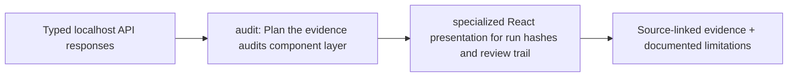

# frontend/src/features/audit — implementation blueprint

> Architecture-only: no functionality or test success is claimed.

**Phase:** P4
**Scope:** Source/run hashes, decisions, incident audit

## Inputs and outputs
**Consumes:** Typed localhost API, cutoff-filtered score/evidence view models  
**Provides:** Accessible screen and safe graph/query interactions

## Planned file responsibilities
| File | Required work |
|---|---|
| `AuditPage.tsx` | Source/run hashes, decisions, incident audit |

## Dependencies and security
UI never claims TXID host is wallet owner, never uses CDNs/remote telemetry; score type and evidence provenance visible.

## Test and completion gate
Keyboard navigation, offline assets, bounded rendering, correct warnings and source drill-down.

Review [complete project structure](../../../../docs/architecture/repository-structure.md) before implementing. Commit real code and its tests in the relevant phase PR; replace comment-only placeholders deliberately.

<!-- CLARION:AUTOGENERATED_FOLDER_GUIDE_BEGIN -->
## Maintainer technical guide — current source tree

> This section is **generated from tracked files** and intentionally preserves the earlier architecture/blueprint notes above. The file index describes the current repository, not a hypothetical implementation. See [source-wide coverage audit](../../../../docs/architecture/FEATURE_IMPLEMENTATION_AUDIT.md).

### Guide contents
1. [Purpose and actual status](#purpose-and-actual-status-audit)
2. [Files directly in this folder](#files-directly-in-this-folder-audit)
3. [Child modules and navigation](#child-modules-and-navigation-audit)
4. [Technical architecture diagram](#technical-architecture-diagram-audit)
5. [Tech stack and interfaces](#tech-stack-and-interfaces-audit)
6. [Validation and work remaining](#validation-and-work-remaining-audit)

### Purpose and actual status (audit)
**Path:** `frontend/src/features/audit/`  
**Responsibility:** Plan the evidence audits component layer.  
**Consumes:** Typed localhost API responses.  
**Produces:** specialized React presentation for run hashes and review trail.  
**Current direct-file inventory:** Blueprint stub: 1.

**Important:** Status is assessed per file; an architectural contract does not prove executable implementation. In particular, CLARION's core running code is primarily `src/clarion/application/engine.py`, `src/clarion/application/training_demo.py`, `src/clarion/api/main.py` and `src/clarion/v4/`, with the React screens in `frontend/src/app/App.tsx`. Other files may be placeholders.

### Files directly in this folder (audit)
| Entry | Technical responsibility | State |
|---|---|---|
| [`AuditPage.tsx`](AuditPage.tsx) | React component | Blueprint stub |

### Child modules and navigation (audit)
No tracked child folders.

### Technical architecture diagram (audit)

### Tech stack and interfaces (audit)
**Technologies:** React 18, TypeScript, Vite, Lucide icons, CSS; localhost FastAPI JSON.

**Input boundary:** Typed localhost API responses.  
**Output boundary:** specialized React presentation for run hashes and review trail.  
**Causal/evidence invariants:** Preserve source SHA-256, UTC `event_time` and `available_at`, explicit score type and `ABSTAIN` when required. Observed relay TXIDs never establish transaction origin or wallet ownership; candidate entity links are not confirmed identity; Country is non-scoring context.

**System contracts:** [original §0–§12 specification](../../../../docs/architecture/architecture-v4-spec.md) · [implemented versus planned matrix](../../../../docs/architecture/FEATURE_IMPLEMENTATION_AUDIT.md) · [canonical schemas and pipeline](../../../../docs/development/V4_PIPELINES_AND_SCHEMAS.md).

### Validation and work remaining (audit)
- **Required gate:** Leaf TSX files are architectural placeholders until implemented and tested.
- Verify the exact entrypoint and source file before using a planned module; avoid importing comment-only blueprints.
- For executable changes run affected Python/TypeScript tests, offline checks and canonical synthetic smoke validation. Real-data ML calibration, service negative controls and SIH capture semantics still need independent evidence.
- Record new inputs/outputs, schema versions and proven tests in this README; rerun `python scripts/docs/generate_folder_readmes.py --write` to refresh its indexed section.

<!-- CLARION:AUTOGENERATED_FOLDER_GUIDE_END -->
