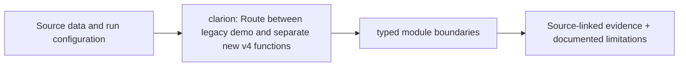

# CLARION Python backend

> DESIGN ONLY — planned files are comments, not functioning application code.

**Scope:** Typed modular monolith: one run orchestration layer, independent evidence and ML engines.

## File and folder responsibilities

- domain, core: immutable data and source/time/score invariants
- application: DAG, mode gates, checkpointing, frozen-seed order
- ingestion/adapters, readiness, chain, wire, storage: traceable evidence
- graph, features, representation, entity_resolution, patterns: graph and MCER
- training, detection, divergence, expenditure, fusion, propagation: ML and scores
- explanations, reporting, api/routers, cli: local case delivery
- security, observability, synthetic, evaluation: correctness and governance

## Contracts, dependencies and safeguards

Domain never depends on infrastructure; algorithm stages cannot import orchestration; source IP relay never proves wallet control.

## Exit criteria

Phase-wise integrated smoke, temporal leakage, transaction flow and air-gap tests.

For system-level dependency direction and migration rationale, consult the [production structure blueprint](../../docs/architecture/repository-structure.md).

<!-- CLARION:AUTOGENERATED_FOLDER_GUIDE_BEGIN -->
## Maintainer technical guide — current source tree

> This section is **generated from tracked files** and intentionally preserves the earlier architecture/blueprint notes above. The file index describes the current repository, not a hypothetical implementation. See [source-wide coverage audit](../../docs/architecture/FEATURE_IMPLEMENTATION_AUDIT.md).

### Guide contents
1. [Purpose and actual status](#purpose-and-actual-status-clarion)
2. [Files directly in this folder](#files-directly-in-this-folder-clarion)
3. [Child modules and navigation](#child-modules-and-navigation-clarion)
4. [Technical architecture diagram](#technical-architecture-diagram-clarion)
5. [Tech stack and interfaces](#tech-stack-and-interfaces-clarion)
6. [Validation and work remaining](#validation-and-work-remaining-clarion)

### Purpose and actual status (clarion)
**Path:** `src/clarion/`  
**Responsibility:** Route between legacy demo and separate new v4 functions.  
**Consumes:** Source data and run configuration.  
**Produces:** typed module boundaries.  
**Current direct-file inventory:** Package marker: 1.

**Important:** Status is assessed per file; an architectural contract does not prove executable implementation. In particular, CLARION's core running code is primarily `src/clarion/application/engine.py`, `src/clarion/application/training_demo.py`, `src/clarion/api/main.py` and `src/clarion/v4/`, with the React screens in `frontend/src/app/App.tsx`. Other files may be placeholders.

### Files directly in this folder (clarion)
| Entry | Technical responsibility | State |
|---|---|---|
| [`__init__.py`](__init__.py) | CLARION — offline, explainable Bitcoin transaction and network-traffic intelligence. | Package marker |

### Child modules and navigation (clarion)
- [`api/`](./api/README.md) — Read-only FastAPI for bundled React and case examination.
- [`application/`](./application/README.md) — Coordinate demo generation, validation, training and review.
- [`chain/`](./chain/README.md) — UTXO prevout/value validation.
- [`cli/`](./cli/README.md) — Dispatch explicit generate/train/investigate/serve commands.
- [`core/`](./core/README.md) — Shared settings/validation foundations.
- [`detection/`](./detection/README.md) — Four-family detector design and OOF stack.
- [`divergence/`](./divergence/README.md) — Estimate Δ residual dependences.
- [`domain/`](./domain/README.md) — Define stable domain boundaries.
- [`entity_resolution/`](./entity_resolution/README.md) — Compute conservative MCER proposals and lineage.
- [`evaluation/`](./evaluation/README.md) — Bootstrap, leakage, calibration and false-positive tests.
- [`expenditure/`](./expenditure/README.md) — Compare unit-consistent Π components.
- [`explanations/`](./explanations/README.md) — Explain contributions and hypothetical alternatives.
- [`features/`](./features/README.md) — Compute nullable chain, wire, temporal features.
- [`fusion/`](./fusion/README.md) — Freeze local priority then cap second-pass influence.
- [`graph/`](./graph/README.md) — Build temporal typed evidence structure.
- [`ingestion/`](./ingestion/README.md) — Bounded parsing and source validation.
- [`observability/`](./observability/README.md) — Track failures without leaking sensitive data.
- [`patterns/`](./patterns/README.md) — Detect structural peel, fan-in/out, mixing-like candidates.
- [`propagation/`](./propagation/README.md) — Propagate value-backed exposure ≤6 hops.
- [`readiness/`](./readiness/README.md) — Route chain-only/unsupervised/conditionally cross-layer.
- [`reporting/`](./reporting/README.md) — Offline JSON/CSV/PDF representations.
- [`representation/`](./representation/README.md) — GraphSAGE/GAT and heterogeneous representations.
- [`security/`](./security/README.md) — Reject unsafe inputs and redact optional host fields.
- [`storage/`](./storage/README.md) — Offline Parquet/DuckDB/SQLite contracts.
- [`synthetic/`](./synthetic/README.md) — Create fictional evidence and held-back ground truth.
- [`training/`](./training/README.md) — Design folds, training, registry and drift audits.
- [`v4/`](./v4/README.md) — Import → as-of UTXO graph → uncertain evidence → novelty and leads.
- [`wire/`](./wire/README.md) — Time-valid observed-TXID join and context.

### Technical architecture diagram (clarion)

### Tech stack and interfaces (clarion)
**Technologies:** Python 3.11/3.12, Pydantic 2 and scikit-learn where relevant; optional PyG/DuckDB/Arrow. See actual imports before installing.

**Input boundary:** Source data and run configuration.  
**Output boundary:** typed module boundaries.  
**Causal/evidence invariants:** Preserve source SHA-256, UTC `event_time` and `available_at`, explicit score type and `ABSTAIN` when required. Observed relay TXIDs never establish transaction origin or wallet ownership; candidate entity links are not confirmed identity; Country is non-scoring context.

**System contracts:** [original §0–§12 specification](../../docs/architecture/architecture-v4-spec.md) · [implemented versus planned matrix](../../docs/architecture/FEATURE_IMPLEMENTATION_AUDIT.md) · [canonical schemas and pipeline](../../docs/development/V4_PIPELINES_AND_SCHEMAS.md).

### Validation and work remaining (clarion)
- **Required gate:** Do not interpret folder existence as production feature completion.
- Verify the exact entrypoint and source file before using a planned module; avoid importing comment-only blueprints.
- For executable changes run affected Python/TypeScript tests, offline checks and canonical synthetic smoke validation. Real-data ML calibration, service negative controls and SIH capture semantics still need independent evidence.
- Record new inputs/outputs, schema versions and proven tests in this README; rerun `python scripts/docs/generate_folder_readmes.py --write` to refresh its indexed section.

<!-- CLARION:AUTOGENERATED_FOLDER_GUIDE_END -->
