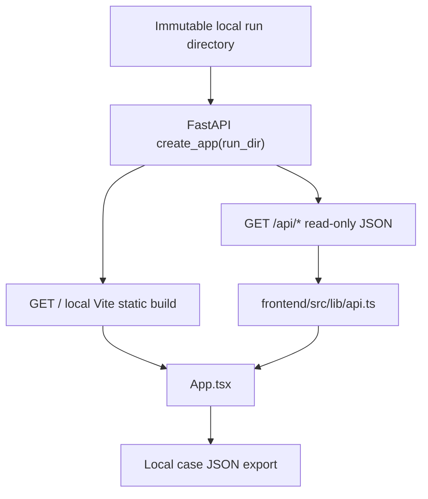
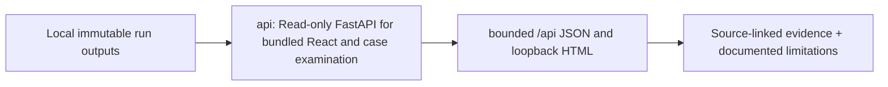

# Local investigator API and routers

> DESIGN ONLY — planned files are comments, not functioning application code.

**Scope:** FastAPI composition with bounded, authorized, read-only investigation queries.

## File and folder responsibilities

- main.py: FastAPI factory, offline/loopback defaults.
- dependencies.py: read-only DuckDB/result/model version injection and role context.
- schemas.py: DTO mapping and abstention/score type.
- routers/runs.py, leads.py, graph.py, entities.py, patterns.py: dataset/run and investigation.
- routers/signals.py, propagation.py, cases.py, models.py, evaluations.py: calibrated/novelty signals, safe risk paths, dossier and evidence metrics.

## Contracts, dependencies and safeguards

Each router owns its endpoint DTO; no training or scoring computation in HTTP handlers. API cannot expose private raw paths or unbounded graph neighborhoods.

## Exit criteria

OpenAPI/contract, role/access, paging, no egress and case export integration tests.

For system-level dependency direction and migration rationale, consult the [production structure blueprint](../../../docs/architecture/repository-structure.md).

## Active FastAPI service contract

The old README describes a planned router split. The **actual live API is [main.py](main.py)**, exposing only a local read-only view of persisted run outputs. Most leaf files under [routers/](routers/README.md) are still comment-only stubs.

### Routes and their artifact dependencies

| Method | Path | Run artifact |
|---|---|---|
| GET | `/` | Built React `frontend/dist/index.html` or legacy local HTML fallback |
| GET | `/api/manifest` | `run_manifest.json` |
| GET | `/api/leads?limit=&offset=` | Bounded `leads.json` |
| GET | `/api/graph` | `graph.json` |
| GET | `/api/motifs` | `motifs.json` |
| GET | `/api/propagation` | `propagation.json` |
| GET | `/api/entities` | `entities.json`, populated by canonical v4 pipeline |
| GET | `/api/features` | `features.json`, available from canonical v4 |
| GET | `/api/health` | Local health/read-only flags |

**Runtime:** `clarion serve --run artifacts/v4_run --port 8000`. Bind to loopback only. The old dark HTML page remains as fallback when compiled React assets are absent. The service is **not** an authenticated multiuser or Internet-exposed API. Neither API nor UI should map an observed relay host to a controlled wallet.

<!-- CLARION:AUTOGENERATED_FOLDER_GUIDE_BEGIN -->
## Maintainer technical guide — current source tree

> This section is **generated from tracked files** and intentionally preserves the earlier architecture/blueprint notes above. The file index describes the current repository, not a hypothetical implementation. See [source-wide coverage audit](../../../docs/architecture/FEATURE_IMPLEMENTATION_AUDIT.md).

### Guide contents
1. [Purpose and actual status](#purpose-and-actual-status-api)
2. [Files directly in this folder](#files-directly-in-this-folder-api)
3. [Child modules and navigation](#child-modules-and-navigation-api)
4. [Technical architecture diagram](#technical-architecture-diagram-api)
5. [Tech stack and interfaces](#tech-stack-and-interfaces-api)
6. [Validation and work remaining](#validation-and-work-remaining-api)

### Purpose and actual status (api)
**Path:** `src/clarion/api/`  
**Responsibility:** Read-only FastAPI for bundled React and case examination.  
**Consumes:** Local immutable run outputs.  
**Produces:** bounded /api JSON and loopback HTML.  
**Current direct-file inventory:** Blueprint stub: 3, Executable source / config (validate): 2.

**Important:** Status is assessed per file; an architectural contract does not prove executable implementation. In particular, CLARION's core running code is primarily `src/clarion/application/engine.py`, `src/clarion/application/training_demo.py`, `src/clarion/api/main.py` and `src/clarion/v4/`, with the React screens in `frontend/src/app/App.tsx`. Other files may be placeholders.

### Files directly in this folder (api)
| Entry | Technical responsibility | State |
|---|---|---|
| [`__init__.py`](__init__.py) | Python module | Blueprint stub |
| [`dependencies.py`](dependencies.py) | Python module | Blueprint stub |
| [`main.py`](main.py) | Read-only offline investigation dashboard. Only bind to loopback. | Executable source / config (validate) |
| [`reviews.py`](reviews.py) | Local case-management routes mounted under the immutable run-file API. Write operations require an explic | Executable source / config (validate) |
| [`schemas.py`](schemas.py) | Python module | Blueprint stub |

### Child modules and navigation (api)
- [`routers/`](./routers/README.md) — Future split routers for leads/graph/cases/models.

### Technical architecture diagram (api)

### Tech stack and interfaces (api)
**Technologies:** Python 3.11/3.12, Pydantic 2 and scikit-learn where relevant; optional PyG/DuckDB/Arrow. See actual imports before installing.

**Input boundary:** Local immutable run outputs.  
**Output boundary:** bounded /api JSON and loopback HTML.  
**Causal/evidence invariants:** Preserve source SHA-256, UTC `event_time` and `available_at`, explicit score type and `ABSTAIN` when required. Observed relay TXIDs never establish transaction origin or wallet ownership; candidate entity links are not confirmed identity; Country is non-scoring context.

**System contracts:** [original §0–§12 specification](../../../docs/architecture/architecture-v4-spec.md) · [implemented versus planned matrix](../../../docs/architecture/FEATURE_IMPLEMENTATION_AUDIT.md) · [canonical schemas and pipeline](../../../docs/development/V4_PIPELINES_AND_SCHEMAS.md).

### Validation and work remaining (api)
- **Required gate:** No public multi-user authorization guarantees.
- Verify the exact entrypoint and source file before using a planned module; avoid importing comment-only blueprints.
- For executable changes run affected Python/TypeScript tests, offline checks and canonical synthetic smoke validation. Real-data ML calibration, service negative controls and SIH capture semantics still need independent evidence.
- Record new inputs/outputs, schema versions and proven tests in this README; rerun `python scripts/docs/generate_folder_readmes.py --write` to refresh its indexed section.

<!-- CLARION:AUTOGENERATED_FOLDER_GUIDE_END -->
