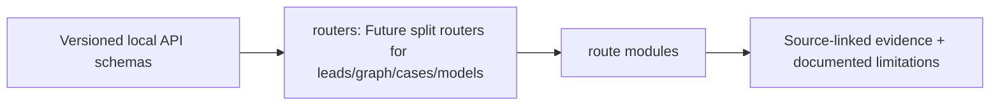

# src/clarion/api/routers — implementation blueprint

> Architecture-only: no functionality or test success is claimed.

**Phase:** P4
**Scope:** Separate versioned offline investigation HTTP query surfaces.

## Inputs and outputs
**Consumes:** Authenticated local reader, run model/evidence, finite query params  
**Provides:** Typed response DTOs, read-only investigation and authorized export

## Planned file responsibilities
| File | Required work |
|---|---|
| `__init__.py` | Router composition |
| `runs.py` | Runs, jobs and status |
| `leads.py` | Ranked leads and filters |
| `graph.py` | Bounded graph neighborhoods, evidence paths |
| `entities.py` | MCER candidate history/conflicts |
| `patterns.py` | Motif witness subgraphs |
| `signals.py` | Model, Δ/Π and typology results |
| `propagation.py` | Frozen seeds, bounded paths and risk layers |
| `cases.py` | Evidence dossier review/export |
| `models.py` | Model versions/calibration status |
| `evaluations.py` | Dataset/holdout metrics and ablations |

## Dependencies and security
No route performs training, new association inference or untrusted raw file execution; localhost until RBAC tested.

## Test and completion gate
API contract validation, pagination/limit, authorization and offline smoke.

Review [complete project structure](../../../../docs/architecture/repository-structure.md) before implementing. Commit real code and its tests in the relevant phase PR; replace comment-only placeholders deliberately.

<!-- CLARION:AUTOGENERATED_FOLDER_GUIDE_BEGIN -->
## Maintainer technical guide — current source tree

> This section is **generated from tracked files** and intentionally preserves the earlier architecture/blueprint notes above. The file index describes the current repository, not a hypothetical implementation. See [source-wide coverage audit](../../../../docs/architecture/FEATURE_IMPLEMENTATION_AUDIT.md).

### Guide contents
1. [Purpose and actual status](#purpose-and-actual-status-routers)
2. [Files directly in this folder](#files-directly-in-this-folder-routers)
3. [Child modules and navigation](#child-modules-and-navigation-routers)
4. [Technical architecture diagram](#technical-architecture-diagram-routers)
5. [Tech stack and interfaces](#tech-stack-and-interfaces-routers)
6. [Validation and work remaining](#validation-and-work-remaining-routers)

### Purpose and actual status (routers)
**Path:** `src/clarion/api/routers/`  
**Responsibility:** Future split routers for leads/graph/cases/models.  
**Consumes:** Versioned local API schemas.  
**Produces:** route modules.  
**Current direct-file inventory:** Blueprint stub: 10, Package marker: 1.

**Important:** Status is assessed per file; an architectural contract does not prove executable implementation. In particular, CLARION's core running code is primarily `src/clarion/application/engine.py`, `src/clarion/application/training_demo.py`, `src/clarion/api/main.py` and `src/clarion/v4/`, with the React screens in `frontend/src/app/App.tsx`. Other files may be placeholders.

### Files directly in this folder (routers)
| Entry | Technical responsibility | State |
|---|---|---|
| [`__init__.py`](__init__.py) | Python module | Package marker |
| [`cases.py`](cases.py) | Python module | Blueprint stub |
| [`entities.py`](entities.py) | Python module | Blueprint stub |
| [`evaluations.py`](evaluations.py) | Python module | Blueprint stub |
| [`graph.py`](graph.py) | Python module | Blueprint stub |
| [`leads.py`](leads.py) | Python module | Blueprint stub |
| [`models.py`](models.py) | Python module | Blueprint stub |
| [`patterns.py`](patterns.py) | Python module | Blueprint stub |
| [`propagation.py`](propagation.py) | Python module | Blueprint stub |
| [`runs.py`](runs.py) | Python module | Blueprint stub |
| [`signals.py`](signals.py) | Python module | Blueprint stub |

### Child modules and navigation (routers)
No tracked child folders.

### Technical architecture diagram (routers)

### Tech stack and interfaces (routers)
**Technologies:** Python 3.11/3.12, Pydantic 2 and scikit-learn where relevant; optional PyG/DuckDB/Arrow. See actual imports before installing.

**Input boundary:** Versioned local API schemas.  
**Output boundary:** route modules.  
**Causal/evidence invariants:** Preserve source SHA-256, UTC `event_time` and `available_at`, explicit score type and `ABSTAIN` when required. Observed relay TXIDs never establish transaction origin or wallet ownership; candidate entity links are not confirmed identity; Country is non-scoring context.

**System contracts:** [original §0–§12 specification](../../../../docs/architecture/architecture-v4-spec.md) · [implemented versus planned matrix](../../../../docs/architecture/FEATURE_IMPLEMENTATION_AUDIT.md) · [canonical schemas and pipeline](../../../../docs/development/V4_PIPELINES_AND_SCHEMAS.md).

### Validation and work remaining (routers)
- **Required gate:** Many router files are still comment-only stubs; active routes in api/main.py.
- Verify the exact entrypoint and source file before using a planned module; avoid importing comment-only blueprints.
- For executable changes run affected Python/TypeScript tests, offline checks and canonical synthetic smoke validation. Real-data ML calibration, service negative controls and SIH capture semantics still need independent evidence.
- Record new inputs/outputs, schema versions and proven tests in this README; rerun `python scripts/docs/generate_folder_readmes.py --write` to refresh its indexed section.

<!-- CLARION:AUTOGENERATED_FOLDER_GUIDE_END -->
