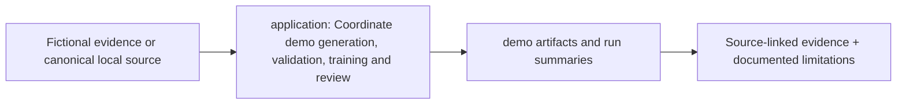

# src/clarion/application — implementation blueprint

> Architecture-only: no functionality or test success is claimed.

**Phase:** P1–P4
**Scope:** One orchestrator and lifecycle for entire local investigation pipeline.

## Inputs and outputs
**Consumes:** Domain contracts, readiness, immutable snapshots, injected services  
**Provides:** Deterministic run manifests, routed stages, reproducible cases

## Planned file responsibilities
| File | Required work |
|---|---|
| `__init__.py` | Module API |
| `pipeline.py` | Ingest→ready→graph→features→MCER→motifs→stack/Δ/Π→freeze→MLRP→final risk→dossier |
| `stages.py` | Typed stage prerequisites, status and abstention |
| `run_manager.py` | Atomic jobs, resume, checkpoint, hash/version ledger |
| `mode_policy.py` | Cross-layer/chain-only and supervised/unsupervised routing |

## Dependencies and security
Coordinates modules; no algorithm duplication, no inference-time network, no pass-2 feedback.

## Test and completion gate
End-to-end fixtures, no-wire/labels/goal fallbacks, deterministic restart.

Review [complete project structure](../../../docs/architecture/repository-structure.md) before implementing. Commit real code and its tests in the relevant phase PR; replace comment-only placeholders deliberately.

<!-- CLARION:AUTOGENERATED_FOLDER_GUIDE_BEGIN -->
## Maintainer technical guide — current source tree

> This section is **generated from tracked files** and intentionally preserves the earlier architecture/blueprint notes above. The file index describes the current repository, not a hypothetical implementation. See [source-wide coverage audit](../../../docs/architecture/FEATURE_IMPLEMENTATION_AUDIT.md).

### Guide contents
1. [Purpose and actual status](#purpose-and-actual-status-application)
2. [Files directly in this folder](#files-directly-in-this-folder-application)
3. [Child modules and navigation](#child-modules-and-navigation-application)
4. [Technical architecture diagram](#technical-architecture-diagram-application)
5. [Tech stack and interfaces](#tech-stack-and-interfaces-application)
6. [Validation and work remaining](#validation-and-work-remaining-application)

### Purpose and actual status (application)
**Path:** `src/clarion/application/`  
**Responsibility:** Coordinate demo generation, validation, training and review.  
**Consumes:** Fictional evidence or canonical local source.  
**Produces:** demo artifacts and run summaries.  
**Current direct-file inventory:** Blueprint stub: 4, Executable source / config (validate): 2, Package marker: 1.

**Important:** Status is assessed per file; an architectural contract does not prove executable implementation. In particular, CLARION's core running code is primarily `src/clarion/application/engine.py`, `src/clarion/application/training_demo.py`, `src/clarion/api/main.py` and `src/clarion/v4/`, with the React screens in `frontend/src/app/App.tsx`. Other files may be placeholders.

### Files directly in this folder (application)
| Entry | Technical responsibility | State |
|---|---|---|
| [`__init__.py`](__init__.py) | Python module | Package marker |
| [`engine.py`](engine.py) | CLARION evidence-first local demonstration engine. All generated addresses/transactions and ground truth  | Executable source / config (validate) |
| [`mode_policy.py`](mode_policy.py) | Python module | Blueprint stub |
| [`pipeline.py`](pipeline.py) | Python module | Blueprint stub |
| [`run_manager.py`](run_manager.py) | Python module | Blueprint stub |
| [`stages.py`](stages.py) | Python module | Blueprint stub |
| [`training_demo.py`](training_demo.py) | Chronological demo-only out-of-fold stacking. NOT validated real-world AML prediction. | Executable source / config (validate) |

### Child modules and navigation (application)
No tracked child folders.

### Technical architecture diagram (application)

### Tech stack and interfaces (application)
**Technologies:** Python 3.11/3.12, Pydantic 2 and scikit-learn where relevant; optional PyG/DuckDB/Arrow. See actual imports before installing.

**Input boundary:** Fictional evidence or canonical local source.  
**Output boundary:** demo artifacts and run summaries.  
**Causal/evidence invariants:** Preserve source SHA-256, UTC `event_time` and `available_at`, explicit score type and `ABSTAIN` when required. Observed relay TXIDs never establish transaction origin or wallet ownership; candidate entity links are not confirmed identity; Country is non-scoring context.

**System contracts:** [original §0–§12 specification](../../../docs/architecture/architecture-v4-spec.md) · [implemented versus planned matrix](../../../docs/architecture/FEATURE_IMPLEMENTATION_AUDIT.md) · [canonical schemas and pipeline](../../../docs/development/V4_PIPELINES_AND_SCHEMAS.md).

### Validation and work remaining (application)
- **Required gate:** Demo success does not validate actual financial crime detection.
- Verify the exact entrypoint and source file before using a planned module; avoid importing comment-only blueprints.
- For executable changes run affected Python/TypeScript tests, offline checks and canonical synthetic smoke validation. Real-data ML calibration, service negative controls and SIH capture semantics still need independent evidence.
- Record new inputs/outputs, schema versions and proven tests in this README; rerun `python scripts/docs/generate_folder_readmes.py --write` to refresh its indexed section.

<!-- CLARION:AUTOGENERATED_FOLDER_GUIDE_END -->
