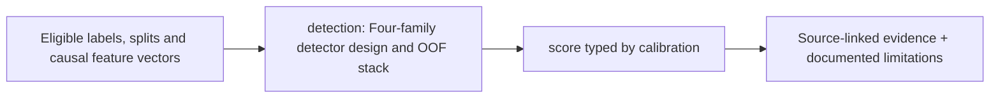

# src/clarion/detection/ — Architecture contract

> **Documentation-only scaffold.** No module functionality is implemented. Follow the original v4 specification and root README; file stubs are comments describing future work.

## Responsibility
Classic supervised and unsupervised detectors plus OOF meta-learning.

## Phase ownership
P3

## Planned files and their exact responsibilities

| File | What must be written during implementation |
|---|---|
| **__init__.py** | Declare package boundary. |
| **supervised.py** | LR RF optional LightGBM base learners and feature fit. |
| **unsupervised.py** | Isolation Forest OCSVM GMM and honest novelty ranking. |
| **graph_heads.py** | GNN classifier/novelty head on model-valid embeddings. |
| **stacking.py** | Chronological OOF stacking, calibrator and abstention handling. |

## Data/interfaces
**Inputs:** Validated train folds and representations.

**Outputs:** Scores, calibrated probabilities only if eligible, uncertainty manifests.

## Security, testing and acceptance
Meta-model cannot train on in-sample base predictions.

For all modules: preserve provenance, causal availability, explicit uncertainty/abstention, offline operation, real tests and realistic false-positive controls. Record status in docs/progress before claiming completion.

## Implementation handoff
Do not add executable logic before the assigned phase PR; update this README when actual public interfaces, dependencies and tests are verified.

---

## Detailed §6 stacking engineering contract

**Source-derived architecture:** four base learner families; rule score 0–1; supervised LR/RF/LightGBM; unsupervised IF/OCSVM/GMM plus density diagnostics; GraphSAGE/GAT and temporal graph heads; chronological OOF predictions; regularized LR/LightGBM meta learner; eligible Δ/Π/motif meta-features; anomaly probability only with valid labels/calibration and conformal diagnostics.

**Do not** include graph propagation in pass-1, even though the uploaded diagram lists it among possible meta-features: seeds originate in pass-1. Put this score into capped pass-2 §9 after frozen §10 propagation.

**Inputs:** subject-level cutoff graph snapshot, causal feature registry, eligible labels, fold boundaries, embeddings, motif/Δ/Π feature availability and masks. **Outputs:** base score table (score types), OOF table, meta-model and calibration versions, likelihood/novelty, confidence/abstention, feature contributions.

**Required tests:** no in-sample meta-features; no future graph features or MCER state; no leakage from imputation/normalization; no false calibrated probability in unsupervised mode; false-positive cohorts and temporal holdout. Complete design: [Stacking architecture](../../../docs/architecture/stacking-architecture.md).

<!-- CLARION:AUTOGENERATED_FOLDER_GUIDE_BEGIN -->
## Maintainer technical guide — current source tree

> This section is **generated from tracked files** and intentionally preserves the earlier architecture/blueprint notes above. The file index describes the current repository, not a hypothetical implementation. See [source-wide coverage audit](../../../docs/architecture/FEATURE_IMPLEMENTATION_AUDIT.md).

### Guide contents
1. [Purpose and actual status](#purpose-and-actual-status-detection)
2. [Files directly in this folder](#files-directly-in-this-folder-detection)
3. [Child modules and navigation](#child-modules-and-navigation-detection)
4. [Technical architecture diagram](#technical-architecture-diagram-detection)
5. [Tech stack and interfaces](#tech-stack-and-interfaces-detection)
6. [Validation and work remaining](#validation-and-work-remaining-detection)

### Purpose and actual status (detection)
**Path:** `src/clarion/detection/`  
**Responsibility:** Four-family detector design and OOF stack.  
**Consumes:** Eligible labels, splits and causal feature vectors.  
**Produces:** score typed by calibration.  
**Current direct-file inventory:** Blueprint stub: 5.

**Important:** Status is assessed per file; an architectural contract does not prove executable implementation. In particular, CLARION's core running code is primarily `src/clarion/application/engine.py`, `src/clarion/application/training_demo.py`, `src/clarion/api/main.py` and `src/clarion/v4/`, with the React screens in `frontend/src/app/App.tsx`. Other files may be placeholders.

### Files directly in this folder (detection)
| Entry | Technical responsibility | State |
|---|---|---|
| [`__init__.py`](__init__.py) | Python module | Blueprint stub |
| [`graph_heads.py`](graph_heads.py) | Python module | Blueprint stub |
| [`stacking.py`](stacking.py) | Python module | Blueprint stub |
| [`supervised.py`](supervised.py) | Python module | Blueprint stub |
| [`unsupervised.py`](unsupervised.py) | Python module | Blueprint stub |

### Child modules and navigation (detection)
No tracked child folders.

### Technical architecture diagram (detection)

### Tech stack and interfaces (detection)
**Technologies:** Python 3.11/3.12, Pydantic 2 and scikit-learn where relevant; optional PyG/DuckDB/Arrow. See actual imports before installing.

**Input boundary:** Eligible labels, splits and causal feature vectors.  
**Output boundary:** score typed by calibration.  
**Causal/evidence invariants:** Preserve source SHA-256, UTC `event_time` and `available_at`, explicit score type and `ABSTAIN` when required. Observed relay TXIDs never establish transaction origin or wallet ownership; candidate entity links are not confirmed identity; Country is non-scoring context.

**System contracts:** [original §0–§12 specification](../../../docs/architecture/architecture-v4-spec.md) · [implemented versus planned matrix](../../../docs/architecture/FEATURE_IMPLEMENTATION_AUDIT.md) · [canonical schemas and pipeline](../../../docs/development/V4_PIPELINES_AND_SCHEMAS.md).

### Validation and work remaining (detection)
- **Required gate:** Unsupervised novelty is not illicit probability.
- Verify the exact entrypoint and source file before using a planned module; avoid importing comment-only blueprints.
- For executable changes run affected Python/TypeScript tests, offline checks and canonical synthetic smoke validation. Real-data ML calibration, service negative controls and SIH capture semantics still need independent evidence.
- Record new inputs/outputs, schema versions and proven tests in this README; rerun `python scripts/docs/generate_folder_readmes.py --write` to refresh its indexed section.

<!-- CLARION:AUTOGENERATED_FOLDER_GUIDE_END -->
