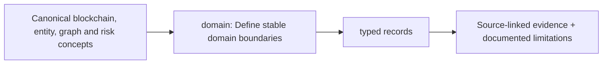

# src/clarion/domain — implementation blueprint

> Architecture-only: no functionality or test success is claimed.

**Phase:** P1–P4
**Scope:** Typed immutable Bitcoin, graph, evidence, entity, scoring and case objects.

## Inputs and outputs
**Consumes:** Validated source records, schema definitions, provenance  
**Provides:** Strongly typed value objects; explicit uncertainty, abstention and cutoff

## Planned file responsibilities
| File | Required work |
|---|---|
| `__init__.py` | Public domain types and schema version |
| `evidence.py` | Source references, hashes, observation time precision |
| `bitcoin.py` | Exact TXID/outpoint, amount_sats, transaction inputs/outputs |
| `graph.py` | Six node types and permitted temporal evidence edges |
| `entity.py` | Candidate clusters, constraints and lineage |
| `scoring.py` | Score types, Δ/Π, frozen seed, propagation output |
| `investigation.py` | Lead, case dossier and review state |

## Dependencies and security
No imports from ML, DuckDB, FastAPI, UI; relay never equals wallet controller.

## Test and completion gate
Validation/invariant tests for sats, time, source IDs, score kinds.

Review [complete project structure](../../../docs/architecture/repository-structure.md) before implementing. Commit real code and its tests in the relevant phase PR; replace comment-only placeholders deliberately.

<!-- CLARION:AUTOGENERATED_FOLDER_GUIDE_BEGIN -->
## Maintainer technical guide — current source tree

> This section is **generated from tracked files** and intentionally preserves the earlier architecture/blueprint notes above. The file index describes the current repository, not a hypothetical implementation. See [source-wide coverage audit](../../../docs/architecture/FEATURE_IMPLEMENTATION_AUDIT.md).

### Guide contents
1. [Purpose and actual status](#purpose-and-actual-status-domain)
2. [Files directly in this folder](#files-directly-in-this-folder-domain)
3. [Child modules and navigation](#child-modules-and-navigation-domain)
4. [Technical architecture diagram](#technical-architecture-diagram-domain)
5. [Tech stack and interfaces](#tech-stack-and-interfaces-domain)
6. [Validation and work remaining](#validation-and-work-remaining-domain)

### Purpose and actual status (domain)
**Path:** `src/clarion/domain/`  
**Responsibility:** Define stable domain boundaries.  
**Consumes:** Canonical blockchain, entity, graph and risk concepts.  
**Produces:** typed records.  
**Current direct-file inventory:** Blueprint stub: 6, Package marker: 1.

**Important:** Status is assessed per file; an architectural contract does not prove executable implementation. In particular, CLARION's core running code is primarily `src/clarion/application/engine.py`, `src/clarion/application/training_demo.py`, `src/clarion/api/main.py` and `src/clarion/v4/`, with the React screens in `frontend/src/app/App.tsx`. Other files may be placeholders.

### Files directly in this folder (domain)
| Entry | Technical responsibility | State |
|---|---|---|
| [`__init__.py`](__init__.py) | Python module | Package marker |
| [`bitcoin.py`](bitcoin.py) | Python module | Blueprint stub |
| [`entity.py`](entity.py) | Python module | Blueprint stub |
| [`evidence.py`](evidence.py) | Python module | Blueprint stub |
| [`graph.py`](graph.py) | Python module | Blueprint stub |
| [`investigation.py`](investigation.py) | Python module | Blueprint stub |
| [`scoring.py`](scoring.py) | Python module | Blueprint stub |

### Child modules and navigation (domain)
No tracked child folders.

### Technical architecture diagram (domain)

### Tech stack and interfaces (domain)
**Technologies:** Python 3.11/3.12, Pydantic 2 and scikit-learn where relevant; optional PyG/DuckDB/Arrow. See actual imports before installing.

**Input boundary:** Canonical blockchain, entity, graph and risk concepts.  
**Output boundary:** typed records.  
**Causal/evidence invariants:** Preserve source SHA-256, UTC `event_time` and `available_at`, explicit score type and `ABSTAIN` when required. Observed relay TXIDs never establish transaction origin or wallet ownership; candidate entity links are not confirmed identity; Country is non-scoring context.

**System contracts:** [original §0–§12 specification](../../../docs/architecture/architecture-v4-spec.md) · [implemented versus planned matrix](../../../docs/architecture/FEATURE_IMPLEMENTATION_AUDIT.md) · [canonical schemas and pipeline](../../../docs/development/V4_PIPELINES_AND_SCHEMAS.md).

### Validation and work remaining (domain)
- **Required gate:** Legacy domain files are blueprints; live canonical contracts in v4/contracts.py.
- Verify the exact entrypoint and source file before using a planned module; avoid importing comment-only blueprints.
- For executable changes run affected Python/TypeScript tests, offline checks and canonical synthetic smoke validation. Real-data ML calibration, service negative controls and SIH capture semantics still need independent evidence.
- Record new inputs/outputs, schema versions and proven tests in this README; rerun `python scripts/docs/generate_folder_readmes.py --write` to refresh its indexed section.

<!-- CLARION:AUTOGENERATED_FOLDER_GUIDE_END -->
