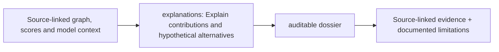

# src/clarion/explanations/ — Architecture contract

> **Documentation-only scaffold.** No module functionality is implemented. Follow the original v4 specification and root README; file stubs are comments describing future work.

## Responsibility
Evidence-centered interpretability and minimal sufficient proof subgraphs.

## Phase ownership
P4

## Planned files and their exact responsibilities

| File | What must be written during implementation |
|---|---|
| **__init__.py** | Declare package boundary. |
| **contributions.py** | SHAP/model contributions and signal/gating bars. |
| **dossiers.py** | Assemble local, signed and redactable case evidence. |
| **counterfactual.py** | Time-valid chain-only vs cross-layer ablation comparison. |

## Data/interfaces
**Inputs:** Model outputs, evidence graph, typed uncertainty and manifest.

**Outputs:** Case dossier data with human-readable evidence paths.

## Security, testing and acceptance
Never export unauthorized IP identifiers or unreviewed attribution.

For all modules: preserve provenance, causal availability, explicit uncertainty/abstention, offline operation, real tests and realistic false-positive controls. Record status in docs/progress before claiming completion.

## Implementation handoff
Do not add executable logic before the assigned phase PR; update this README when actual public interfaces, dependencies and tests are verified.

---

## Explanation and dossier output contract (§11)

Produce SHAP over the **eligible stacking meta-model** when supported, local score contribution bars (stack, Δ, Π, motif and propagation **separate**), MCER evidence history, minimal sufficient chain/wire graph, itemized Π observed-versus-minimum bill, plain-language Δ contradiction, frozen-seed MLRP path, confidence/uncertainty and legitimate alternatives.

Dossier also includes source hashes, cutoff, encoder/model versions, feature availability and abstentions, ASN/country/host attribution as **uncertain context**, chain-only re-score when supported and offline PDF/CSV/JSON exports with role-based redaction and file hashes. See [Dashboard design](../../../docs/architecture/investigator-dashboard-architecture.md).

## Explicit separation: explanation versus reporting

explanations/ decides which claims can be supported by paths, score kinds, Δ/Π/MLRP evidence and caveats. reporting/ is separately responsible for safe authorized PDF/CSV/JSON rendering, escaping, redaction and export manifests; the UI does not construct forensic reports directly. See [reporting blueprint](../reporting/README.md).

<!-- CLARION:AUTOGENERATED_FOLDER_GUIDE_BEGIN -->
## Maintainer technical guide — current source tree

> This section is **generated from tracked files** and intentionally preserves the earlier architecture/blueprint notes above. The file index describes the current repository, not a hypothetical implementation. See [source-wide coverage audit](../../../docs/architecture/FEATURE_IMPLEMENTATION_AUDIT.md).

### Guide contents
1. [Purpose and actual status](#purpose-and-actual-status-explanations)
2. [Files directly in this folder](#files-directly-in-this-folder-explanations)
3. [Child modules and navigation](#child-modules-and-navigation-explanations)
4. [Technical architecture diagram](#technical-architecture-diagram-explanations)
5. [Tech stack and interfaces](#tech-stack-and-interfaces-explanations)
6. [Validation and work remaining](#validation-and-work-remaining-explanations)

### Purpose and actual status (explanations)
**Path:** `src/clarion/explanations/`  
**Responsibility:** Explain contributions and hypothetical alternatives.  
**Consumes:** Source-linked graph, scores and model context.  
**Produces:** auditable dossier.  
**Current direct-file inventory:** Blueprint stub: 4.

**Important:** Status is assessed per file; an architectural contract does not prove executable implementation. In particular, CLARION's core running code is primarily `src/clarion/application/engine.py`, `src/clarion/application/training_demo.py`, `src/clarion/api/main.py` and `src/clarion/v4/`, with the React screens in `frontend/src/app/App.tsx`. Other files may be placeholders.

### Files directly in this folder (explanations)
| Entry | Technical responsibility | State |
|---|---|---|
| [`__init__.py`](__init__.py) | Python module | Blueprint stub |
| [`contributions.py`](contributions.py) | Python module | Blueprint stub |
| [`counterfactual.py`](counterfactual.py) | Python module | Blueprint stub |
| [`dossiers.py`](dossiers.py) | Python module | Blueprint stub |

### Child modules and navigation (explanations)
No tracked child folders.

### Technical architecture diagram (explanations)

### Tech stack and interfaces (explanations)
**Technologies:** Python 3.11/3.12, Pydantic 2 and scikit-learn where relevant; optional PyG/DuckDB/Arrow. See actual imports before installing.

**Input boundary:** Source-linked graph, scores and model context.  
**Output boundary:** auditable dossier.  
**Causal/evidence invariants:** Preserve source SHA-256, UTC `event_time` and `available_at`, explicit score type and `ABSTAIN` when required. Observed relay TXIDs never establish transaction origin or wallet ownership; candidate entity links are not confirmed identity; Country is non-scoring context.

**System contracts:** [original §0–§12 specification](../../../docs/architecture/architecture-v4-spec.md) · [implemented versus planned matrix](../../../docs/architecture/FEATURE_IMPLEMENTATION_AUDIT.md) · [canonical schemas and pipeline](../../../docs/development/V4_PIPELINES_AND_SCHEMAS.md).

### Validation and work remaining (explanations)
- **Required gate:** Deterministic evidence has priority over attention scores.
- Verify the exact entrypoint and source file before using a planned module; avoid importing comment-only blueprints.
- For executable changes run affected Python/TypeScript tests, offline checks and canonical synthetic smoke validation. Real-data ML calibration, service negative controls and SIH capture semantics still need independent evidence.
- Record new inputs/outputs, schema versions and proven tests in this README; rerun `python scripts/docs/generate_folder_readmes.py --write` to refresh its indexed section.

<!-- CLARION:AUTOGENERATED_FOLDER_GUIDE_END -->
