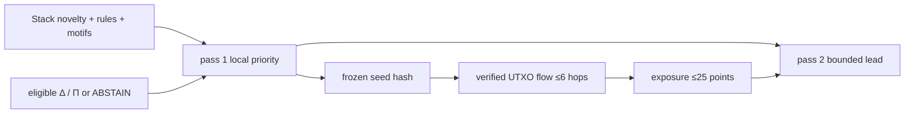

# src/clarion/fusion/ — Architecture contract

> **Documentation-only scaffold.** No module functionality is implemented. Follow the original v4 specification and root README; file stubs are comments describing future work.

## Responsibility
Two-pass calibrated local and capped propagation fusion and typology.

## Phase ownership
P3/P4

## Planned files and their exact responsibilities

| File | What must be written during implementation |
|---|---|
| **__init__.py** | Declare package boundary. |
| **local.py** | Calibrate eligible local evidence without raw Π+Δ addition. |
| **typology.py** | Π–Δ quadrants, only when both axes valid. |
| **final.py** | Freeze seeds, cap MLRP <=25/100, priority P1–P4. |

## Data/interfaces
**Inputs:** Stack, patterns, Δ/Π, then independent frozen MLRP exposure.

**Outputs:** Provisional/final lead score with contribution explanation.

## Security, testing and acceptance
No circular propagation feeding pass-1 predictor.

For all modules: preserve provenance, causal availability, explicit uncertainty/abstention, offline operation, real tests and realistic false-positive controls. Record status in docs/progress before claiming completion.

## Implementation handoff
Do not add executable logic before the assigned phase PR; update this README when actual public interfaces, dependencies and tests are verified.

---

## Full §9 two-pass fusion contract

**Pass 1:** consume local stacked score (or honest novelty rank), motif evidence, valid Δ residual/components, and valid itemized Π bills, plus missingness/coverage. Do not raw-add Π and Δ, or use unsupported conformal p-values. The scored result can be uncalibrated if labels are missing. Freeze and hash provisional seed vector s.

**§10 propagation:** deterministic causal value-flow and separate network-context channel, service boundaries, bounded paths. No pass-1 feedback.

**Pass 2:** combine frozen local score with a **maximum 25/100-point** contribution from validated propagation, exactly once; show the local contribution, propagation points, final risk 0–100 (only if justified), calibration uncertainty and P1–P4 triage band. Thresholds and normalization must be empirically validated. When no trusted calibration is available, label as *priority/rank*, not an illegal-activity probability.

**Typology:** Δ and Π remain two explanatory axes with ABSENT/ABSTAIN states; legitimate exchange batching, VPN users and CoinJoin are false-positive controls. See [MLRP architecture](../../../docs/architecture/risk-propagation-architecture.md), [stacking architecture](../../../docs/architecture/stacking-architecture.md).

<!-- CLARION:AUTOGENERATED_FOLDER_GUIDE_BEGIN -->
## Maintainer technical guide — current source tree

> This section is **generated from tracked files** and intentionally preserves the earlier architecture/blueprint notes above. The file index describes the current repository, not a hypothetical implementation. See [source-wide coverage audit](../../../docs/architecture/FEATURE_IMPLEMENTATION_AUDIT.md).

### Guide contents
1. [Purpose and actual status](#purpose-and-actual-status-fusion)
2. [Files directly in this folder](#files-directly-in-this-folder-fusion)
3. [Child modules and navigation](#child-modules-and-navigation-fusion)
4. [Technical architecture diagram](#technical-architecture-diagram-fusion)
5. [Tech stack and interfaces](#tech-stack-and-interfaces-fusion)
6. [Validation and work remaining](#validation-and-work-remaining-fusion)

### Purpose and actual status (fusion)
**Path:** `src/clarion/fusion/`  
**Responsibility:** Freeze local priority then cap second-pass influence.  
**Consumes:** Typed rule/novelty/motif and eligible Δ/Π.  
**Produces:** P1–P4 investigative review ranking.  
**Current direct-file inventory:** Blueprint stub: 4.

**Important:** Status is assessed per file; an architectural contract does not prove executable implementation. In particular, CLARION's core running code is primarily `src/clarion/application/engine.py`, `src/clarion/application/training_demo.py`, `src/clarion/api/main.py` and `src/clarion/v4/`, with the React screens in `frontend/src/app/App.tsx`. Other files may be placeholders.

### Files directly in this folder (fusion)
| Entry | Technical responsibility | State |
|---|---|---|
| [`__init__.py`](__init__.py) | Python module | Blueprint stub |
| [`final.py`](final.py) | Python module | Blueprint stub |
| [`local.py`](local.py) | Python module | Blueprint stub |
| [`typology.py`](typology.py) | Python module | Blueprint stub |

### Child modules and navigation (fusion)
No tracked child folders.

### Technical architecture diagram (fusion)

### Tech stack and interfaces (fusion)
**Technologies:** Python 3.11/3.12, Pydantic 2 and scikit-learn where relevant; optional PyG/DuckDB/Arrow. See actual imports before installing.

**Input boundary:** Typed rule/novelty/motif and eligible Δ/Π.  
**Output boundary:** P1–P4 investigative review ranking.  
**Causal/evidence invariants:** Preserve source SHA-256, UTC `event_time` and `available_at`, explicit score type and `ABSTAIN` when required. Observed relay TXIDs never establish transaction origin or wallet ownership; candidate entity links are not confirmed identity; Country is non-scoring context.

**System contracts:** [original §0–§12 specification](../../../docs/architecture/architecture-v4-spec.md) · [implemented versus planned matrix](../../../docs/architecture/FEATURE_IMPLEMENTATION_AUDIT.md) · [canonical schemas and pipeline](../../../docs/development/V4_PIPELINES_AND_SCHEMAS.md).

### Validation and work remaining (fusion)
- **Required gate:** Heuristic points must not be called criminality probability.
- Verify the exact entrypoint and source file before using a planned module; avoid importing comment-only blueprints.
- For executable changes run affected Python/TypeScript tests, offline checks and canonical synthetic smoke validation. Real-data ML calibration, service negative controls and SIH capture semantics still need independent evidence.
- Record new inputs/outputs, schema versions and proven tests in this README; rerun `python scripts/docs/generate_folder_readmes.py --write` to refresh its indexed section.

<!-- CLARION:AUTOGENERATED_FOLDER_GUIDE_END -->
