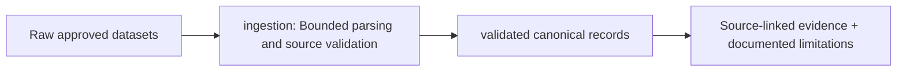

# Ingestion and source adapters

> DESIGN ONLY — planned files are comments, not functioning application code.

**Scope:** Secure bulk CSV/JSON/XML normalized into source-provenance records.

## File and folder responsibilities

| Location | Planned work |
|---|---|
| readers.py | bounded CSV/JSON/XML and XXE refusal |
| validation.py | integer sats, UTC/time semantics, duplicates, row diagnostics |
| adapters/__init__.py | source capability and version registry |
| adapters/sih.py | official SIH-format input |
| adapters/bitcoin_core.py | authentic local UTXO export, not historical relay IP |
| adapters/elliptic_pp.py | Elliptic++ transaction/actor feature benchmark |
| adapters/bitcoinheist.py | address behavior labels with uncertain negatives |

## Contracts, dependencies and safeguards

Source-specific adapters declare absent fields; no synthetic cross-layer joins from benchmark feature graphs.

## Exit criteria

Exact formats, source rights/hashes, no inferred ownership, malformed-input and unit tests.

For system-level dependency direction and migration rationale, consult the [production structure blueprint](../../../docs/architecture/repository-structure.md).

<!-- CLARION:AUTOGENERATED_FOLDER_GUIDE_BEGIN -->
## Maintainer technical guide — current source tree

> This section is **generated from tracked files** and intentionally preserves the earlier architecture/blueprint notes above. The file index describes the current repository, not a hypothetical implementation. See [source-wide coverage audit](../../../docs/architecture/FEATURE_IMPLEMENTATION_AUDIT.md).

### Guide contents
1. [Purpose and actual status](#purpose-and-actual-status-ingestion)
2. [Files directly in this folder](#files-directly-in-this-folder-ingestion)
3. [Child modules and navigation](#child-modules-and-navigation-ingestion)
4. [Technical architecture diagram](#technical-architecture-diagram-ingestion)
5. [Tech stack and interfaces](#tech-stack-and-interfaces-ingestion)
6. [Validation and work remaining](#validation-and-work-remaining-ingestion)

### Purpose and actual status (ingestion)
**Path:** `src/clarion/ingestion/`  
**Responsibility:** Bounded parsing and source validation.  
**Consumes:** Raw approved datasets.  
**Produces:** validated canonical records.  
**Current direct-file inventory:** Blueprint stub: 3.

**Important:** Status is assessed per file; an architectural contract does not prove executable implementation. In particular, CLARION's core running code is primarily `src/clarion/application/engine.py`, `src/clarion/application/training_demo.py`, `src/clarion/api/main.py` and `src/clarion/v4/`, with the React screens in `frontend/src/app/App.tsx`. Other files may be placeholders.

### Files directly in this folder (ingestion)
| Entry | Technical responsibility | State |
|---|---|---|
| [`__init__.py`](__init__.py) | Python module | Blueprint stub |
| [`readers.py`](readers.py) | Python module | Blueprint stub |
| [`validation.py`](validation.py) | Python module | Blueprint stub |

### Child modules and navigation (ingestion)
- [`adapters/`](./adapters/README.md) — Convert source records only with explicit mappings.

### Technical architecture diagram (ingestion)

### Tech stack and interfaces (ingestion)
**Technologies:** Python 3.11/3.12, Pydantic 2 and scikit-learn where relevant; optional PyG/DuckDB/Arrow. See actual imports before installing.

**Input boundary:** Raw approved datasets.  
**Output boundary:** validated canonical records.  
**Causal/evidence invariants:** Preserve source SHA-256, UTC `event_time` and `available_at`, explicit score type and `ABSTAIN` when required. Observed relay TXIDs never establish transaction origin or wallet ownership; candidate entity links are not confirmed identity; Country is non-scoring context.

**System contracts:** [original §0–§12 specification](../../../docs/architecture/architecture-v4-spec.md) · [implemented versus planned matrix](../../../docs/architecture/FEATURE_IMPLEMENTATION_AUDIT.md) · [canonical schemas and pipeline](../../../docs/development/V4_PIPELINES_AND_SCHEMAS.md).

### Validation and work remaining (ingestion)
- **Required gate:** Live ingestion is in v4/ingest.py rather than old stubs.
- Verify the exact entrypoint and source file before using a planned module; avoid importing comment-only blueprints.
- For executable changes run affected Python/TypeScript tests, offline checks and canonical synthetic smoke validation. Real-data ML calibration, service negative controls and SIH capture semantics still need independent evidence.
- Record new inputs/outputs, schema versions and proven tests in this README; rerun `python scripts/docs/generate_folder_readmes.py --write` to refresh its indexed section.

<!-- CLARION:AUTOGENERATED_FOLDER_GUIDE_END -->
