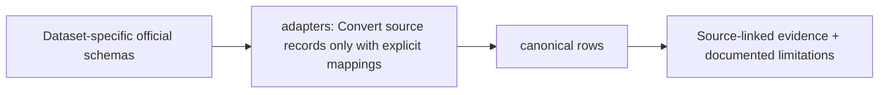

# src/clarion/ingestion/adapters — implementation blueprint

> Architecture-only: no functionality or test success is claimed.

**Phase:** P1
**Scope:** Per-dataset versioned adapter registry instead of monolithic adapters.py.

## Inputs and outputs
**Consumes:** Authorized local CSV/JSON/XML or benchmark source + usage manifest  
**Provides:** Typed canonical records, source mapping and unsupported-field declarations

## Planned file responsibilities
| File | Required work |
|---|---|
| `__init__.py` | Adapter registration and supported capability interface |
| `sih.py` | SIH transactions and optional network metadata adapter |
| `bitcoin_core.py` | Bitcoin Core local block/UTXO export adapter |
| `elliptic_pp.py` | Elliptic++ graph and feature benchmark import; preserve granularity |
| `bitcoinheist.py` | Address-level labeled benchmark import; uncertain negative labels |

## Dependencies and security
Never fabricate raw transactions or cross-layer IP ownership from benchmark graph features.

## Test and completion gate
Schema versions, sampling bias, missing fields, exact monetary conversion.

Review [complete project structure](../../../../docs/architecture/repository-structure.md) before implementing. Commit real code and its tests in the relevant phase PR; replace comment-only placeholders deliberately.

<!-- CLARION:AUTOGENERATED_FOLDER_GUIDE_BEGIN -->
## Maintainer technical guide — current source tree

> This section is **generated from tracked files** and intentionally preserves the earlier architecture/blueprint notes above. The file index describes the current repository, not a hypothetical implementation. See [source-wide coverage audit](../../../../docs/architecture/FEATURE_IMPLEMENTATION_AUDIT.md).

### Guide contents
1. [Purpose and actual status](#purpose-and-actual-status-adapters)
2. [Files directly in this folder](#files-directly-in-this-folder-adapters)
3. [Child modules and navigation](#child-modules-and-navigation-adapters)
4. [Technical architecture diagram](#technical-architecture-diagram-adapters)
5. [Tech stack and interfaces](#tech-stack-and-interfaces-adapters)
6. [Validation and work remaining](#validation-and-work-remaining-adapters)

### Purpose and actual status (adapters)
**Path:** `src/clarion/ingestion/adapters/`  
**Responsibility:** Convert source records only with explicit mappings.  
**Consumes:** Dataset-specific official schemas.  
**Produces:** canonical rows.  
**Current direct-file inventory:** Blueprint stub: 4, Package marker: 1.

**Important:** Status is assessed per file; an architectural contract does not prove executable implementation. In particular, CLARION's core running code is primarily `src/clarion/application/engine.py`, `src/clarion/application/training_demo.py`, `src/clarion/api/main.py` and `src/clarion/v4/`, with the React screens in `frontend/src/app/App.tsx`. Other files may be placeholders.

### Files directly in this folder (adapters)
| Entry | Technical responsibility | State |
|---|---|---|
| [`__init__.py`](__init__.py) | Python module | Package marker |
| [`bitcoin_core.py`](bitcoin_core.py) | Python module | Blueprint stub |
| [`bitcoinheist.py`](bitcoinheist.py) | Python module | Blueprint stub |
| [`elliptic_pp.py`](elliptic_pp.py) | Python module | Blueprint stub |
| [`sih.py`](sih.py) | Python module | Blueprint stub |

### Child modules and navigation (adapters)
No tracked child folders.

### Technical architecture diagram (adapters)

### Tech stack and interfaces (adapters)
**Technologies:** Python 3.11/3.12, Pydantic 2 and scikit-learn where relevant; optional PyG/DuckDB/Arrow. See actual imports before installing.

**Input boundary:** Dataset-specific official schemas.  
**Output boundary:** canonical rows.  
**Causal/evidence invariants:** Preserve source SHA-256, UTC `event_time` and `available_at`, explicit score type and `ABSTAIN` when required. Observed relay TXIDs never establish transaction origin or wallet ownership; candidate entity links are not confirmed identity; Country is non-scoring context.

**System contracts:** [original §0–§12 specification](../../../../docs/architecture/architecture-v4-spec.md) · [implemented versus planned matrix](../../../../docs/architecture/FEATURE_IMPLEMENTATION_AUDIT.md) · [canonical schemas and pipeline](../../../../docs/development/V4_PIPELINES_AND_SCHEMAS.md).

### Validation and work remaining (adapters)
- **Required gate:** SIH/Elliptic++/BitcoinHeist stubs cannot invent missing outpoints or IP labels.
- Verify the exact entrypoint and source file before using a planned module; avoid importing comment-only blueprints.
- For executable changes run affected Python/TypeScript tests, offline checks and canonical synthetic smoke validation. Real-data ML calibration, service negative controls and SIH capture semantics still need independent evidence.
- Record new inputs/outputs, schema versions and proven tests in this README; rerun `python scripts/docs/generate_folder_readmes.py --write` to refresh its indexed section.

<!-- CLARION:AUTOGENERATED_FOLDER_GUIDE_END -->
