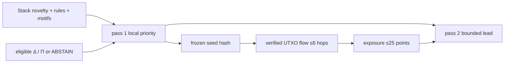

# src/clarion/propagation/ — Architecture contract

> **Documentation-only scaffold.** No module functionality is implemented. Follow the original v4 specification and root README; file stubs are comments describing future work.

## Responsibility
Value-conserving causal forward/backward MLRP with absorbing boundaries.

## Phase ownership
P4

## Planned files and their exact responsibilities

| File | What must be written during implementation |
|---|---|
| **__init__.py** | Declare package boundary. |
| **edges.py** | Typed conductances, value share, time/hop decay. |
| **diffusion.py** | Deterministic frozen-seed bounded propagation. |
| **boundaries.py** | Services, CoinJoin, ASN/country no-reemission policies. |
| **paths.py** | Trace minimal contributing causal paths and provenance. |

## Data/interfaces
**Inputs:** Frozen preliminary seeds + typed transaction graph.

**Outputs:** Per-level risk, provenance channels, bounded paths.

## Security, testing and acceptance
Test no blanket contamination across exchanges/hosts.

For all modules: preserve provenance, causal availability, explicit uncertainty/abstention, offline operation, real tests and realistic false-positive controls. Record status in docs/progress before claiming completion.

## Implementation handoff
Do not add executable logic before the assigned phase PR; update this README when actual public interfaces, dependencies and tests are verified.

---

## Full §10 MLRP architecture contract

**Levels:** Address, Transaction, Entity, Host, ASN and Country context-only. **Equation:** r_i(k+1)=(1−α)s_i+αΣ_(j→i) w(e_ji)φ(v_ji)τ(Δt)r_j(k). s is the hashed frozen pass-1 seed; current pass-2 score cannot re-enter diffusion.

**Diagram's initial edge conductances:** spends/funds 1.0; observed-broadcast 0.6 × confidence; co-session 0.3; candidate member-of 0.8; hosted-in 0.1. Require valid time/direction, and distinguish financial value-flow from non-ownership relay context.

**Controls:** hard six-hop scoring bound; hop γ decay, temporal τ decay; value share normalization and nonamplification; absorbing exchange/custody/CoinJoin boundaries; host/ASN never re-emit to other customers; Country receives no score; separate forward taint and backward provenance. Emit path evidence and confidence, not guilt.

**Score budget:** at most 25/100 points contributed to final triage by §10; report seed, per-level exposure, incoming/outgoing shares, minimal path, time, boundary decisions and convergence/abstention flags. Compare deterministic baseline against learned GAT but deterministic evidence paths remain the dossier explanation. See [MLRP architecture](../../../docs/architecture/risk-propagation-architecture.md).

<!-- CLARION:AUTOGENERATED_FOLDER_GUIDE_BEGIN -->
## Maintainer technical guide — current source tree

> This section is **generated from tracked files** and intentionally preserves the earlier architecture/blueprint notes above. The file index describes the current repository, not a hypothetical implementation. See [source-wide coverage audit](../../../docs/architecture/FEATURE_IMPLEMENTATION_AUDIT.md).

### Guide contents
1. [Purpose and actual status](#purpose-and-actual-status-propagation)
2. [Files directly in this folder](#files-directly-in-this-folder-propagation)
3. [Child modules and navigation](#child-modules-and-navigation-propagation)
4. [Technical architecture diagram](#technical-architecture-diagram-propagation)
5. [Tech stack and interfaces](#tech-stack-and-interfaces-propagation)
6. [Validation and work remaining](#validation-and-work-remaining-propagation)

### Purpose and actual status (propagation)
**Path:** `src/clarion/propagation/`  
**Responsibility:** Propagate value-backed exposure ≤6 hops.  
**Consumes:** Immutable local seeds and causal spends.  
**Produces:** exposure priors and witness paths.  
**Current direct-file inventory:** Blueprint stub: 5.

**Important:** Status is assessed per file; an architectural contract does not prove executable implementation. In particular, CLARION's core running code is primarily `src/clarion/application/engine.py`, `src/clarion/application/training_demo.py`, `src/clarion/api/main.py` and `src/clarion/v4/`, with the React screens in `frontend/src/app/App.tsx`. Other files may be placeholders.

### Files directly in this folder (propagation)
| Entry | Technical responsibility | State |
|---|---|---|
| [`__init__.py`](__init__.py) | Python module | Blueprint stub |
| [`boundaries.py`](boundaries.py) | Python module | Blueprint stub |
| [`diffusion.py`](diffusion.py) | Python module | Blueprint stub |
| [`edges.py`](edges.py) | Python module | Blueprint stub |
| [`paths.py`](paths.py) | Python module | Blueprint stub |

### Child modules and navigation (propagation)
No tracked child folders.

### Technical architecture diagram (propagation)

### Tech stack and interfaces (propagation)
**Technologies:** Python 3.11/3.12, Pydantic 2 and scikit-learn where relevant; optional PyG/DuckDB/Arrow. See actual imports before installing.

**Input boundary:** Immutable local seeds and causal spends.  
**Output boundary:** exposure priors and witness paths.  
**Causal/evidence invariants:** Preserve source SHA-256, UTC `event_time` and `available_at`, explicit score type and `ABSTAIN` when required. Observed relay TXIDs never establish transaction origin or wallet ownership; candidate entity links are not confirmed identity; Country is non-scoring context.

**System contracts:** [original §0–§12 specification](../../../docs/architecture/architecture-v4-spec.md) · [implemented versus planned matrix](../../../docs/architecture/FEATURE_IMPLEMENTATION_AUDIT.md) · [canonical schemas and pipeline](../../../docs/development/V4_PIPELINES_AND_SCHEMAS.md).

### Validation and work remaining (propagation)
- **Required gate:** Real service boundaries and six-level MLRP still partial.
- Verify the exact entrypoint and source file before using a planned module; avoid importing comment-only blueprints.
- For executable changes run affected Python/TypeScript tests, offline checks and canonical synthetic smoke validation. Real-data ML calibration, service negative controls and SIH capture semantics still need independent evidence.
- Record new inputs/outputs, schema versions and proven tests in this README; rerun `python scripts/docs/generate_folder_readmes.py --write` to refresh its indexed section.

<!-- CLARION:AUTOGENERATED_FOLDER_GUIDE_END -->
