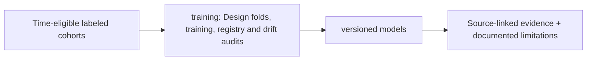

# src/clarion/training/ — Architecture contract

> **Documentation-only scaffold.** No module functionality is implemented. Follow the original v4 specification and root README; file stubs are comments describing future work.

## Responsibility
Chronological fold construction, fitting, artifact registry and drift comparison.

## Phase ownership
P3/P5

## Planned files and their exact responsibilities

| File | What must be written during implementation |
|---|---|
| **__init__.py** | Declare package boundary. |
| **splits.py** | Expanding folds, gaps, entity/scenario leakage diagnostics. |
| **trainer.py** | Training orchestrator with base and meta-model stages. |
| **registry.py** | Offline signed/hashes model manifest, champion/challenger decisions. |
| **drift.py** | Shift/coverage diagnostics and human-approved promotion. |

## Data/interfaces
**Inputs:** Eligible labels, time-safe features, model recipes.

**Outputs:** OOF predictions, validated model artifacts, model cards.

## Security, testing and acceptance
No synthetic/unknown labels silently treated as confirmed truth.

For all modules: preserve provenance, causal availability, explicit uncertainty/abstention, offline operation, real tests and realistic false-positive controls. Record status in docs/progress before claiming completion.

## Implementation handoff
Do not add executable logic before the assigned phase PR; update this README when actual public interfaces, dependencies and tests are verified.

---

## OOF stack and model evolution contract

Training steps: dataset/label audit → predeclared chronological folds → fold-specific features/embeddings/MCER → train base learners on past → predict the next fold → store OOF scores + valid motif/Δ/Π components → meta-learner LR/optional LightGBM → independent calibration/holdout → model card → offline registry/promotion.

Track original score type, input schema, available_at, source hashes, feature-selection process, split boundaries, seeds and environment. Unsupervised/no-label fallback ranks novelty, not crime probability. Separate pass-2 propagation training using independently generated fold-local frozen seeds; never feed training-instance propagation into its own pass-1 label. See [architecture design](../../../docs/architecture/stacking-architecture.md).

<!-- CLARION:AUTOGENERATED_FOLDER_GUIDE_BEGIN -->
## Maintainer technical guide — current source tree

> This section is **generated from tracked files** and intentionally preserves the earlier architecture/blueprint notes above. The file index describes the current repository, not a hypothetical implementation. See [source-wide coverage audit](../../../docs/architecture/FEATURE_IMPLEMENTATION_AUDIT.md).

### Guide contents
1. [Purpose and actual status](#purpose-and-actual-status-training)
2. [Files directly in this folder](#files-directly-in-this-folder-training)
3. [Child modules and navigation](#child-modules-and-navigation-training)
4. [Technical architecture diagram](#technical-architecture-diagram-training)
5. [Tech stack and interfaces](#tech-stack-and-interfaces-training)
6. [Validation and work remaining](#validation-and-work-remaining-training)

### Purpose and actual status (training)
**Path:** `src/clarion/training/`  
**Responsibility:** Design folds, training, registry and drift audits.  
**Consumes:** Time-eligible labeled cohorts.  
**Produces:** versioned models.  
**Current direct-file inventory:** Blueprint stub: 5.

**Important:** Status is assessed per file; an architectural contract does not prove executable implementation. In particular, CLARION's core running code is primarily `src/clarion/application/engine.py`, `src/clarion/application/training_demo.py`, `src/clarion/api/main.py` and `src/clarion/v4/`, with the React screens in `frontend/src/app/App.tsx`. Other files may be placeholders.

### Files directly in this folder (training)
| Entry | Technical responsibility | State |
|---|---|---|
| [`__init__.py`](__init__.py) | Python module | Blueprint stub |
| [`drift.py`](drift.py) | Python module | Blueprint stub |
| [`registry.py`](registry.py) | Python module | Blueprint stub |
| [`splits.py`](splits.py) | Python module | Blueprint stub |
| [`trainer.py`](trainer.py) | Python module | Blueprint stub |

### Child modules and navigation (training)
No tracked child folders.

### Technical architecture diagram (training)

### Tech stack and interfaces (training)
**Technologies:** Python 3.11/3.12, Pydantic 2 and scikit-learn where relevant; optional PyG/DuckDB/Arrow. See actual imports before installing.

**Input boundary:** Time-eligible labeled cohorts.  
**Output boundary:** versioned models.  
**Causal/evidence invariants:** Preserve source SHA-256, UTC `event_time` and `available_at`, explicit score type and `ABSTAIN` when required. Observed relay TXIDs never establish transaction origin or wallet ownership; candidate entity links are not confirmed identity; Country is non-scoring context.

**System contracts:** [original §0–§12 specification](../../../docs/architecture/architecture-v4-spec.md) · [implemented versus planned matrix](../../../docs/architecture/FEATURE_IMPLEMENTATION_AUDIT.md) · [canonical schemas and pipeline](../../../docs/development/V4_PIPELINES_AND_SCHEMAS.md).

### Validation and work remaining (training)
- **Required gate:** Legacy trainer files remain scaffold; live baseline in v4/ml.py.
- Verify the exact entrypoint and source file before using a planned module; avoid importing comment-only blueprints.
- For executable changes run affected Python/TypeScript tests, offline checks and canonical synthetic smoke validation. Real-data ML calibration, service negative controls and SIH capture semantics still need independent evidence.
- Record new inputs/outputs, schema versions and proven tests in this README; rerun `python scripts/docs/generate_folder_readmes.py --write` to refresh its indexed section.

<!-- CLARION:AUTOGENERATED_FOLDER_GUIDE_END -->
