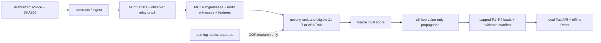

# `src/clarion/v4/` — CLARION folder guide

<!-- CLARION:AUTOGENERATED_FOLDER_GUIDE_BEGIN -->
## Maintainer technical guide — current source tree

> This section is **generated from tracked files** and intentionally preserves the earlier architecture/blueprint notes above. The file index describes the current repository, not a hypothetical implementation. See [source-wide coverage audit](../../../docs/architecture/FEATURE_IMPLEMENTATION_AUDIT.md).

### Guide contents
1. [Purpose and actual status](#purpose-and-actual-status-v4)
2. [Files directly in this folder](#files-directly-in-this-folder-v4)
3. [Child modules and navigation](#child-modules-and-navigation-v4)
4. [Technical architecture diagram](#technical-architecture-diagram-v4)
5. [Tech stack and interfaces](#tech-stack-and-interfaces-v4)
6. [Validation and work remaining](#validation-and-work-remaining-v4)

### Purpose and actual status (v4)
**Path:** `src/clarion/v4/`  
**Responsibility:** Import → as-of UTXO graph → uncertain evidence → novelty and leads.  
**Consumes:** Approved canonical CSV/JSON/XML inputs.  
**Produces:** case/risk/manifests.  
**Current direct-file inventory:** Executable source / config (validate): 13, Package marker: 1.

**Important:** Status is assessed per file; an architectural contract does not prove executable implementation. In particular, CLARION's core running code is primarily `src/clarion/application/engine.py`, `src/clarion/application/training_demo.py`, `src/clarion/api/main.py` and `src/clarion/v4/`, with the React screens in `frontend/src/app/App.tsx`. Other files may be placeholders.

### Files directly in this folder (v4)
| Entry | Technical responsibility | State |
|---|---|---|
| [`__init__.py`](__init__.py) | CLARION v4 evidence-first modular implementation. No network side effects on import. | Package marker |
| [`analysis.py`](analysis.py) | MCER candidates, explanatory motifs, frozen two-pass risk propagation. | Executable source / config (validate) |
| [`contracts.py`](contracts.py) | Versioned canonical evidence contracts. All money is integer satoshis. Only observed wire relations are a | Executable source / config (validate) |
| [`evaluation.py`](evaluation.py) | Research validity: honest holdouts, bootstrap intervals and cohort reviews. No synthetic metric is presen | Executable source / config (validate) |
| [`graph.py`](graph.py) | As-of typed cross-layer evidence graph; exact UTXO transfer accounting. Host relays attach to transaction | Executable source / config (validate) |
| [`ingest.py`](ingest.py) | Bounded canonical CSV/JSON/XML adapters and deterministic quarantine. Unrecognized provider columns are r | Executable source / config (validate) |
| [`mcer.py`](mcer.py) | MCER v4 H1-H5 evidence ledger and conservative versioned partition hypotheses. This does not establish le | Executable source / config (validate) |
| [`ml.py`](ml.py) | Temporal, group-safe supervised and unsupervised baselines with optional GNN. No object unpickling; predi | Executable source / config (validate) |
| [`pipeline.py`](pipeline.py) | CLARION v4 deterministic local evidence pipeline. No network I/O. Canonical CSV/JSON/XML -> validation/qu | Executable source / config (validate) |
| [`reporting.py`](reporting.py) | Offline case dossier export (JSON and optional ReportLab PDF). Contains source hashes, uncertainty and ev | Executable source / config (validate) |
| [`representation.py`](representation.py) | Snapshot-safe sparse PyTorch Geometric adapters and temporal graph encoders. Do not create training repre | Executable source / config (validate) |
| [`security.py`](security.py) | Offline operational trust boundaries for CLARION source and case files. | Executable source / config (validate) |
| [`signals.py`](signals.py) | Data-gated chain/wire Δ and verified economic-goal Π signal candidates. These are research estimators wit | Executable source / config (validate) |
| [`storage.py`](storage.py) | Optional local Parquet/DuckDB storage and SQLite case index. Parquet files are rebuildable from verified  | Executable source / config (validate) |

### Child modules and navigation (v4)
No tracked child folders.

### Technical architecture diagram (v4)

### Tech stack and interfaces (v4)
**Technologies:** Python 3.11/3.12, Pydantic 2 and scikit-learn where relevant; optional PyG/DuckDB/Arrow. See actual imports before installing.

**Input boundary:** Approved canonical CSV/JSON/XML inputs.  
**Output boundary:** case/risk/manifests.  
**Causal/evidence invariants:** Preserve source SHA-256, UTC `event_time` and `available_at`, explicit score type and `ABSTAIN` when required. Observed relay TXIDs never establish transaction origin or wallet ownership; candidate entity links are not confirmed identity; Country is non-scoring context.

**System contracts:** [original §0–§12 specification](../../../docs/architecture/architecture-v4-spec.md) · [implemented versus planned matrix](../../../docs/architecture/FEATURE_IMPLEMENTATION_AUDIT.md) · [canonical schemas and pipeline](../../../docs/development/V4_PIPELINES_AND_SCHEMAS.md).

### Validation and work remaining (v4)
- **Required gate:** Δ, Π, learned GNN and real-world calibration remain conditional.
- Verify the exact entrypoint and source file before using a planned module; avoid importing comment-only blueprints.
- For executable changes run affected Python/TypeScript tests, offline checks and canonical synthetic smoke validation. Real-data ML calibration, service negative controls and SIH capture semantics still need independent evidence.
- Record new inputs/outputs, schema versions and proven tests in this README; rerun `python scripts/docs/generate_folder_readmes.py --write` to refresh its indexed section.

<!-- CLARION:AUTOGENERATED_FOLDER_GUIDE_END -->
