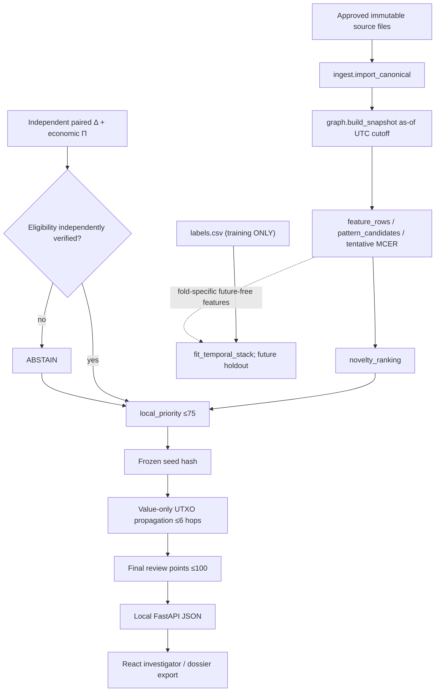
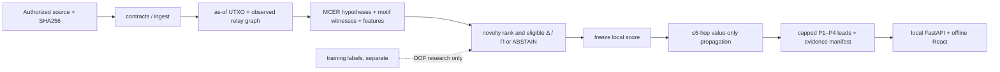

# `src/clarion/v4/` — CLARION folder guide


## Implementation guide: active v4 subsystem

This package is the **implemented research pipeline**. It is separate from the original decomposition into legacy blueprint directories. It is not a claim that every sophisticated model proposed in the v4 architecture is trained or scientifically validated.

### Package API contents

| Module and function | Algorithm / data contract | Output and limitations |
|---|---|---|
| [`contracts.py`](contracts.py): `Tx`, `Input`, `Output`, `WireObservation`, `Label`, `Snapshot` | Pydantic contracts, 64-hex TXIDs, integer satoshis, timezone-aware event/availability timestamps | Typed frozen evidence; labels are separate and host/ASN fields are observations |
| [`ingest.py`](ingest.py): `load_rows`, `import_canonical` | Bounded CSV/JSON/XML parsing, normalization, hashing and quarantining bad rows | Explicit tables plus import errors; requires known provider mapping and documented permission |
| [`ingest.py`](ingest.py): `import_bitcoin_core_tx`, `declared_mapping_adapter` | Transform local Core verbose-v2 JSON or user-specified SIH/benchmark mappings | Never invent unavailable outpoints, owners, P2P TXIDs or labels |
| [`graph.py`](graph.py): `build_snapshot` | Filter by `available_at <= cutoff`; reject duplicate outpoints and invalid known-value conservation, deduplicate sensor relays | Verified spend and observed-relay edges, no host→wallet ownership |
| [`graph.py`](graph.py): `feature_rows`, `graph_export` | Causal transaction features and bounded graph JSON | Nullable fees/age/prevouts rather than fabricated values |
| [`mcer.py`](mcer.py): `h1_common_inputs` through `h5_continuity`, `conservative_partition`, `partition_lineage` | Signed proposed evidence and tentative non-service partition | H2–H5 weights are research heuristics, **not** calibrated identity posterior |
| [`analysis.py`](analysis.py): `mcer_candidates`, `pattern_candidates` | Conservative basic H1, peel-like path, equal-output CoinJoin-like and fan-in/out candidate recognition | Evidence references and benign alternatives; limited motif family coverage |
| [`ml.py`](ml.py): `fit_temporal_stack` | Expanding chronology/group OOF logistic/RF/IsolationForest with meta logistic | **Uncalibrated** research scores; real label eligibility and temporal purge must be audited |
| [`ml.py`](ml.py): `novelty_ranking`, `optional_pyg_encoder` | IsolationForest ranks, optional PyG SAGE/GAT edge reconstruction | Rank/embedding, **not** crime probability or validated temporal heterogeneous GNN |
| [`representation.py`](representation.py): `sparse_hetero_data`, `temporal_hetero_forward` | Optional typed PyG snapshot with edge timestamps and an untrained hetero forward | Demonstrates tensor interfaces; learned temporal encoder remains missing |
| [`signals.py`](signals.py): `delta_signal` | CCA heldout paired-view correlation plus permutation gate | Global dependence only; not casewise Δ1–Δ5 or attribution |
| [`signals.py`](signals.py): `pi_signal` | Actual/baseline cost ratios only for independently verified same goal | Missing goals or units return explicit ABSTAIN |
| [`analysis.py`](analysis.py): `local_priority`, `propagate`, `final_priority` | Provisional seed ≤75; directed value-aware attenuation ≤6 hops; propagation prior ≤25 | Investigator-review priority only, distinct from illicit probability |
| [`pipeline.py`](pipeline.py): `run` | Local evidence pipeline from approved canonical tables to read-only JSON/CSV | `run_manifest.json`, `leads.json`, `graph.json`, `motifs.json`, `entities.json`, `quarantine.json` |
| [`pipeline.py`](pipeline.py): `train_from_canonical` | Separate opt-in labeled temporal OOF training path | Metrics and holdout predictions; no unsafe pickle serving |
| [`storage.py`](storage.py), [`reporting.py`](reporting.py), [`security.py`](security.py) | Optional Arrow/DuckDB/SQLite, auditable case JSON/PDF and bounded local paths | Deployment, PDF visual QA, database concurrency and OS access still require acceptance |
| [`evaluation.py`](evaluation.py) | ROC/PR and grouped bootstrap, temporal availability, ablations and false-merge rates | Scientific utility functions; no independently labeled real dataset bundled |

### Evidence and training paths



### Canonical fixture and output walkthrough

After installing the project and extras in [the beginner guide](../../../docs/development/V4_BEGINNER_START_HERE.md), prepare fictional data, then run the canonical pipeline:

```bash
python scripts/data/generate_fixtures.py --out data/generated/demo --cases 36 --seed 26
python scripts/v4_pipeline.py analyze --data data/generated/demo --out artifacts/v4_run --licence SYNTHETIC_LOCAL --origin CLARION_GENERATOR
clarion serve --run artifacts/v4_run --port 8000
```

Open `http://127.0.0.1:8000` (built Vite assets are served when available). The synthetic generator has a **separate training-only truth sidecar**: never load it as evidence. The live read-only UI uses `/api/manifest`, `/api/leads`, `/api/graph`, `/api/motifs`, `/api/propagation` and `/api/entities`.

### Invariants a new module must preserve

1. Every inferred link must cite an observed source fact. Unknown prevouts remain unknown.
2. Relaying a TXID does **not** identify the creator/controller or link a host to an address.
3. Clusters are H1–H5 hypotheses, not ownership claims. Exclude ambiguous multi-party/service co-spends.
4. Keep event time and feature-availability time separate; no current subject sees future graph edges or labels.
5. First-pass scores are frozen before propagation, and cannot consume their own current propagated result.
6. Δ and Π must abstain when scientific premises are missing. Scores are **review priorities** and novelty ranks, not criminal guilt probabilities.

Detailed limitations and the remaining research steps are in the [feature-by-feature audit](../../../docs/architecture/FEATURE_IMPLEMENTATION_AUDIT.md).

<!-- CLARION:AUTOGENERATED_FOLDER_GUIDE_BEGIN -->
## Maintainer technical guide — current source tree

> This section is **generated from tracked files** and intentionally preserves the earlier architecture/blueprint notes above. The file index describes the current repository, not a hypothetical implementation. See [source-wide coverage audit](../../../docs/architecture/FEATURE_IMPLEMENTATION_AUDIT.md).

### Guide contents
1. [Purpose and actual status](#purpose-and-actual-status-v4)
2. [Files directly in this folder](#files-directly-in-this-folder-v4)
3. [Child modules and navigation](#child-modules-and-navigation-v4)
4. [Technical architecture diagram](#technical-architecture-diagram-v4)
5. [Tech stack and interfaces](#tech-stack-and-interfaces-v4)
6. [Validation and work remaining](#validation-and-work-remaining-v4)

### Purpose and actual status (v4)
**Path:** `src/clarion/v4/`  
**Responsibility:** Import → as-of UTXO graph → uncertain evidence → novelty and leads.  
**Consumes:** Approved canonical CSV/JSON/XML inputs.  
**Produces:** case/risk/manifests.  
**Current direct-file inventory:** Executable source / config (validate): 21, Package marker: 1.

**Important:** Status is assessed per file; an architectural contract does not prove executable implementation. In particular, CLARION's core running code is primarily `src/clarion/application/engine.py`, `src/clarion/application/training_demo.py`, `src/clarion/api/main.py` and `src/clarion/v4/`, with the React screens in `frontend/src/app/App.tsx`. Other files may be placeholders.

### Files directly in this folder (v4)
| Entry | Technical responsibility | State |
|---|---|---|
| [`__init__.py`](__init__.py) | CLARION v4 evidence-first modular implementation. No network side effects on import. | Package marker |
| [`analysis.py`](analysis.py) | MCER candidates, explanatory motifs, frozen two-pass risk propagation. | Executable source / config (validate) |
| [`case_store.py`](case_store.py) | SQLite-backed local investigative case reviews with tamper-evident event chain. Lead scores are immutable | Executable source / config (validate) |
| [`contracts.py`](contracts.py) | Versioned canonical evidence contracts. All money is integer satoshis. Only observed wire relations are a | Executable source / config (validate) |
| [`evaluation.py`](evaluation.py) | Research validity: honest holdouts, bootstrap intervals and cohort reviews. No synthetic metric is presen | Executable source / config (validate) |
| [`gnn_training.py`](gnn_training.py) | Optional CPU GraphSAGE self-supervised edge reconstruction and safe JSON inference. Research proxy only.  | Executable source / config (validate) |
| [`graph.py`](graph.py) | As-of typed cross-layer evidence graph; exact UTXO transfer accounting. Host relays attach to transaction | Executable source / config (validate) |
| [`ingest.py`](ingest.py) | Bounded canonical CSV/JSON/XML adapters and deterministic quarantine. Unrecognized provider columns are r | Executable source / config (validate) |
| [`mcer.py`](mcer.py) | MCER v4 H1-H5 evidence ledger and conservative versioned partition hypotheses. This does not establish le | Executable source / config (validate) |
| [`ml.py`](ml.py) | Temporal, group-safe supervised and unsupervised baselines with optional GNN. No object unpickling; predi | Executable source / config (validate) |
| [`mlops_adapter.py`](mlops_adapter.py) | Local-only experiment metadata and optional MLflow logging. Experiments are not deployed models. Never lo | Executable source / config (validate) |
| [`model_artifact.py`](model_artifact.py) | Safe JSON-serializable chronological logistic baseline, no pickle execution. Separate experimental superv | Executable source / config (validate) |
| [`monitoring.py`](monitoring.py) | Offline feature drift and factual batch observability, not model self-training. | Executable source / config (validate) |
| [`motifs_extended.py`](motifs_extended.py) | Additional explainable Bitcoin flow motifs, with careful address ambiguity. Transaction-value edges remai | Executable source / config (validate) |
| [`pipeline.py`](pipeline.py) | CLARION v4 deterministic local evidence pipeline. No network I/O. Canonical CSV/JSON/XML -> validation/qu | Executable source / config (validate) |
| [`reporting.py`](reporting.py) | Offline case dossier export (JSON and optional ReportLab PDF). Contains source hashes, uncertainty and ev | Executable source / config (validate) |
| [`representation.py`](representation.py) | Snapshot-safe sparse PyTorch Geometric adapters and temporal graph encoders. Do not create training repre | Executable source / config (validate) |
| [`security.py`](security.py) | Offline operational trust boundaries for CLARION source and case files. | Executable source / config (validate) |
| [`signals.py`](signals.py) | Data-gated chain/wire Δ and verified economic-goal Π signal candidates. These are research estimators wit | Executable source / config (validate) |
| [`storage.py`](storage.py) | Optional local Parquet/DuckDB storage and SQLite case index. Parquet files are rebuildable from verified  | Executable source / config (validate) |
| [`submission.py`](submission.py) | Offline SIH submission orchestration and independently checkable acceptance evidence. No synthetic data i | Executable source / config (validate) |
| [`wire_sessions.py`](wire_sessions.py) | Observed P2P relay sessionization and contextual feature extraction. A TXID seen from a host is an observ | Executable source / config (validate) |

### Child modules and navigation (v4)
No tracked child folders.

### Technical architecture diagram (v4)


### Tech stack and interfaces (v4)
**Technologies:** Python 3.11/3.12, Pydantic 2 and scikit-learn where relevant; optional PyG/DuckDB/Arrow. See actual imports before installing.

**Input boundary:** Approved canonical CSV/JSON/XML inputs.  
**Output boundary:** case/risk/manifests.  
**Causal/evidence invariants:** Preserve source SHA-256, UTC `event_time` and `available_at`, explicit score type and `ABSTAIN` when required. Observed relay TXIDs never establish transaction origin or wallet ownership; candidate entity links are not confirmed identity; Country is non-scoring context.

**System contracts:** [original §0–§12 specification](../../../docs/architecture/architecture-v4-spec.md) · [implemented versus planned matrix](../../../docs/architecture/FEATURE_IMPLEMENTATION_AUDIT.md) · [canonical schemas and pipeline](../../../docs/development/V4_PIPELINES_AND_SCHEMAS.md).

### Validation and work remaining (v4)
- **Required gate:** Δ, Π, learned GNN and real-world calibration remain conditional.
- Verify the exact entrypoint and source file before using a planned module; avoid importing comment-only blueprints.
- For executable changes run affected Python/TypeScript tests, offline checks and canonical synthetic smoke validation. Real-data ML calibration, service negative controls and SIH capture semantics still need independent evidence.
- Record new inputs/outputs, schema versions and proven tests in this README; rerun `python scripts/docs/generate_folder_readmes.py --write` to refresh its indexed section.

<!-- CLARION:AUTOGENERATED_FOLDER_GUIDE_END -->
