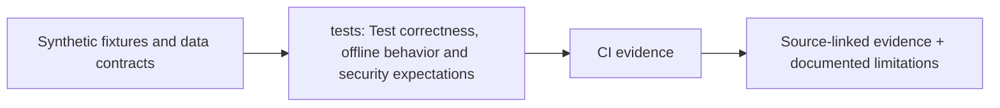

# Complete verification layout

> DESIGN ONLY — planned files are comments, not functioning application code.

**Scope:** Source/ML/security/testing controls aligned with architecture blocks 0–12.

## File and folder responsibilities

- unit: parser and local math tests.
- contracts: domain schema/API compatibility.
- integration: deterministic full chain-only and validated-wire pipelines.
- property: graph conservation, no time travel or fan-out amplification.
- leakage: temporal OOF and per-fold graph/MCER feature cutoffs.
- adversarial: XXE/CSV/model poisoning, false wallet ownership.
- offline: air-gapped operation.
- e2e: local case UI and report export.
- performance: measured RAM, p50/p95 and throughput.
- fixtures: sealed synthetic truths and benign service controls.

## Contracts, dependencies and safeguards

Tests are comment-only blueprints today. Performance and incident accuracy must never be asserted without real measured runs.

## Exit criteria

Every phase needs real executable tests, CI evidence and failure disclosure.

For system-level dependency direction and migration rationale, consult the [production structure blueprint](../docs/architecture/repository-structure.md).

<!-- CLARION:AUTOGENERATED_FOLDER_GUIDE_BEGIN -->
## Maintainer technical guide — current source tree

> This section is **generated from tracked files** and intentionally preserves the earlier architecture/blueprint notes above. The file index describes the current repository, not a hypothetical implementation. See [source-wide coverage audit](../docs/architecture/FEATURE_IMPLEMENTATION_AUDIT.md).

### Guide contents
1. [Purpose and actual status](#purpose-and-actual-status-tests)
2. [Files directly in this folder](#files-directly-in-this-folder-tests)
3. [Child modules and navigation](#child-modules-and-navigation-tests)
4. [Technical architecture diagram](#technical-architecture-diagram-tests)
5. [Tech stack and interfaces](#tech-stack-and-interfaces-tests)
6. [Validation and work remaining](#validation-and-work-remaining-tests)

### Purpose and actual status (tests)
**Path:** `tests/`  
**Responsibility:** Test correctness, offline behavior and security expectations.  
**Consumes:** Synthetic fixtures and data contracts.  
**Produces:** CI evidence.  
**Current direct-file inventory:** Executable source / config (validate): 2.

**Important:** Status is assessed per file; an architectural contract does not prove executable implementation. In particular, CLARION's core running code is primarily `src/clarion/application/engine.py`, `src/clarion/application/training_demo.py`, `src/clarion/api/main.py` and `src/clarion/v4/`, with the React screens in `frontend/src/app/App.tsx`. Other files may be placeholders.

### Files directly in this folder (tests)
| Entry | Technical responsibility | State |
|---|---|---|
| [`conftest.py`](conftest.py) | Shared pytest setup for CLARION. CLARION must run fully offline, so every test runs with network access b | Executable source / config (validate) |
| [`test_engine.py`](test_engine.py) | Python module | Executable source / config (validate) |

### Child modules and navigation (tests)
- [`adversarial/`](./adversarial/README.md) — Reject false attribution and parser abuse.
- [`contracts/`](./contracts/README.md) — Compatibility and validation tests.
- [`e2e/`](./e2e/README.md) — Planned browser flows.
- [`fixtures/`](./fixtures/README.md) — Fixture provenance and index.
- [`integration/`](./integration/README.md) — Stage-to-stage assertions.
- [`leakage/`](./leakage/README.md) — Guard feature/label future leakage.
- [`offline/`](./offline/README.md) — Assert code does not unexpectedly open outbound sockets.
- [`performance/`](./performance/README.md) — Planned CPU/memory and large-graph tests.
- [`property/`](./property/README.md) — Property test hypotheses.
- [`unit/`](./unit/README.md) — Base unit testing.
- [`v4/`](./v4/README.md) — Check conservation, no ownership claims, null Π/Δ, and bounded scoring.

### Technical architecture diagram (tests)

### Tech stack and interfaces (tests)
**Technologies:** Python 3.11/3.12, Pydantic 2 and scikit-learn where relevant; optional PyG/DuckDB/Arrow. See actual imports before installing.

**Input boundary:** Synthetic fixtures and data contracts.  
**Output boundary:** CI evidence.  
**Causal/evidence invariants:** Preserve source SHA-256, UTC `event_time` and `available_at`, explicit score type and `ABSTAIN` when required. Observed relay TXIDs never establish transaction origin or wallet ownership; candidate entity links are not confirmed identity; Country is non-scoring context.

**System contracts:** [original §0–§12 specification](../docs/architecture/architecture-v4-spec.md) · [implemented versus planned matrix](../docs/architecture/FEATURE_IMPLEMENTATION_AUDIT.md) · [canonical schemas and pipeline](../docs/development/V4_PIPELINES_AND_SCHEMAS.md).

### Validation and work remaining (tests)
- **Required gate:** Many specialized tests remain stubs, not executable assertions.
- Verify the exact entrypoint and source file before using a planned module; avoid importing comment-only blueprints.
- For executable changes run affected Python/TypeScript tests, offline checks and canonical synthetic smoke validation. Real-data ML calibration, service negative controls and SIH capture semantics still need independent evidence.
- Record new inputs/outputs, schema versions and proven tests in this README; rerun `python scripts/docs/generate_folder_readmes.py --write` to refresh its indexed section.

<!-- CLARION:AUTOGENERATED_FOLDER_GUIDE_END -->
