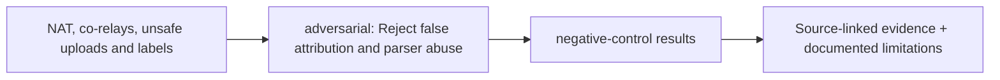

# tests/adversarial/ — Architecture contract

> **Documentation-only scaffold.** No module functionality is implemented. Follow the original v4 specification and root README; file stubs are comments describing future work.

## Responsibility
File parser abuse, graph contamination, false associations and poisoning tests.

## Phase ownership
P1–P5

## Planned files and their exact responsibilities

| File | What must be written during implementation |
|---|---|
| **test_xxe_and_upload.py** | TODO: entity expansion, zip bombs, CSV formula, path traversal. |
| **test_false_ownership.py** | TODO: relay sees TXID does not imply wallet owner. |

## Data/interfaces
**Inputs:** See parent modules and the architecture specification.

**Outputs:** Versioned artifacts or typed interfaces; no implementation exists yet.

## Security, testing and acceptance
Require executable tests, provenance and review before marking complete.

For all modules: preserve provenance, causal availability, explicit uncertainty/abstention, offline operation, real tests and realistic false-positive controls. Record status in docs/progress before claiming completion.

## Implementation handoff
Do not add executable logic before the assigned phase PR; update this README when actual public interfaces, dependencies and tests are verified.

<!-- CLARION:AUTOGENERATED_FOLDER_GUIDE_BEGIN -->
## Maintainer technical guide — current source tree

> This section is **generated from tracked files** and intentionally preserves the earlier architecture/blueprint notes above. The file index describes the current repository, not a hypothetical implementation. See [source-wide coverage audit](../../docs/architecture/FEATURE_IMPLEMENTATION_AUDIT.md).

### Guide contents
1. [Purpose and actual status](#purpose-and-actual-status-adversarial)
2. [Files directly in this folder](#files-directly-in-this-folder-adversarial)
3. [Child modules and navigation](#child-modules-and-navigation-adversarial)
4. [Technical architecture diagram](#technical-architecture-diagram-adversarial)
5. [Tech stack and interfaces](#tech-stack-and-interfaces-adversarial)
6. [Validation and work remaining](#validation-and-work-remaining-adversarial)

### Purpose and actual status (adversarial)
**Path:** `tests/adversarial/`  
**Responsibility:** Reject false attribution and parser abuse.  
**Consumes:** NAT, co-relays, unsafe uploads and labels.  
**Produces:** negative-control results.  
**Current direct-file inventory:** Blueprint stub: 2.

**Important:** Status is assessed per file; an architectural contract does not prove executable implementation. In particular, CLARION's core running code is primarily `src/clarion/application/engine.py`, `src/clarion/application/training_demo.py`, `src/clarion/api/main.py` and `src/clarion/v4/`, with the React screens in `frontend/src/app/App.tsx`. Other files may be placeholders.

### Files directly in this folder (adversarial)
| Entry | Technical responsibility | State |
|---|---|---|
| [`test_false_ownership.py`](test_false_ownership.py) | Python module | Blueprint stub |
| [`test_xxe_and_upload.py`](test_xxe_and_upload.py) | Python module | Blueprint stub |

### Child modules and navigation (adversarial)
No tracked child folders.

### Technical architecture diagram (adversarial)

### Tech stack and interfaces (adversarial)
**Technologies:** Python 3.11/3.12, Pydantic 2 and scikit-learn where relevant; optional PyG/DuckDB/Arrow. See actual imports before installing.

**Input boundary:** NAT, co-relays, unsafe uploads and labels.  
**Output boundary:** negative-control results.  
**Causal/evidence invariants:** Preserve source SHA-256, UTC `event_time` and `available_at`, explicit score type and `ABSTAIN` when required. Observed relay TXIDs never establish transaction origin or wallet ownership; candidate entity links are not confirmed identity; Country is non-scoring context.

**System contracts:** [original §0–§12 specification](../../docs/architecture/architecture-v4-spec.md) · [implemented versus planned matrix](../../docs/architecture/FEATURE_IMPLEMENTATION_AUDIT.md) · [canonical schemas and pipeline](../../docs/development/V4_PIPELINES_AND_SCHEMAS.md).

### Validation and work remaining (adversarial)
- **Required gate:** Some adversarial scenarios remain placeholders.
- Verify the exact entrypoint and source file before using a planned module; avoid importing comment-only blueprints.
- For executable changes run affected Python/TypeScript tests, offline checks and canonical synthetic smoke validation. Real-data ML calibration, service negative controls and SIH capture semantics still need independent evidence.
- Record new inputs/outputs, schema versions and proven tests in this README; rerun `python scripts/docs/generate_folder_readmes.py --write` to refresh its indexed section.

<!-- CLARION:AUTOGENERATED_FOLDER_GUIDE_END -->
