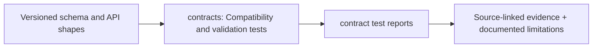

# tests/contracts — implementation blueprint

> Architecture-only: no functionality or test success is claimed.

**Phase:** P1/P4
**Scope:** Versioned schema and API/domain compatibility tests.

## Inputs and outputs
**Consumes:** Canonical schemas, generated OpenAPI, independent fixtures  
**Provides:** Schema migration and type compatibility results

## Planned file responsibilities
| File | Required work |
|---|---|
| `test_domain_schemas.py` | Sats, graph relations, missingness and score-kind contracts |
| `test_api_contracts.py` | Versioning, pagination, abstention and role check DTOs |

## Dependencies and security
Reject incompatible schema silently treated as old.

## Test and completion gate
Negative control and old/new version acceptance.

Review [complete project structure](../../docs/architecture/repository-structure.md) before implementing. Commit real code and its tests in the relevant phase PR; replace comment-only placeholders deliberately.

<!-- CLARION:AUTOGENERATED_FOLDER_GUIDE_BEGIN -->
## Maintainer technical guide — current source tree

> This section is **generated from tracked files** and intentionally preserves the earlier architecture/blueprint notes above. The file index describes the current repository, not a hypothetical implementation. See [source-wide coverage audit](../../docs/architecture/FEATURE_IMPLEMENTATION_AUDIT.md).

### Guide contents
1. [Purpose and actual status](#purpose-and-actual-status-contracts)
2. [Files directly in this folder](#files-directly-in-this-folder-contracts)
3. [Child modules and navigation](#child-modules-and-navigation-contracts)
4. [Technical architecture diagram](#technical-architecture-diagram-contracts)
5. [Tech stack and interfaces](#tech-stack-and-interfaces-contracts)
6. [Validation and work remaining](#validation-and-work-remaining-contracts)

### Purpose and actual status (contracts)
**Path:** `tests/contracts/`  
**Responsibility:** Compatibility and validation tests.  
**Consumes:** Versioned schema and API shapes.  
**Produces:** contract test reports.  
**Current direct-file inventory:** Blueprint stub: 2.

**Important:** Status is assessed per file; an architectural contract does not prove executable implementation. In particular, CLARION's core running code is primarily `src/clarion/application/engine.py`, `src/clarion/application/training_demo.py`, `src/clarion/api/main.py` and `src/clarion/v4/`, with the React screens in `frontend/src/app/App.tsx`. Other files may be placeholders.

### Files directly in this folder (contracts)
| Entry | Technical responsibility | State |
|---|---|---|
| [`test_api_contracts.py`](test_api_contracts.py) | Python module | Blueprint stub |
| [`test_domain_schemas.py`](test_domain_schemas.py) | Python module | Blueprint stub |

### Child modules and navigation (contracts)
No tracked child folders.

### Technical architecture diagram (contracts)

### Tech stack and interfaces (contracts)
**Technologies:** Python 3.11/3.12, Pydantic 2 and scikit-learn where relevant; optional PyG/DuckDB/Arrow. See actual imports before installing.

**Input boundary:** Versioned schema and API shapes.  
**Output boundary:** contract test reports.  
**Causal/evidence invariants:** Preserve source SHA-256, UTC `event_time` and `available_at`, explicit score type and `ABSTAIN` when required. Observed relay TXIDs never establish transaction origin or wallet ownership; candidate entity links are not confirmed identity; Country is non-scoring context.

**System contracts:** [original §0–§12 specification](../../docs/architecture/architecture-v4-spec.md) · [implemented versus planned matrix](../../docs/architecture/FEATURE_IMPLEMENTATION_AUDIT.md) · [canonical schemas and pipeline](../../docs/development/V4_PIPELINES_AND_SCHEMAS.md).

### Validation and work remaining (contracts)
- **Required gate:** Old files need real assertions.
- Verify the exact entrypoint and source file before using a planned module; avoid importing comment-only blueprints.
- For executable changes run affected Python/TypeScript tests, offline checks and canonical synthetic smoke validation. Real-data ML calibration, service negative controls and SIH capture semantics still need independent evidence.
- Record new inputs/outputs, schema versions and proven tests in this README; rerun `python scripts/docs/generate_folder_readmes.py --write` to refresh its indexed section.

<!-- CLARION:AUTOGENERATED_FOLDER_GUIDE_END -->
