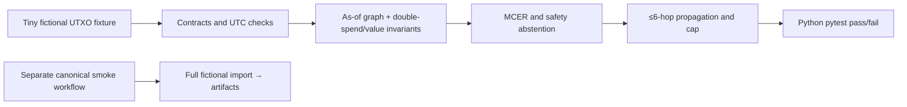
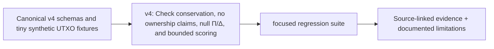

# `tests/v4/` — CLARION folder guide

## Executable v4 safety and contract tests

The **actual focused Python tests** live in [test_v4_static_pipeline.py](test_v4_static_pipeline.py). The filename reflects how the initial source was authored; these tests **were later executed successfully by the GitHub `v4 validation` job**. They check known-value conservation, duplicate TXIDs, rejection of naive time fields, as-of causal visibility, no host→wallet ownership, cautious MCER, capped 0–100 prioritization, directed exposure and Δ/Π abstention.

**Later run:** `python -m pip install -e . -r requirements-v4.txt pytest && python -m pytest -q tests/v4`. Run the canonical smoke workflow to exercise a 36-case fictional dataset from import through evidence manifests and leads. The frontend typecheck/build is a **separate** CI job.

**Not covered:** legal/real SIH captures, production model calibration, full H1–H5 false-merge rates, genuine Δ1–Δ5 pairs, verified economic Π objectives, large-graph workloads or secure multiuser operation. Do not translate these test results into real-world AML accuracy claims.

<!-- CLARION:AUTOGENERATED_FOLDER_GUIDE_BEGIN -->
## Maintainer technical guide — current source tree

> This section is **generated from tracked files** and intentionally preserves the earlier architecture/blueprint notes above. The file index describes the current repository, not a hypothetical implementation. See [source-wide coverage audit](../../docs/architecture/FEATURE_IMPLEMENTATION_AUDIT.md).

### Guide contents
1. [Purpose and actual status](#purpose-and-actual-status-v4)
2. [Files directly in this folder](#files-directly-in-this-folder-v4)
3. [Child modules and navigation](#child-modules-and-navigation-v4)
4. [Technical architecture diagram](#technical-architecture-diagram-v4)
5. [Tech stack and interfaces](#tech-stack-and-interfaces-v4)
6. [Validation and work remaining](#validation-and-work-remaining-v4)

### Purpose and actual status (v4)
**Path:** `tests/v4/`  
**Responsibility:** Check conservation, no ownership claims, null Π/Δ, and bounded scoring.  
**Consumes:** Canonical v4 schemas and tiny synthetic UTXO fixtures.  
**Produces:** focused regression suite.  
**Current direct-file inventory:** Executable source / config (validate): 4.

**Important:** Status is assessed per file; an architectural contract does not prove executable implementation. In particular, CLARION's core running code is primarily `src/clarion/application/engine.py`, `src/clarion/application/training_demo.py`, `src/clarion/api/main.py` and `src/clarion/v4/`, with the React screens in `frontend/src/app/App.tsx`. Other files may be placeholders.

### Files directly in this folder (v4)
| Entry | Technical responsibility | State |
|---|---|---|
| [`test_case_store.py`](test_case_store.py) | Persistent review transitions, concurrency and audit chain checks. | Executable source / config (validate) |
| [`test_extended_evidence.py`](test_extended_evidence.py) | Real verified evidence contracts for relay sessions, structural motifs and model serialization. | Executable source / config (validate) |
| [`test_review_api.py`](test_review_api.py) | Real FastAPI routes, auth refusal and hash check with fictional artifacts. | Executable source / config (validate) |
| [`test_v4_static_pipeline.py`](test_v4_static_pipeline.py) | Focused v4 correctness contracts. Authored statically; NOT EXECUTED in this pass. | Executable source / config (validate) |

### Child modules and navigation (v4)
No tracked child folders.

### Technical architecture diagram (v4)

### Tech stack and interfaces (v4)
**Technologies:** Python 3.11/3.12, Pydantic 2 and scikit-learn where relevant; optional PyG/DuckDB/Arrow. See actual imports before installing.

**Input boundary:** Canonical v4 schemas and tiny synthetic UTXO fixtures.  
**Output boundary:** focused regression suite.  
**Causal/evidence invariants:** Preserve source SHA-256, UTC `event_time` and `available_at`, explicit score type and `ABSTAIN` when required. Observed relay TXIDs never establish transaction origin or wallet ownership; candidate entity links are not confirmed identity; Country is non-scoring context.

**System contracts:** [original §0–§12 specification](../../docs/architecture/architecture-v4-spec.md) · [implemented versus planned matrix](../../docs/architecture/FEATURE_IMPLEMENTATION_AUDIT.md) · [canonical schemas and pipeline](../../docs/development/V4_PIPELINES_AND_SCHEMAS.md).

### Validation and work remaining (v4)
- **Required gate:** Passing 13 v4 unit tests cannot establish real-data research quality.
- Verify the exact entrypoint and source file before using a planned module; avoid importing comment-only blueprints.
- For executable changes run affected Python/TypeScript tests, offline checks and canonical synthetic smoke validation. Real-data ML calibration, service negative controls and SIH capture semantics still need independent evidence.
- Record new inputs/outputs, schema versions and proven tests in this README; rerun `python scripts/docs/generate_folder_readmes.py --write` to refresh its indexed section.

<!-- CLARION:AUTOGENERATED_FOLDER_GUIDE_END -->
